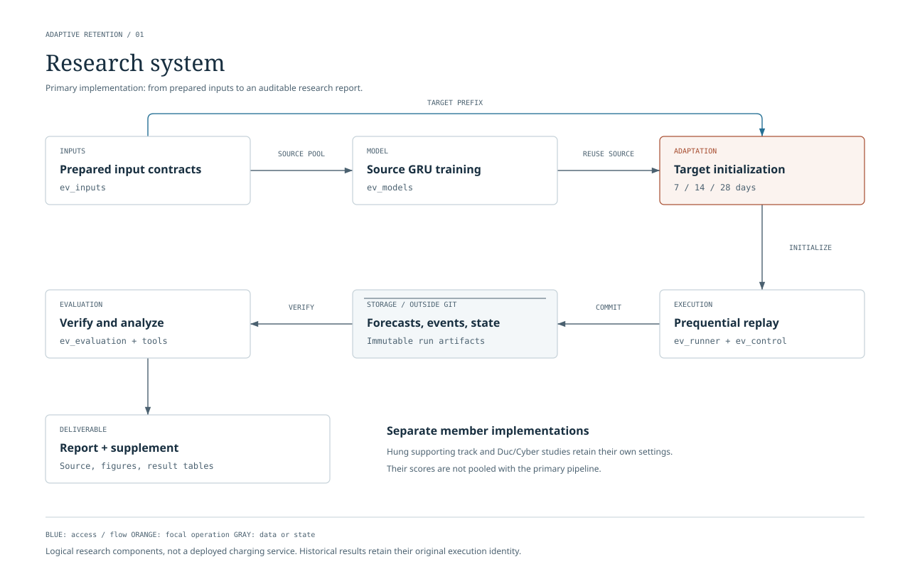

# Adaptive Retention for EV Charging Demand Forecasting

Research code and report for low-history, 24→24 EV charging demand forecasting with
GRU transfer learning and source-retention selection. This repository preserves
implementations and evidence from all four team members. Work integrates into
`dev`; promoting a snapshot to `main` requires a separate instruction.

## System at a glance



See the [data pipeline and Adaptive replay diagrams](docs/diagrams/README.md) for
separated datasets, forecast/label access and retention-state transitions. These
views describe the primary code; member studies keep their own settings.

## Read the report

The canonical [report and supplement](report/README.md) contain the method,
experimental design, results, limitations and detailed comparisons. Their source
and figures are byte-pinned in `report/manifest.json`.

The primary frozen execution covers 810 units / 11,340 method cells across seven
namespaces and 7/14/28-day initial histories. Null outcomes are retained. Adaptive
has lower mean MAE than Target-only in 18/21 group/history aggregates and than
Fixed in 9/21. These are descriptive aggregate counts, not independent replications
or proof of consistent superiority. See the [Final handoff](
docs/reports/issue23-final-complete-handoff-20261029.md) and
[joint evidence synthesis](docs/reports/issue23-joint-evidence-synthesis-20261030.md).

Hùng's separate bounded 360-job Final and the other member studies use different
settings. Do not pool their scores or rank implementations by absolute MAE.

## Release scope and provenance

[RELEASE_SCOPE.md](RELEASE_SCOPE.md) identifies what belongs in the main candidate,
which evidence is incomplete and which extensions are not planned. The
[readiness handoff](docs/reports/main-readiness-20261102.md) records checks and the
remaining release decision. [Archived PR dispositions](docs/ARCHIVE_INDEX.md)
explain superseded branches; dated historical reports are evidence of their own
snapshots, not current execution instructions.

Original primary scientific source is retained under
`evidence/primary-final-20261027-v2`. Later verifier and metadata hardening does not
rewrite old outputs. The current checkout is not byte-identical to the original
execution lock. Report 1 remains the [method reference](adaptive_retention_report_1.pdf).

Full end-to-end compute accounting, expanded supporting experiments, a verified
Đức bundle distribution link and corrected-code Cyber real-data results remain
incomplete. No additional real-data training is planned for this release. Closing
these extensions as **not planned** does not certify their acceptance criteria.

## Code map

| Location | Responsibility |
|---|---|
| `ev_inputs/` | Prepared data contracts, scaling, windows and authenticated loading |
| `ev_models/` | Primary GRU model, retention loss and training helpers |
| `ev_control/` | Confidence-based retention selection |
| `ev_runner/` | Prequential forecasts, label availability, updates and checkpoints |
| `ev_baselines/`, `ev_evaluation/` | Comparisons, metrics and audit artifacts |
| `tools/`, `configs/` | Data/experiment CLIs, verifiers and versioned configurations |
| `experiments/hung_sprint2/`, `tools/hung_*` | Separate supporting implementation |
| `experiments/member_studies/` | Isolated Đức and Cyber implementations |
| `report/` | Canonical report source, figures, tables and manifest |
| `docs/data/`, `docs/reports/` | Contracts, data instructions and dated handoffs |
| `tests/`, `tests/artifact/` | Offline fixtures and separately invoked artifact checks |

Cyber's [corrected IO guards](experiments/member_studies/cyber_controller/README.md)
are fixture-tested; historical scores are not outputs of that corrected version.
Member settings/dependencies remain separate from the primary environment.

## Install and verify offline

Use **Python 3.12**. Create a local environment; do not copy environments or compiled
packages between machines.

```sh
python3.12 -m venv .venv
# macOS/Linux:
source .venv/bin/activate
# Windows PowerShell instead: .venv\Scripts\Activate.ps1
python -m pip install -r requirements-dev.txt -r requirements-model.txt
python -m tools.sources list
python -m tools.check_release
python -m unittest discover -s tests -v
python -m unittest discover -s experiments/member_studies/duc_retention -v
python -m unittest discover -s experiments/member_studies/cyber_controller -v
python -m ruff check .
python -m ruff format --check .
git diff --check
```

These checks require a full Git checkout with retained tags/history, but no raw
data download, GPU or credentials. Some provenance tests require a clean tracked
checkout. CUDA checks skip when unavailable. The release checker uses only the
standard library; model tests also need the pinned PyTorch/NumPy requirements.

The [18 external-artifact tests](tests/artifact/README.md) are invoked separately
and require the original artifacts. Passing offline fixtures does not verify
those artifacts, reproduce training, compile the report or prove effectiveness.
Paid CI waiting and non-author review were waived by the lead for this integration;
local checks are not reported as remote CI success or independent approval.

## Data and execution contracts

Start with the [data flow](docs/data/DATA_FLOW.md), [source catalog instructions](
data/README.md) and [shared snapshot downloads](docs/data/DATA_DOWNLOADS.md).
Raw archives, processed/input data, checkpoints, environments and large runs stay
outside Git. Preserve their original bytes and verify recorded identities locally.
Historical hashes alone do not prove a fresh acquisition.

Before using an experiment CLI, read its configuration and the relevant
[input acceptance](docs/data/INPUT_ACCEPTANCE.md),
[controller](docs/data/CONTROLLER_CONTRACT.md),
[runner](docs/data/PREQUENTIAL_RUNNER.md) and
[baseline](docs/data/BASELINE_CONTRACT.md) contracts. Never fill missing target
labels or expose future labels before availability. New executions require new
output locations and recorded code, config, source/input and runtime identities.

Follow [AGENTS.md](AGENTS.md) and the [team workflow](docs/WORKFLOW.md) for changes.
`master` is a retained backup. Archived proposals are not enabled runtime policies.
