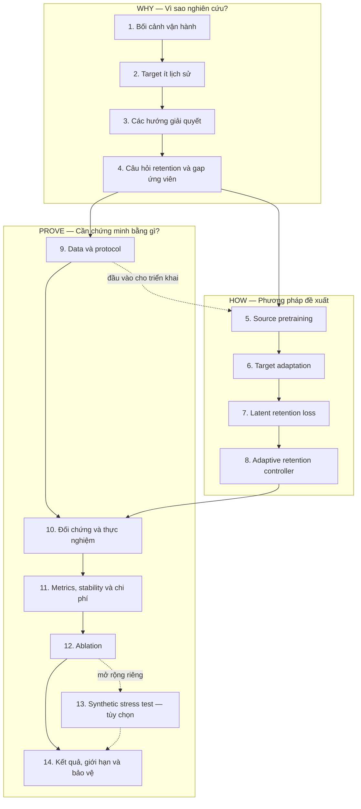
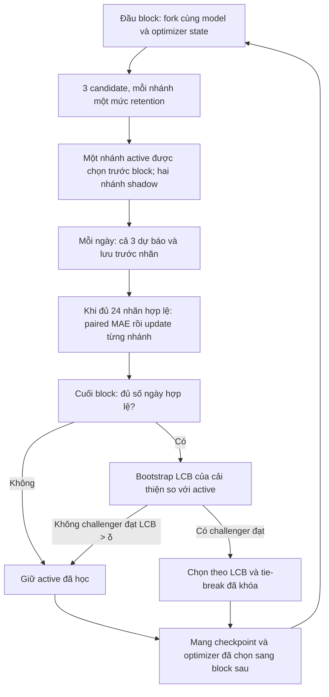

# Master Research Flow — WHY → HOW → PROVE

**Đối chiếu foundation ngày 15/10/2026, trên nền `main` commit `6f8bd97`.**

Codebase trước được giữ tại nhánh `master`, commit `528680dd73791322ed12f32b2c72a3b58618a428`. Các liên kết evidence lịch sử bên dưới cố định theo commit đó; chúng không chứng nhận pipeline mới đã triển khai. Hướng dẫn làm việc hiện hành ở [WORKFLOW](WORKFLOW.md), nguồn data ở [data/README](../data/README.md).
Repository chuẩn: [HungLD9505/adaptive-retention-ev](https://github.com/HungLD9505/adaptive-retention-ev).

Đây là bản đồ để mọi thành viên hiểu vì sao nghiên cứu tồn tại, phương pháp hoạt động thế nào và cần bằng chứng gì để kết luận. [Report 1](../adaptive_retention_report_1.pdf) là nguồn chuẩn thiết kế. Giữ phương pháp cốt lõi đã gửi giảng viên; mọi mở rộng phải được đề xuất và review riêng. Research gap, novelty và hiệu quả vẫn cần kiểm chứng.

## 1. Cách đọc và phân biệt trạng thái

Đọc WHY trước, sau đó HOW, cuối cùng PROVE. Data/protocol phải sẵn sàng trước khi chạy model, dù được giải thích trong phần PROVE để flow dễ theo dõi. Số mục 1–14 dưới đây là bản đồ khái niệm, không phải mã task DEV trong plan lịch sử.

| Nhãn | Nghĩa và điều kiện sử dụng |
|---|---|
| **Conceptually understood — đã trao đổi khái niệm** | Nội dung đã được giải thích trong trao đổi học tập. Không chứng nhận mọi thành viên đã hiểu, code đã có hoặc phương pháp đã đúng. |
| **Proposed / planned — đề xuất / kế hoạch** | Có trong Report 1 hoặc kế hoạch được ghi nhận; chưa có implementation/evidence hoàn thành tương ứng. |
| **Implemented — đã triển khai** | Có code cụ thể trong repo. Phải chỉ ra module và phạm vi; tồn tại code chưa chứng minh đã chạy đúng. |
| **Verified by evidence — có bằng chứng kiểm tra** | Có artifact, run/check cụ thể và phạm vi PASS. Phân biệt evidence đã lưu với lần chạy lại hiện tại. |
| **Blocked / unknown — bị chặn / chưa rõ** | Nêu điều kiện thiếu, claim bị giới hạn hoặc quyết định cần chốt. Unknown không tự động chặn mọi việc development. |

Các nhãn có thể cùng tồn tại trong một snapshot: Input ở codebase trước có code và stored evidence trong phạm vi benchmark, nhưng strict online vẫn chưa được xác minh. Foundation hiện tại chưa có pipeline Data/Input mới. Tiến độ học theo trao đổi hiện tại: WHY và khái niệm Retention/Adaptive Retention đã được giải thích; bước học tiếp theo là Confidence-based Controller. Chưa có biên bản nghiệm thu hiểu biết toàn team.

## 2. WHY — Research foundation

### 1. Research Context — Bối cảnh thực tế

Nhu cầu sạc thay đổi theo giờ. Dự báo trước có thể hỗ trợ lập kế hoạch cấp điện, quản lý phụ tải và điều phối sạc. Bài toán của nhóm: mỗi ngày tại giờ cố định, dùng **24 giờ gần nhất để dự báo 24 giá trị năng lượng theo giờ tiếp theo**, kèm thông tin lịch biết trước và missing mask. Theo audit của codebase trước, gọi mục tiêu là năng lượng **ước tính/derived**, không gọi là đo công tơ độc lập.

### 2. Problem Statement — Target ít dữ liệu

Target chỉ được cấp **7, 14 hoặc 28 ngày lịch sử ban đầu**. Ít dữ liệu có thể gây overfit và thiếu quan sát về quy luật sử dụng. Đây là cold-start mô phỏng bằng historical replay, không khẳng định các trạm trong dataset vừa mở. Lịch sử ban đầu khác input window 24 giờ; dữ liệu tiếp tục tích lũy sau deployment mô phỏng.

### 3. Existing Approaches — Các hướng đã tìm hiểu

| Nhóm | Ví dụ / câu hỏi cần hiểu |
|---|---|
| Statistical methods | Seasonal Naive, ARIMA, ETS: khai thác quy luật chuỗi thời gian; Seasonal Naive sao chép chu kỳ đã chọn. |
| Machine Learning | RF, XGBoost, SVR: học quan hệ giữa đặc trưng và nhu cầu; cần thiết kế đặc trưng và đầu ra phù hợp horizon. |
| Deep Learning | LSTM, GRU, Transformer: học biểu diễn từ chuỗi; khả năng biểu diễn không bảo đảm tốt hơn với ít dữ liệu. |
| Joint / Multi-task Learning | Học từ nhiều trạm, có thể chia sẻ phần biểu diễn và có phần riêng theo nhiệm vụ. |
| Transfer Learning | Học từ source trước, chuyển checkpoint rồi thích nghi riêng với target. |
| Meta-Learning | Học để thích nghi nhanh với nhiệm vụ/trạm mới; là hướng so sánh khái niệm. |

Đây là bản đồ literature, **không phải danh sách baseline bắt buộc**. Không mặc định Transfer Learning tốt hơn mọi hướng còn lại. Các diễn giải về paper cụ thể phải được đối chiếu bài gốc trước khi dùng làm bằng chứng novelty; xem [roadmap, mục 6](https://github.com/HungLD9505/adaptive-retention-ev/blob/528680dd73791322ed12f32b2c72a3b58618a428/docs/RESEARCH_ROADMAP.md#6-evaluation-và-tiêu-chí-kết-luận).

### 4. Research Gap — Câu hỏi cụ thể, chưa xác nhận novelty

Giữ source quá mạnh có thể cản thích nghi; thả ràng buộc quá sớm có thể làm mất biểu diễn hữu ích. Source error, uncertainty của dự báo và behavior drift là **proxy**, chưa trực tiếp đo chênh lệch hiệu quả giữa các mức retention.

**Câu hỏi ứng viên:** so sánh sai số đã quan sát giữa các quá trình học có retention khác nhau, rồi chỉ đổi mức khi bằng chứng cải thiện đủ rõ, có giúp hơn fixed retention, Simple Online Best-λ và các controller theo proxy không?

Chênh lệch đó phản ánh block đã qua, không phải toàn bộ giá trị kiến thức source hay bảo đảm cho tương lai. Confidence về chênh lệch hiệu quả khác uncertainty của dự báo source. Kiến thức source không mặc định mất giá trị khi target có thêm dữ liệu. Report 1 §1–3, §9 đặt giới hạn claim; chưa hoàn tất novelty check.

## 3. HOW — Proposed method

Phần này diễn giải **thiết kế**, chưa phải mô tả code model đã chạy. Công thức chi tiết và gradient nằm ở [roadmap, mục 2–3](https://github.com/HungLD9505/adaptive-retention-ev/blob/528680dd73791322ed12f32b2c72a3b58618a428/docs/RESEARCH_ROADMAP.md#2-model-loss-và-gradient--cái-gì-được-học) và Report 1 §5–7.

### 5. Source Pretraining — Tạo điểm xuất phát

Một GRU học từ tập source stations cố định, chỉ dùng lịch sử được phép trước mốc deployment. Thiết kế khởi đầu: GRU 2 lớp, hidden size 64; MLP nhận biểu diễn cùng lịch tương lai, Softplus tạo 24 dự báo không âm. Lưu checkpoint encoder/head. GRU là backbone hỗ trợ, chưa phải đóng góp mới.

**Vì sao cần:** cung cấp điểm xuất phát đã học từ nhiều trạm. Bỏ source initialization là một ablation cần kiểm tra.

### 6. Target Adaptation — Học đặc điểm của target

Copy encoder và head tương thích từ source sang target; thích nghi bằng đúng lịch sử ban đầu được cấp. Sau deployment, dự báo và lưu trước; khi đủ 24 nhãn hợp lệ đã đến mới score/update theo thuật toán đã khóa. Source encoder tham chiếu được freeze/eval, không nhận gradient.

**Vì sao cần:** target có đặc điểm riêng. Frozen Source là đối chứng kiểm tra điều gì xảy ra nếu không cập nhật.

### 7. Latent Retention Loss — Giữ biểu diễn source đến mức nào?

Cùng input target đi qua target encoder đang học và source encoder đóng băng. Retention loss phạt độ lệch giữa hai biểu diễn, chuẩn hóa từng chiều bằng độ lệch chuẩn latent tính trên source-training rồi giữ cố định.

`L_total = L_forecast + λ × L_retain`

Forecast loss là MAE trung bình 24 giờ trên thang chuẩn hóa; metrics đổi về đơn vị gốc. Retention loss là trung bình bình phương chênh lệch latent đã chuẩn hóa, đúng Report 1 (2); gradient không đi vào source. λ = 0 là full fine-tuning, vẫn khởi tạo từ source. λ cao hơn tăng ràng buộc, không phải phần trăm kiến thức giữ lại hoặc learning rate. Giữ biểu diễn gần source chưa tự chứng minh dự báo target tốt hơn.

**Vì sao cần:** tạo cách kiểm soát độ lệch biểu diễn trong lúc thích nghi. Fixed Retention và Full Fine-tuning giúp kiểm tra giá trị của ràng buộc này.

### 8. Adaptive Retention Controller — Quyết định cho block tiếp theo

Thay vì cố định λ, so sánh các quá trình học theo block. Thiết kế khởi đầu là **`{0, λlow, λhigh}` và block 14 ngày**; chưa chứng minh tối ưu. Hai λ dương, mức khởi đầu và cấu hình confidence phải chọn trên development rồi khóa trước final. Continuous/learnable λ hoặc thêm mức là mở rộng cần review riêng.

Các candidate cùng normalization, data, batch order, update schedule, step count và RNG ghép cặp. Ngày chưa đủ nhãn không được score/update hay tính là ngày hợp lệ; vẫn giữ lịch forecast và log tình trạng thiếu. Lịch forecast không được chọn bằng việc biết trước ngày nào đủ nhãn tương lai.

Paired MAE là so sai số các nhánh **trên cùng ngày**: `d = MAE_active − MAE_challenger`; d dương là challenger tốt hơn trong ngày đó. B là số ngày đủ đáp án. LCB là cận dưới một phía của cải thiện trung bình từ block bootstrap theo ngày. Chỉ switch khi đủ Bmin và LCB > δ. Nếu nhiều nhánh đạt, chọn LCB lớn nhất; khi hòa ưu tiên λ gần hiện tại, rồi thứ tự cố định. Cách xử lý hai challenger và kiểm tra lặp phải được ghi/khóa, không diễn giải confidence như bảo đảm an toàn lâu dài.

Quyết định chỉ ảnh hưởng dự báo tương lai; không chọn lại dự báo quá khứ sau khi thấy đáp án. Chốt score/update/decision ở boundary trước forecast chịu tác động của block sau. Nếu giữ mức hiện tại, tiếp tục active đã học, không quay lại checkpoint đầu block.

**Vì sao cần kiểm chứng:** Simple Online Best-λ có thể đã đủ tốt. Đối chứng này phải dùng cùng candidate/block/checkpoint/update budget, chỉ khác quyết định theo mean MAE thay cho confidence.

## 4. PROVE — Experiments & evaluation

### 9. Data & Protocol — Xác định dữ liệu nào được phép dùng

UrbanEV station-level là bộ chính dự kiến; CHARGED là site-level, hiện chỉ benchmark trong release riêng. Implementation Input trước reset đã chọn split entity hash 60/20/20; CHARGED chia riêng từng city. Đây là cấu hình lịch sử để đối chiếu khi xây lại, chưa là evidence của pipeline mới. Source để pretrain; development để chọn thiết kế/hyperparameters; final unseen targets chỉ đánh giá thiết kế đã khóa. Final-stream labels được dùng cho cập nhật online đúng thời điểm, không dùng để sửa thiết kế.

Contract của implementation trước reset: `X_hist[24,7]`, `C_future[24,5]`, `Y[24]`; p95 scale từ prefix được phép, missing X có mask riêng, không fill Y. Calendar biết trước; không thêm weather/price chưa available. Mốc deployment của implementation trước reset: UrbanEV 01/12/2022, CHARGED 01/07/2023 theo clock phát hành. Chi tiết lịch sử (không phải hướng dẫn chạy trên foundation mới): [Input README](https://github.com/HungLD9505/adaptive-retention-ev/blob/528680dd73791322ed12f32b2c72a3b58618a428/src/inputs/README.md), [bàn giao Input](https://github.com/HungLD9505/adaptive-retention-ev/blob/528680dd73791322ed12f32b2c72a3b58618a428/BAO_CAO_DAU_VAO_MODEL.md), [plan mục 7](https://github.com/HungLD9505/adaptive-retention-ev/blob/528680dd73791322ed12f32b2c72a3b58618a428/plan.md#7-phase-đầu-vào-model--quyết-định-và-checklist-đang-triển-khai).

Historical replay phát lại dữ liệu theo thứ tự thời gian để mô phỏng target ít lịch sử. Trong protocol trước reset, labels **giả định** available ở exclusive horizon end; actual arrival, timezone/DST/bin semantics và upstream masks chưa xác minh. Local causal checks không sửa được xử lý tương lai có thể đã xảy ra upstream. Chỉ gọi kết quả là published-data benchmark; strict causal gate vẫn mở.

### 10. Main Experiments — Các đối chứng bắt buộc

| Đối chứng trong Report 1 §8.1 | Câu hỏi nó giúp trả lời |
|---|---|
| Seasonal Naive, có fallback | Có hơn cách lặp lịch sử đơn giản không? |
| Target-only GRU | Transfer có giúp hơn học riêng target không? |
| Frozen Source | Thích nghi target có cần thiết không? |
| Full Fine-tuning, λ = 0 | Retention có giúp hơn bỏ ràng buộc không? |
| Fixed Retention | Điều chỉnh theo thời gian có cần thiết không? |
| Simple Online Best-λ | Confidence có thêm lợi ích so với chọn mean MAE thấp nhất không? |
| Source-error / Uncertainty / Drift controllers | Dùng chênh lệch retention quan sát được có lợi hơn dùng proxy không? |

Dùng cùng task, splits, origins và điều kiện nhãn. Proxy controllers cần tuning budget tương ứng. Related methods chỉ so trực tiếp khi adaptation/tái lập và task tương thích; không gọi controller tự viết là reproduction. Khóa cấu hình trên development trước final; tối thiểu ba seed theo proposal. Chưa có kết quả các đối chứng này trong repo.

### 11. Evaluation — Hiệu quả, ổn định và chi phí

Báo MAE chính, RMSE bổ sung theo trạm/site, budget và thời gian; đổi về đơn vị gốc. Transfer gain so với Target-only và negative transfer rate phải có đơn vị tổng hợp khóa trước final; MAE Target-only = 0 thì báo chênh lệch tuyệt đối riêng. Tổng hợp theo trạm trước, xét phụ thuộc theo trạm/thời gian khi báo bất định.

Phân tích số lần switch, thiếu bằng chứng, sai số sau switch và ổn định qua seed. Audit branch tiếp tục chính sách cũ trong block sau chỉ phục vụ phân tích hồi cứu switch bất lợi, không cung cấp thông tin cho controller. Báo runtime, peak memory, inference, update steps và toàn bộ chi phí ba candidate; chi phí audit riêng. Không trình bày như chỉ chạy một GRU.

### 12. Ablation — Thành phần nào tạo ra lợi ích?

Report 1 §8.3 yêu cầu: **Without Confidence, Fixed λ, Parameter Retention, Different Block Size, Without Source Initialization**. Mỗi ablation trả lời giá trị của một thành phần với protocol/cost minh bạch. Without Confidence liên hệ trực tiếp Simple Online Best-λ; cần tránh đếm hai lần như hai bằng chứng độc lập nếu cùng cấu hình. Tất cả còn planned.

### 13. Synthetic Stress Testing — Mở rộng tùy chọn

Có thể đề xuất mismatch, behavioral drift, missing-data scenarios và recovery với mốc can thiệp rõ. Đây là **optional extension**, chưa triển khai, không thay thực nghiệm công khai và không tự chứng minh sự kiện thật. Khóa cách tạo, seed, ngưỡng recovery trên development và ghi riêng dữ liệu can thiệp. Report 1 cho phép stress test có mốc xác định; các kịch bản cụ thể này chưa là thiết kế đã nghiệm thu. Weekday/weekend, sparse/dense hiện chỉ là nhóm phân tích, không thêm context controller.

### 14. Results & Discussion — Trả lời RQ, rồi mới kết luận

| Research question trong Report 1 | Bằng chứng cần có |
|---|---|
| RQ1: Retention ảnh hưởng sai số thế nào, khi nào proxy không phản ánh đúng chênh lệch? | Forecasts ghép cặp, mức retention, proxy logs và phân tích nhiều trạm/budget. |
| RQ2: Confidence controller hơn fixed, online best-λ và proxy không? | Baselines công bằng, ablation, bất định và độ lớn cải thiện thực tiễn. |
| RQ3: Ổn định qua trạm, lịch sử, context và tốn bao nhiêu? | Phân phối theo trạm/budget/context, nhiều seed, runtime/memory/update cost. |

Câu chuyện bảo vệ: bối cảnh → khó khăn → giả thuyết → phép so sánh → evidence → giới hạn. Nếu confidence không giúp hoặc overhead quá cao, thu hẹp claim theo kết quả. Kết quả tốt không tự chứng minh novelty; chưa có forecasting findings để viết kết luận hiện tại.

## 5. Trạng thái foundation và evidence lịch sử

### Trạng thái hiện tại sau reset

| Phạm vi | Trạng thái | Nguồn đối chiếu |
|---|---|---|
| Phương pháp nghiên cứu và flow | Thiết kế theo Report 1; chưa chứng minh hiệu quả/novelty | [Report 1](../adaptive_retention_report_1.pdf), các mục WHY/HOW/PROVE phía trên |
| Nguồn raw và kiểm tra file local | Đã triển khai catalog + tool kiểm tra; tests dùng fixtures | [Nguồn data](../data/README.md), [source tool](../tools/sources.py), [tests](../tests/test_sources.py) |
| Raw acquisition trên nền mới | Chưa tải/kiểm tra archive thật trong task foundation/flow | URL và checksum lịch sử không phải bằng chứng tải lại |
| Processing, audit, model inputs mới | Chưa triển khai | Cần PR, tests và report mới theo [WORKFLOW](WORKFLOW.md) |
| Model/loss, runner/controller, baselines và experiments | Planned; chưa triển khai | Bám Report 1, không sử dụng PASS cũ làm kết quả mới |
| Full reproduction / strict online / độc lập external | Chưa xác minh | Thiếu raw local và evidence về upstream/time/availability/overlap |

Bàn giao nền mới: [FOUNDATION_REPORT](FOUNDATION_REPORT.md). Các kết quả local trong đó thuộc commit dựng foundation; CI từng PR phải đối chiếu run tương ứng.

### Snapshot trước reset — chỉ để truy vết

Bảng và số liệu dưới đây thuộc commit `528680d` trên `master`, không mô tả working tree hiện tại. Các nhãn Implemented/Verified chỉ áp dụng cho snapshot lịch sử. Pipeline mới cần acceptance và evidence mới; chưa khôi phục module cũ vào main.

Trong lần đối chiếu trước reset, đã đọc Report 1, README, roadmap, plan, báo cáo Data/Input, code `src/data`, `src/inputs` và evidence liên kết dưới đây. Đây là **kiểm tra code/tài liệu/artifacts đã lưu**, không rerun tests, full rebuild hay training trong task tài liệu này.

| Phạm vi lịch sử | Trạng thái tại `528680d` | Bằng chứng / giới hạn |
|---|---|---|
| WHY: context, data scarcity, các hướng học | Conceptually understood qua trao đổi; không phải nghiệm thu toàn team | Report 1 §1–4; không suy ra mọi thuật toán đã code. |
| Gap/novelty | Proposed; unknown về novelty/effectiveness | Report 1 §1–3, §9; cần đối chiếu literature gốc. |
| Data acquisition, processing, audit, EDA | Implemented; verified by stored evidence trong phạm vi candidate panel | [Code](https://github.com/HungLD9505/adaptive-retention-ev/blob/528680dd73791322ed12f32b2c72a3b58618a428/src/data/README.md), [execution summary](https://github.com/HungLD9505/adaptive-retention-ev/blob/528680dd73791322ed12f32b2c72a3b58618a428/reports/data/execution_summary.json), [báo cáo Data](https://github.com/HungLD9505/adaptive-retention-ev/blob/528680dd73791322ed12f32b2c72a3b58618a428/BAO_CAO_PHASE_DATA.md). |
| DEV1–DEV3 trong bảng development của plan: contract, split, input | Implemented; verified by stored evidence cho benchmark | [Code input](https://github.com/HungLD9505/adaptive-retention-ev/blob/528680dd73791322ed12f32b2c72a3b58618a428/src/inputs/core.py), [build](https://github.com/HungLD9505/adaptive-retention-ev/blob/528680dd73791322ed12f32b2c72a3b58618a428/src/inputs/build.py), [active runs](https://github.com/HungLD9505/adaptive-retention-ev/blob/528680dd73791322ed12f32b2c72a3b58618a428/reports/inputs/active_runs.json), [execution summary](https://github.com/HungLD9505/adaptive-retention-ev/blob/528680dd73791322ed12f32b2c72a3b58618a428/reports/inputs/execution_summary.json). |
| Source model/training và target adaptation | Proposed / planned; chưa có module model/training trong `src` được theo dõi | [Plan mục 2, DEV4](https://github.com/HungLD9505/adaptive-retention-ev/blob/528680dd73791322ed12f32b2c72a3b58618a428/plan.md#2-kế-hoạch-development); summary Input ghi training false. |
| Latent retention loss | Concept đã trao đổi; implementation planned | Chưa có code loss/latent-scale/gradient checks model; Report 1 §5. |
| Adaptive / confidence controller | Adaptive đã trao đổi; confidence là phần học tiếp; implementation planned | [Roadmap mục 3](https://github.com/HungLD9505/adaptive-retention-ev/blob/528680dd73791322ed12f32b2c72a3b58618a428/docs/RESEARCH_ROADMAP.md#3-online-lifecycle-đúng-thứ-tự-nhân-quả); plan DEV5. |
| Runner, baselines, metrics, ablations và final experiments | Proposed / planned; chưa có evidence chạy | Plan DEV5–DEV6, EXP; không coi input windows là forecasts. |
| Synthetic stress scenarios | Optional proposed extension | Chưa code/run; cần review phạm vi riêng. |
| Strict online / external independence | Unknown; chặn claim strict online hoặc CHARGED external độc lập | Contracts [UrbanEV](https://github.com/HungLD9505/adaptive-retention-ev/blob/528680dd73791322ed12f32b2c72a3b58618a428/reports/inputs/urbanev_inputs_full_20261004_02/data_contract.json), [CHARGED](https://github.com/HungLD9505/adaptive-retention-ev/blob/528680dd73791322ed12f32b2c72a3b58618a428/reports/inputs/charged_inputs_full_20261004_02/data_contract.json). Không chặn development trong benchmark đã chọn. |
| Full reproduction trên checkout đang đối chiếu | Blocked vì thiếu raw/panel/index local | `data/raw`, `data/processed`, `data/inputs` không có trong checkout ngày 15/10; các thư mục bị Git ignore. Cần khôi phục đúng nguồn/hash và runtime. |

### Evidence lịch sử đã lưu trong Git

- Data summary ghi 13 tests và readback hai full runs PASS. Input summary ghi 11 fixtures + 13 regression PASS; [verification 07/10](https://github.com/HungLD9505/adaptive-retention-ev/blob/528680dd73791322ed12f32b2c72a3b58618a428/reports/review/roadmap_20261007/verification.json) ghi rerun hai suites PASS bằng bundled Python 3.12, không full rebuild và không training.
- Input active: `urbanev_inputs_full_20261004_02`, `charged_inputs_full_20261004_02`. Summary ghi lần lượt **226.486 / 782.616 window records**, **39 / 234 readback samples**, **18 / 108 future-perturbation samples**. Đây là records theo entity × budget × origin, không phải số dự báo độc lập hay metric model.
- [UrbanEV QC](https://github.com/HungLD9505/adaptive-retention-ev/blob/528680dd73791322ed12f32b2c72a3b58618a428/reports/inputs/urbanev_inputs_full_20261004_02/qc_supplement.md) và [CHARGED QC](https://github.com/HungLD9505/adaptive-retention-ev/blob/528680dd73791322ed12f32b2c72a3b58618a428/reports/inputs/charged_inputs_full_20261004_02/qc_supplement.md) dẫn kết quả full rebuild: split/cohort/scalers/index/audit khớp, tensor samples bit-exact. Giới hạn chỉ ở dữ liệu/pipeline và samples được kiểm tra; không chứng minh upstream causality.

### Các điểm dễ nhầm khi đọc tài liệu cũ

1. `reports/data/execution_summary.json` ngày 02/10 ghi split/scaling/windows chưa chạy **trong phase Data**. Input summary và báo cáo bàn giao 04/10 ghi phase Input đã chạy. Đây là các mốc khác nhau; không sửa lịch sử để làm chúng giống nhau. Báo cáo Data mục 12 giải thích cập nhật liên phase.
2. Plan mục 7 ghi DEV1–DEV5 **của phase Input** hoàn tất, còn bảng development mục 2 ghi model DEV4/controller DEV5/smoke DEV6 chưa làm. Phải đọc cả phạm vi, không đánh đồng mã DEV.
3. Bàn giao Input giữ lỗi import Python 3.13 ở mốc 04/10, rồi có mục rerun PASS 07/10 bằng runtime đúng. Lỗi cũ không là trạng thái test mới nhất; PASS lưu cũng không là rerun trên máy hiện tại.
4. Report 1 giữ trạng thái đề xuất trước audit. Số liệu thực thi mới lấy từ active artifacts, không chép trạng thái chưa audit trong PDF thành tiến độ hiện tại. Những cập nhật này không chứng minh các giả định strict online đã được giải quyết.

Các mốc và số liệu trên được giữ để truy vết; không dùng để kết luận nền mới đã hoàn tất Data/Input. Nếu review phát hiện xung đột thiết kế, ghi rõ nguồn/mục và đưa quyết định vào PR riêng.

## 6. Những gì còn cần quyết định / xác minh

- **Literature:** systematic novelty check; ranh giới với adaptive regularization, online selection và related methods. Không suy diễn hạn chế paper từ bảng so sánh của nhóm.
- **Model/development:** đặc tả model/loss chính xác, training/update schedule, latent scale, λlow/λhigh/mức ban đầu; Bmin, δ, alpha, block bootstrap length, nhiều challenger và tie-break. Nội dung Report 1 đã quy định phải tuân theo; cấu hình khởi đầu chưa là tối ưu.
- **Runner/evaluation:** lưu forecast trước nhãn, thứ tự boundary, checkpoint/optimizer/RNG; định nghĩa NTR, proxy estimators/calibration, seed list, ngân sách tuning/cost và audit branch trước final.
- **Data claims:** timestamp/bin/timezone/DST, actual label arrival, upstream masks và Shenzhen overlap chưa đủ evidence. CHARGED hiện không là external validation độc lập với UrbanEV.
- **Reproduction:** lấy đúng raw theo catalog và kiểm tra checksum; xây processing/inputs mới kèm report. Nếu tái chạy snapshot cũ, dùng checkout/runtime riêng; không mặc định đường dẫn provenance trên máy cũ tồn tại ở máy khác.

## 7. Duy trì một bộ tài liệu nhất quán

| Nơi | Trách nhiệm |
|---|---|
| [Report 1](../adaptive_retention_report_1.pdf) | Chuẩn phương pháp; thay đổi core cần quyết định/review riêng. |
| **Master Flow này** | Giải thích từng stage, liên kết evidence và snapshot trạng thái; không tạo task IDs hay lịch chạy riêng. |
| [Workflow hiện hành](WORKFLOW.md) | Quy trình branch → checks/report → peer review → main và thứ tự bàn giao. |
| [Research roadmap lịch sử](https://github.com/HungLD9505/adaptive-retention-ev/blob/528680dd73791322ed12f32b2c72a3b58618a428/docs/RESEARCH_ROADMAP.md) | Tham khảo chi tiết method/gates trước reset; không phải tiến độ hiện tại. |
| [plan.md lịch sử](https://github.com/HungLD9505/adaptive-retention-ev/blob/528680dd73791322ed12f32b2c72a3b58618a428/plan.md) | Nhật ký trước reset; không cập nhật như kế hoạch hiện hành. Chưa tạo plan mới khi team chưa chốt phạm vi. |
| Báo cáo mới trong `docs/reports/`, PR và run IDs | Evidence của implementation mới; không ghi đè reports cũ trên snapshot lịch sử. |
| [README](../README.md) | Điểm vào và links tới các nguồn trên. |

ChatGPT hỗ trợ học lý thuyết, literature và phản biện; Codex đối chiếu/triển khai/kiểm thử và tài liệu kỹ thuật; GitHub lưu phiên bản để team review. Kết luận từ trao đổi chỉ trở thành quyết định chung sau khi được ghi vào đúng tài liệu và review.

**Khi hoàn tất một stage:** ghi code/run ID/check và phạm vi kết luận trong PR/report theo WORKFLOW; cập nhật hàng trạng thái + link tương ứng ở Master Flow trong cùng PR. Khi có kế hoạch được team chốt, chỉ duy trì một bản hiện hành. Không sửa plan/roadmap lịch sử để thể hiện tiến độ mới, không copy toàn bộ bảng số liệu/log sang flow. Người review kiểm tra evidence trước khi cho nhãn implemented/verified. Tiến độ học ghi người/phạm vi đã trao đổi, không dùng thay nghiệm thu kỹ thuật.

Để mỗi thành viên diễn giải được bài, sau từng stage hãy trả lời: **Nó giải quyết vấn đề gì? Hoạt động thế nào? Nếu bỏ đi thì cần đối chứng gì? Evidence nào cho phép kết luận?** Câu trả lời phải gắn với mức hiểu, thiết kế và kết quả thực sự đang có.
