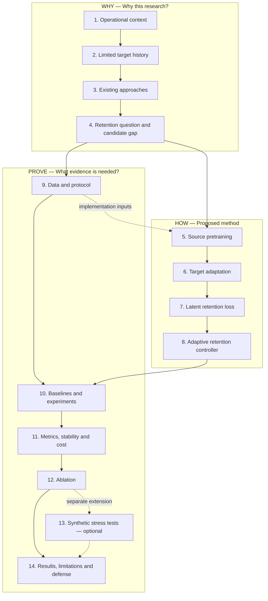
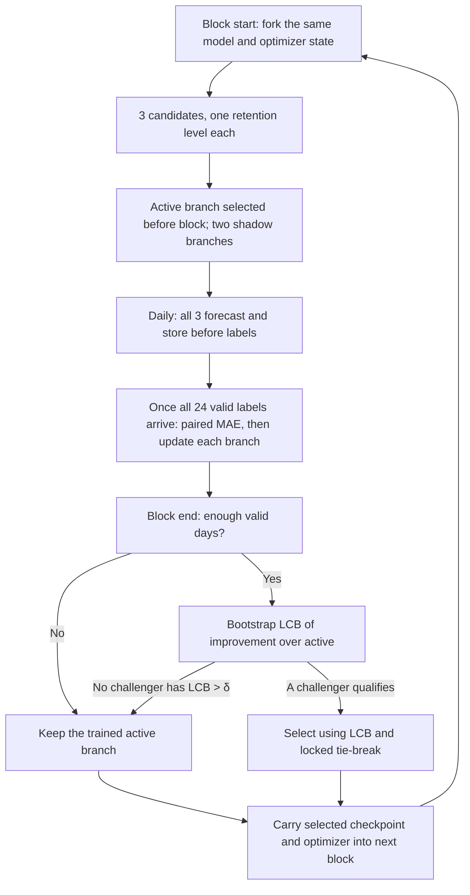

# Master Research Flow — WHY → HOW → PROVE

Working instructions: [WORKFLOW](WORKFLOW.md). Data acquisition: [data/README](../data/README.md).

Reference repository: [HungLD9505/adaptive-retention-ev](https://github.com/HungLD9505/adaptive-retention-ev).

This map explains why the research exists, how the proposed method works, and what evidence is needed for conclusions. [Report 1](../adaptive_retention_report_1.pdf) is the design reference. Preserve the core method submitted to the supervisor; propose and review extensions separately. The research gap, novelty, and effectiveness still need verification.

## 1. How to read this map and interpret status

Read WHY, then HOW, then PROVE. Data/protocol must be ready before running models, even though they are explained under PROVE for readability. Stages 1–14 describe the research concepts; implementation tasks are tracked in GitHub Issues.

| Label | Meaning and conditions |
|---|---|
| **Conceptually understood** | Explained in learning discussions; does not certify team-wide understanding, implementation, or correctness. |
| **Proposed / planned** | Included in Report 1 or a recorded plan, without corresponding completed implementation/evidence. |
| **Implemented** | Concrete code exists; identify its module and scope. Code existence alone does not prove correct execution. |
| **Verified by evidence** | A specific artifact/run/check supports a defined PASS scope. Distinguish stored evidence from a fresh rerun. |
| **Blocked / unknown** | State the missing condition, limited claim, or pending decision. An unknown does not automatically block all development. |

The data catalog and archive verification tool are implemented. Processing, model inputs, models, and controllers remain planned. Learning discussions have covered WHY and Retention/Adaptive Retention; the next topic is the Confidence-based Controller. Team-wide understanding has not been signed off.

## 2. WHY — Research foundation

### 1. Research Context — Operational setting

Charging demand changes by hour. Forecasting may support power planning, load management, and charging coordination. The task is to use the **latest 24 hours to predict 24 hourly energy values for the next day**, at a fixed daily forecast time, with known calendar information and a missing-value mask. Describe the target as **estimated/derived energy**, not independently measured meter readings.

### 2. Problem Statement — Limited target data

Each target receives **7, 14, or 28 days of initial history**. Limited data may cause overfitting and insufficient coverage of usage patterns. This is simulated cold-start through historical replay; it does not assert that dataset stations actually just opened. The initial history budget differs from the 24-hour input window. Data continues accumulating after simulated deployment.

### 3. Existing Approaches — Approaches considered

| Family | Examples / questions to understand |
|---|---|
| Statistical methods | Seasonal Naive, ARIMA, ETS exploit time-series structure; Seasonal Naive repeats a selected cycle. |
| Machine Learning | RF, XGBoost, SVR learn feature-demand relationships; features and outputs must fit the forecast horizon. |
| Deep Learning | LSTM, GRU, Transformer learn sequence representations; expressive capacity does not guarantee better results with scarce data. |
| Joint / Multi-task Learning | Learn across stations, potentially sharing representations with task-specific components. |
| Transfer Learning | Learn from sources first, transfer a checkpoint, then adapt to each target. |
| Meta-Learning | Learn to adapt rapidly to new tasks/stations; included as a conceptual comparison. |

This is a literature map, **not a mandatory baseline list**. Transfer Learning is not assumed superior to every alternative. Check interpretations of specific papers against their originals before using them as novelty evidence.

### 4. Research Gap — A question whose novelty is unverified

Strong source retention may hinder adaptation; releasing the constraint too early may lose useful representations. Source error, predictive uncertainty, and behavioral drift are **proxies**, not direct measurements of performance differences between retention levels.

**Candidate question:** can comparisons of observed errors from learning processes with different retention levels, switching only when improvement evidence is sufficiently clear, outperform fixed retention, Simple Online Best-λ, and proxy controllers?

The difference describes a past block, not the entire value of source knowledge or a guarantee about the future. Confidence in a performance difference differs from uncertainty in source predictions. Source knowledge does not automatically lose value as target data grows. Report 1 §1–3 and §9 limit claims; novelty checking is incomplete.

## 3. HOW — Proposed method

This section explains the **design**, not executed model code. Detailed equations and gradients are specified in Report 1 §5–7.

### 5. Source Pretraining — Establish an initialization

Train a GRU on a fixed set of source stations, using only permitted history before deployment. Initial design: two GRU layers, hidden size 64; an MLP combines the representation with future calendar information, and Softplus produces 24 nonnegative forecasts. Save encoder/head checkpoints. The GRU is a supporting backbone, not an established novel contribution.

**Purpose:** provide an initialization learned across stations. Removing source initialization is an ablation to test.

### 6. Target Adaptation — Learn target characteristics

Copy compatible encoder/head parameters from source to target and adapt using exactly the assigned initial history. After deployment, forecast and store first; score/update only once all 24 valid labels have arrived, following the locked algorithm. Freeze the reference source encoder in evaluation mode; it receives no gradients.

**Purpose:** accommodate target-specific behavior. Frozen Source tests the effect of making no updates.

### 7. Latent Retention Loss — Control representation deviation

Pass the same target input through the trainable target encoder and frozen source encoder. Retention penalizes differences between their representations, normalized per dimension by latent standard deviations computed on source-training data and then held fixed.

`L_total = L_forecast + λ × L_retain`

Forecast loss is mean MAE over 24 hours on the normalized scale; evaluation metrics use original units. Retention loss is the mean squared normalized latent difference, as in Report 1 equation (2); gradients do not enter the source encoder. λ = 0 means full fine-tuning, still initialized from source. A higher λ strengthens the constraint; it is neither a percentage of retained knowledge nor a learning rate. Representation similarity alone does not prove better target forecasts.

**Purpose:** control representation changes during adaptation. Fixed Retention and Full Fine-tuning test the constraint's value.

### 8. Adaptive Retention Controller — Decide for the next block

Compare learning processes in blocks instead of fixing λ. The initial design uses **`{0, λlow, λhigh}` and 14-day blocks**; optimality is unproven. Choose the two positive λ values, initial level, and confidence configuration on development and lock them before final evaluation. Continuous/learnable λ or additional levels are extensions requiring separate review.

Candidates share normalization, data, batch order, update schedules, step counts, and paired RNG. Days without complete labels are not scored, updated, or counted as valid; keep the forecast schedule and log missingness. Do not select forecast dates using advance knowledge of future label completeness.

Paired MAE compares branches **on the same day**: `d = MAE_active − MAE_challenger`; positive d means the challenger was better that day. B counts days with complete valid labels. LCB is a one-sided lower confidence bound on mean improvement from a day-block bootstrap. Switch only when Bmin is met and LCB > δ. If multiple branches qualify, choose the largest LCB; ties prefer λ closest to the current level, then a fixed order. Record and lock treatment of the two challengers and repeated testing. Do not interpret confidence as a long-term safety guarantee.

Decisions affect future forecasts only; never reselect past predictions after observing labels. Complete boundary scoring/update/decisions before the next affected forecast. When retaining the current level, continue the trained active branch rather than reverting to the block-start checkpoint.

**Why test this:** Simple Online Best-λ may already suffice. It must share candidate/block/checkpoint/update budgets and differ only by selecting on mean MAE rather than confidence.

## 4. PROVE — Experiments and evaluation

### 9. Data and Protocol — Determine permitted information

UrbanEV station-level data is the planned primary dataset; CHARGED is site-level and currently a benchmark within its own release. Source entities support pretraining; development entities support design/hyperparameter selection; final unseen targets evaluate the locked design. Final-stream labels may support correctly timed online updates, not design revision.

Reference settings for input implementation are entity-hash splits of 60/20/20, separate CHARGED splits per city, `X_hist[24,7]`, `C_future[24,5]`, and `Y[24]`. Use p95 scaling from the permitted prefix, separate missing-X masks, and no filling of Y. Calendar information is known in advance; do not add unavailable weather/price features. Reference deployment dates are UrbanEV 2022-12-01 and CHARGED 2023-07-01 under the published clock. These settings require implementation, protocol review, and verification before use in experiments.

Historical replay streams data chronologically to simulate limited target history. Label availability at the exclusive horizon end is an **assumption**; actual arrival, timezone/DST/bin semantics, and upstream masks remain unverified. Local causal checks cannot undo possible upstream future-dependent processing. Describe results only as a published-data benchmark until the strict causal gate is resolved.

### 10. Main Experiments — Required comparisons

| Baseline in Report 1 §8.1 | Question addressed |
|---|---|
| Seasonal Naive, with fallback | Is the method better than simple historical repetition? |
| Target-only GRU | Does transfer help compared with learning only from the target? |
| Frozen Source | Is target adaptation necessary? |
| Full Fine-tuning, λ = 0 | Does retention help compared with removing the constraint? |
| Fixed Retention | Is adaptation of retention over time useful? |
| Simple Online Best-λ | Does confidence help beyond choosing the lowest mean MAE? |
| Source-error / Uncertainty / Drift controllers | Do observed retention performance differences help more than proxies? |

Use the same task, splits, origins, and label conditions. Give proxy controllers comparable tuning budgets. Compare related methods directly only when adaptation/reproduction and tasks are compatible; do not label a custom controller a reproduction. Lock configuration on development before final evaluation; use at least three seeds as proposed. No results for these comparisons exist in the repository yet.

### 11. Evaluation — Accuracy, stability, and cost

Report primary MAE and supplementary RMSE by station/site, budget, and time, in original units. Lock the aggregation unit for transfer gain against Target-only and negative transfer rate before final evaluation. When Target-only MAE is zero, report the absolute difference separately. Aggregate by station first and account for station/time dependence when reporting uncertainty.

Analyze switching frequency, insufficient-evidence cases, errors after switches, and stability across seeds. An audit branch continuing the previous policy into the next block is only for retrospective analysis of harmful switches; it cannot inform the controller. Report runtime, peak memory, inference, update steps, and the full cost of three candidates. Report audit costs separately; do not describe the method as running only one GRU.

### 12. Ablation — Identify each component's contribution

Report 1 §8.3 requires **Without Confidence, Fixed λ, Parameter Retention, Different Block Size, Without Source Initialization**. Each tests a component with transparent protocol and cost. Without Confidence directly relates to Simple Online Best-λ; identical configurations must not be counted twice as independent evidence. All remain planned.

### 13. Synthetic Stress Testing — Optional extension

Possible proposals include mismatch, behavioral drift, missing-data scenarios, and recovery with explicit intervention times. These are **optional extensions**, not implemented, substitutes for public-data experiments, or proof of real events. Lock generation procedures, seeds, and recovery thresholds on development and record interventions separately. Report 1 allows stress tests with known intervention times; these specific scenarios have not been accepted as a completed design. Weekday/weekend and sparse/dense are analysis groups, not additional controller context.

### 14. Results and Discussion — Answer the research questions

| Research question in Report 1 | Required evidence |
|---|---|
| RQ1: How does retention affect error, and when do proxies fail to reflect the difference? | Paired forecasts, retention levels, proxy logs, and analysis across stations/budgets. |
| RQ2: Does the confidence controller outperform fixed retention, online best-λ, and proxies? | Fair baselines, ablation, uncertainty, and practical improvement magnitudes. |
| RQ3: How stable is it across stations, history budgets, and contexts, and what does it cost? | Distributions by station/budget/context, multiple seeds, runtime/memory/update cost. |

The defense follows context → difficulty → hypothesis → comparison → evidence → limitations. If confidence provides no benefit or overhead is excessive, narrow claims accordingly. Good results do not prove novelty; no forecasting findings support conclusions yet.

## 5. Implementation status

| Scope | Status | Reference |
|---|---|---|
| Research method and flow | Design follows Report 1; effectiveness/novelty unproven | [Report 1](../adaptive_retention_report_1.pdf), WHY/HOW/PROVE above |
| Raw sources and local file verification | Catalog and verification tool implemented; fixture-based tests | [Data sources](../data/README.md), [source tool](../tools/sources.py), [tests](../tests/test_sources.py) |
| Raw acquisition on the new foundation | No real archives downloaded/checked in the foundation/flow tasks | Historical URLs/checksums do not prove a fresh acquisition |
| Processing, audit, and model inputs | Not implemented | New PRs, tests, and reports required under [WORKFLOW](WORKFLOW.md) |
| Model/loss, runner/controller, baselines, experiments | Planned; not implemented | Follow Report 1; verify each implementation with its own evidence |
| Full reproduction / strict online / external independence | Unverified | Missing local raw data and evidence about upstream/time/availability/overlap |

Foundation handoff: [FOUNDATION_REPORT](FOUNDATION_REPORT.md). Its local results belong to the foundation implementation snapshot; check each PR's corresponding CI run separately.

## 6. Decisions and verification still needed

- **Literature:** systematic novelty checking and boundaries with adaptive regularization, online selection, and related methods. Do not infer paper limitations from the team's comparison table.
- **Model/development:** exact model/loss specification, training/update schedule, latent scale, λlow/λhigh/initial level, Bmin, δ, alpha, bootstrap block length, multiple challengers, and tie-breaking. Follow requirements already fixed by Report 1; initial settings are not proven optimal.
- **Runner/evaluation:** forecast-before-label storage, boundary ordering, checkpoint/optimizer/RNG handling; NTR definition, proxy estimators/calibration, seed list, tuning/cost budgets, and audit branch before final evaluation.
- **Data claims:** insufficient evidence about timestamps/bin/timezone/DST, actual label arrival, upstream masks, and Shenzhen overlap. CHARGED is not currently established as independent external validation of UrbanEV.
- **Reproduction:** acquire the catalog's raw archives and verify checksums; build new processing/inputs with reports. Record source identities, config, runtime, code version, and run IDs.

## 7. Keep documentation consistent

| Location | Responsibility |
|---|---|
| [Report 1](../adaptive_retention_report_1.pdf) | Method reference; core changes require a separate decision/review. |
| **This Master Flow** | Explain stages, link evidence, and record status snapshots; no separate task IDs or schedule. |
| [Current workflow](WORKFLOW.md) | Issue → branch → checks/report → peer review → dev; main updates need separate authorization. |
| `docs/reports/`, PRs, and run IDs | Implementation evidence and phase handoffs. |
| [README](../README.md) | Entry point and links to these sources. |

ChatGPT supports theory, literature, and critique; Codex supports inspection, implementation, testing, and technical documentation; GitHub versions work for team review. Discussion conclusions become team decisions only after being recorded in the appropriate document and reviewed.

**After completing a stage:** record code/run IDs, checks, and conclusion scope in the PR/report under WORKFLOW; update the matching status row/link in Master Flow in the same PR. Maintain one current plan once agreed. Do not copy entire result tables/logs into this flow. Reviewers must check evidence before assigning Implemented/Verified. Learning progress records who discussed what; it is not technical acceptance.

After each stage, every member should be able to explain: **What problem does it address? How does it work? What comparison is needed if it is removed? What evidence supports a conclusion?** Answers must match actual understanding, design, and available results.
