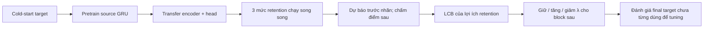
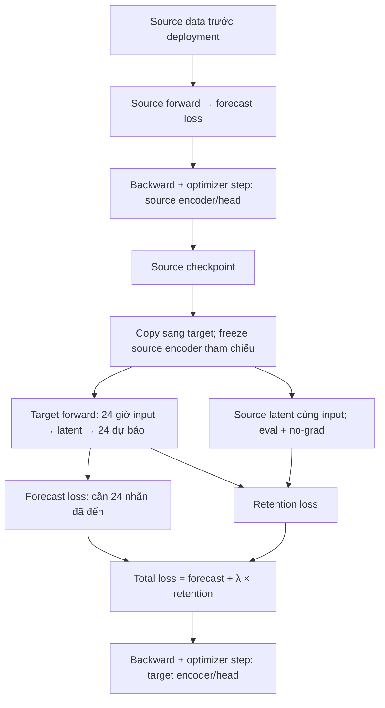
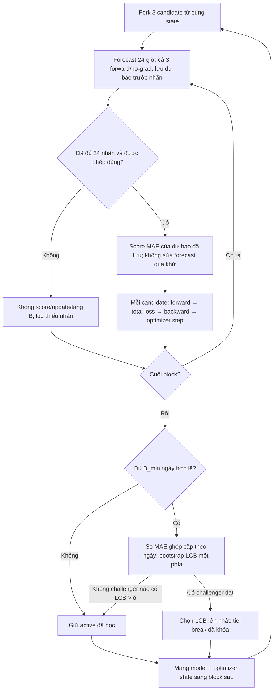

# Research roadmap — Adaptive Retention for EV Charging Demand Forecasting

**Trạng thái: đã đối chiếu Report 1 và evidence Input; cập nhật 07/10/2026.** Nguồn chuẩn duy nhất cho thiết kế nghiên cứu là [Report 1](../adaptive_retention_report_1.pdf). Tài liệu này diễn giải và tổ chức công việc; không thay thế hoặc chỉnh sửa Report 1. Khi có bất đồng, quay lại Report 1 và đưa quyết định vào PR riêng. Không dùng hướng multi-source/source-selection cũ làm phương pháp chính.

## 1. Bài toán và giả thuyết trong một trang

Dự báo nhu cầu sạc (năng lượng ước tính theo giờ, sau khi schema và unit được xác nhận) cho một trạm target chỉ được cấp 7, 14 hoặc 28 ngày lịch sử lúc bắt đầu. Đây là **mô phỏng cold-start**, không khẳng định các trạm trong release vừa khai trương. Mỗi ngày tại một giờ cố định, dùng 24 giờ quá khứ để dự báo 24 giá trị giờ tiếp theo. Nguồn kiến thức là một model được pretrain trên tập source stations cố định trước mốc triển khai.

Target-only dễ overfit vì ít cửa sổ và tải sạc thưa/biến động; transfer có thể giúp nhưng cũng có thể gây negative transfer. Source error, uncertainty và behavior drift là proxy hữu ích để phân tích, nhưng không trực tiếp trả lời: **giữ biểu diễn source nhiều hơn có thực sự giảm sai số target so với giữ ít hơn không?** Giả thuyết làm việc: so sánh các trajectory học với những mức retention khác nhau trên cùng những ngày đã dự báo, rồi chỉ chuyển mức khi cải thiện quan sát đủ chắc chắn, có thể tốt hơn fixed retention, online best-λ dựa trên mean error và controller theo proxy. Đây là **candidate gap/contribution**, chưa xác nhận novelty hay hiệu quả.

## 2. Model, loss và gradient — cái gì được học?

- **Backbone:** GRU 2 lớp, hidden size 64. Input gồm 24 giờ target history, lịch và missing mask; MLP head nhận latent cuối cùng cộng lịch 24 giờ tương lai đã biết trước; Softplus trả 24 dự báo không âm. GRU không phải novelty.
- **Source pretrain:** forward → forecasting loss → backpropagation → optimizer step trên source encoder và head. Chỉ dùng source data hợp lệ trước mốc triển khai tương ứng. Lưu checkpoint.
- **Target init:** copy encoder và compatible head từ source. Source encoder tham chiếu được freeze/eval/no-gradient. Target encoder và head là phần được cập nhật.
- **Forecast loss:** trung bình 24 sai số tuyệt đối trên thang chuẩn hóa cố định từ dữ liệu được phép; báo metric sau inverse transform về đơn vị gốc.
- **Retention loss:** `Lretain = (1/64) Σ_k [(zT,k(X) − zS,k(X))/(s_k + ε)]²`. Chia trước rồi bình phương; s_k tính từ source-training và giữ cố định. Cùng input, source eval/no-grad; gradient chỉ đi về target encoder. Forecast loss trung bình trên horizon 24; batch loss lấy trung bình các sample hợp lệ, không cộng theo batch size.
- **Total loss:** forecast loss + λ × retention loss. λ = 0 là full fine-tuning không có ràng buộc retention. λ lớn hơn siết ràng buộc biểu diễn; giảm λ không đồng nghĩa tự tăng learning rate.
- **Candidate levels:** {0, λ_low, λ_high}, hai mức dương và λ khởi đầu được chọn trên development rồi khóa trước final. λ và controller **không học bằng backprop**; chúng chọn giữa các quá trình học đã được cập nhật bằng backprop.

## 3. Online lifecycle đúng thứ tự nhân quả

Đầu mỗi block (14 ngày là cấu hình khởi đầu, chưa khóa), fork checkpoint **và optimizer state** của active thành ba candidate cùng normalization, data, batch order, update schedule và step count; ghép cặp RNG/dropout/sampling trong mỗi seed. Một candidate active được xác định **trước** block; hai nhánh còn lại chạy shadow để so sánh công bằng.

Với challenger j và active a, mỗi **ngày dự báo đủ 24 nhãn** cho một chênh lệch d_b = MAE_b(a) − MAE_b(j); d_b > 0 là j tốt hơn. MAE ghép cặp và δ dùng thang loss chuẩn hóa, cùng đủ 24 labels cho cả ba candidate; B là số ngày hợp lệ. Chỉ switch khi B ≥ B_min và LCB của mean chênh lệch > δ. Các ngưỡng, alpha, độ dài block bootstrap theo ngày và multiple-comparison rule (tối đa hai challenger) chọn trên development. Nếu không đủ bằng chứng, giữ active. Checkpoint thắng chỉ ảnh hưởng tương lai. LCB không chứng minh causal effect hay an toàn lâu dài qua các block lặp.

Lịch forecast stream tách khỏi index retrospective train/score: không bỏ origin dựa trên nhãn tương lai thiếu. Theo benchmark hiện hành, labels giả định available tại exclusive horizon end; arrival thật vẫn unknown. Khi đến boundary, score/update/decision của block đã kết thúc phải xong trước forecast chịu ảnh hưởng của block sau; runner cần kiểm tra thứ tự này. Lưu/fork model, optimizer và trạng thái RNG để ghép cặp sampling/dropout.

Điểm dễ rò rỉ: dùng target labels của 24 giờ chưa kết thúc; backward-fill từ tương lai; fit scaler trên final/test; tạo input từ future target; chọn cohort hoặc threshold bằng final performance; score shadow forecasts sau khi biết nhãn mà không lưu trước; để calendar/weather/price chứa giá trị chưa available tại forecast origin. Cần test future-perturbation và assert source gradient không tồn tại, target gradient hữu hạn, forecast phase no-grad.

## 4. Trạng thái thật ở repo (không nhầm với kế hoạch)

| Hạng mục | Đã có bằng chứng trong repo | Chưa được coi là xong |
|---|---|---|
| Thiết kế | Report 1 và hướng dẫn chung | Novelty/effectiveness chưa được thực nghiệm xác nhận |
| UrbanEV | Acquisition + audit/EDA trên 1.682 station IDs; candidate hourly panel; 21,36% bin missing/invalid theo release | Timezone/bin/label availability và upstream causality chưa đủ để gọi strict online-ready |
| CHARGED | Audit/EDA 4.280 **sites** ở 6 city; 0 missing trong file phát hành | Không suy ra 0 upstream imputation; Shenzhen independence chưa xác minh; chưa chốt external validation |
| Data/Input code và QC | src/data và src/inputs; artifacts ghi 13 data tests + 11 input fixtures PASS; full/readback/rebuild cả hai bộ | Chưa model training, controller hoặc kết quả forecasting; QC local không chứng minh upstream causality |

Các con số là **inventory/candidate panel**, không phải số cohort đủ điều kiện thí nghiệm. Energy trong hai release là **ước tính/derived**, không gọi là measured meter energy. [Phase data](../BAO_CAO_PHASE_DATA.md) ghi chi tiết nguồn, QC và giới hạn.

Input hiện hành: `X_hist[24,7]`, `C_future[24,5]`, `Y[24]`; budgets 7/14/28; split hash 60/20/20 (CHARGED riêng từng city). Scale-only p95 từ prefix hợp lệ, fallback positive-source-training; missing X = scaled0/mask0, zero hợp lệ mask1; không fill Y. UrbanEV 226.486 và CHARGED 782.616 window records theo entity × budget × origin, không phải forecast độc lập. Readback 273 mẫu, future perturbation 126 mẫu, tensors mẫu bit-exact giữa primary/rebuild theo artifacts đã lưu.

Active runs và bằng chứng: [manifest](../reports/inputs/active_runs.json), [bàn giao](../BAO_CAO_DAU_VAO_MODEL.md), [execution summary](../reports/inputs/execution_summary.json). A–D đã nghiệm thu cho published-data benchmark; unknown time/upstream được giữ rõ. Không claim strict online. Các PASS này là evidence runs đã lưu; không đồng nghĩa full rebuild trong lần chỉnh roadmap.

## 5. Lộ trình A–Z với gate kiểm tra

| Giai đoạn | Việc cần làm | Gate để đi tiếp |
|---|---|---|
| A. Chốt protocol dữ liệu | Xác minh timestamp/bin, timezone/DST, thời điểm label available, nguồn gốc zero/missing/upstream fill, station/site IDs và Shenzhen overlap | Tài liệu evidence + những giới hạn không thể xác minh; quyết định strict causal hay published-data benchmark |
| B. Chốt target/cohort | Xác nhận exact energy column, unit và cách derived; kiểm tra chuỗi 24→24, budget 7/14/28 và phần future còn lại | Cohort/split specification; không dùng final performance để chọn |
| C. Split chống leakage | Source stations, development targets, final unseen targets; mốc thời gian source trước deployment | IDs/mốc thời gian cố định, seed/config lưu; final không dùng tune |
| D. Causal preprocessing | Mã hóa input thiếu bằng scaled0/mask0; không fill target label; scaler chỉ fit trên phần cho phép; calendar known-at-origin; tạo windows bounded trong initial budget | Tests cho gaps, zero≠missing, timezone, future perturbation, no test scaler fit |
| E. Baselines đơn giản | Seasonal Naive, Target-only GRU, Frozen Source, Full Fine-tuning λ=0 | Cùng task, cùng splits/origins, lưu dự báo trước nhãn; metric đơn vị gốc |
| F. Retention | Frozen source reference, latent-scale source-train; Fixed Retention cùng backbone | Gradient/freeze smoke tests, λ=0 khớp fine-tuning, tiny-batch overfit test |
| G. Controller & comparators | 3 candidate trajectories; confidence-LCB controller; Simple Online Best-λ; source-error/uncertainty/drift controllers | Cùng candidate/block/checkpoint/update budget; replay test không future leak |
| H. Lock & final | Chọn hyperparameters, B_min, δ, alpha, block size, proxy rules trên development; đóng băng config rồi chạy final ≥3 seeds | Final targets không tác động bất kỳ quyết định thiết kế nào |
| I. Phân tích & báo cáo | MAE chính, RMSE; gain/negative transfer, station/history/context, switch aftermath, ablation, runtime/memory/candidate cost | Claim chỉ theo evidence; đối chiếu mạnh với online best-λ và literature |

Gate A–D đã đạt trong phạm vi published-data benchmark đã chọn, nên bước tiếp theo là model/loss và development smoke. Strict causal gate vẫn mở. Giữ nguyên assumed availability và limits của contract; không gọi candidate panel là online observation thật. Trước final phải hoàn tất gate model/runner và khóa config.

## 6. Evaluation và tiêu chí kết luận

Baselines bắt buộc: Seasonal Naive (fallback khi ít lịch sử); Target-only GRU (không transfer); Frozen Source (không thích nghi); Full Fine-tuning λ=0; Fixed Retention chọn trên development; Simple Online Best-λ dùng **cùng ba candidate và chi phí** nhưng chọn mean MAE không confidence; Source-error, Uncertainty, Drift controllers dùng proxy và ngân sách tuning tương ứng. Related methods (Li et al., R-Tuning, BOTL, GUARD, PADRE, Hyperon) chỉ so trực tiếp nếu tái lập/adaptation hợp lệ và task/metric tương thích; không gọi controller tự viết là reproduction.

Báo MAE/RMSE theo station, budget và thời gian online; gain và negative-transfer rate so Target-only; sai số sau switch, lần thiếu bằng chứng, stability qua ≥3 seeds; runtime, peak memory, inference, ba candidate và số update steps. Ablation bỏ confidence, fixed λ, retention trên tham số, đổi block size và bỏ source init. Weekday/weekend và sparse/dense chỉ là **phân tích context**, chưa phải context-specific controller.

Tổng hợp theo trạm trước; khóa đơn vị NTR trước final. Gain = (MAE_target-only − MAE_method)/MAE_target-only; mẫu có MAE_target-only = 0 báo chênh lệch tuyệt đối riêng. Khoảng bất định xét phụ thuộc theo trạm/thời gian.

Switch bất lợi chỉ đánh giá bằng nhánh audit tiếp tục chính sách cũ trong block sau; nhánh audit không cung cấp thông tin cho controller và chi phí báo riêng. Recovery time chỉ đo khi có mốc sự kiện/stress test xác định và ngưỡng khóa trên development; nếu không có mốc chỉ báo đường sai số.

Hỗ trợ contribution nếu controller cải thiện có ý nghĩa thực tiễn và ổn định so với full fine-tuning, fixed retention và **đặc biệt Simple Online Best-λ**, với overhead chấp nhận được. Nếu confidence không thêm lợi ích hoặc quá tốn, thu hẹp claim. Nếu nguồn kiến thức không giúp hoặc dữ liệu không đủ tin cậy, báo negative result/giới hạn, không sửa final setup sau khi xem kết quả. Thành công thực nghiệm cũng **không tự chứng minh novelty**.

## 7. Cách phối hợp nhóm và bước kế tiếp

Mỗi phase nên có issue/PR nhỏ: ghi owner, input, output, gate, lệnh tái lập và evidence. Người triển khai không tự xác nhận gate của chính mình; PR của phase quan trọng cần bạn cùng nhóm review. Input/QC đã có; phase tiếp theo chia 4 vai trò dưới đây. Chưa gán tên cá nhân.

| Người | Công việc | Cần nhận | Bàn giao |
|---|---|---|---|
| 1 | Model/loss và source training | Report 1, loader, source split/scalers/config | Model/checkpoint, latent scale, gradient/freeze checks, logs |
| 2 | Target adaptation và controller | Model người 1, target budgets, availability contract | Runner, controller, forecasts/update/switch logs |
| 3 | Seasonal Naive và chạy baselines bằng runner chung | Input, model/runner từ 1–2, config/seed thống nhất | Baseline configs, forecasts, logs, failures |
| 4 | Metrics, chi phí và báo cáo | Forecasts, valid labels/scale, config/run ID, runtime/memory và controller logs | Evaluator, tables/plots, coverage, nhận xét có evidence |

Thứ tự: chốt interface và schema forecasts/logs → làm song song → source training → development baseline/smoke → controller → review và khóa config → final nhiều seed. Người 3–4 dùng fixtures ghi rõ là dữ liệu kiểm thử khi chưa có kết quả thật. Không viết kết luận từ fixtures. Người 1–2 review chéo logic model/adaptation; cả nhóm review trước final.

**Ngoài phạm vi phương pháp chính:** multi-source transferability estimator, source similarity ranking, multi-factor source-target vector, transfer-gain estimator như output, top-k source selection, source weighting và prediction ensemble. Chúng có thể là background/future work nhưng không được lẫn vào core experiment.
