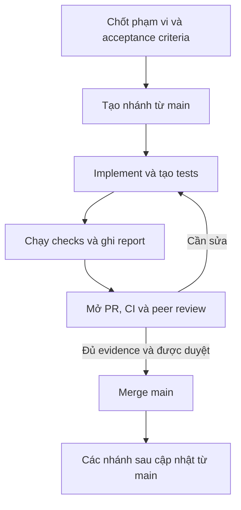

# Cách nhóm phát triển và chốt main

`main` chứa quy trình và implementation đã được review, có checks và report tương ứng. Nhánh backup giữ codebase cũ; foundation mới bắt đầu từ nguồn dữ liệu có thể truy vết.

## Một vòng làm việc

1. Mỗi task nhỏ có owner, mục tiêu, input/output, acceptance criteria và phần ngoài phạm vi. Nếu đụng protocol/method, chỉ rõ trước khi code.
2. Mỗi developer dùng nhánh riêng. Dùng `feat/<topic>`, `fix/<topic>`, `docs/<topic>` hoặc `chore/<topic>` theo nội dung thay đổi, áp dụng cho cả thành viên và coding agent. Nhánh lưu lịch sử dùng `archive/<topic>`. Không dùng chung một nhánh để sửa đồng thời.
3. Tests phù hợp, lint, format và diff checks phải pass. Đừng chỉ kiểm tra happy path: failure phải trả failure thật. CI thông thường không cần raw, mạng tải dữ liệu hoặc GPU.
4. PR implementation có report trong `docs/reports/<topic>.md`: vấn đề, thiết kế, file/config thay đổi, commands, kết quả, evidence/run IDs và giới hạn. PR chỉ sửa typo/link nhỏ có thể ghi report ngay trong PR body.
5. Ít nhất một peer khác tác giả review; người triển khai không tự xác nhận nghiệm thu của mình. Có thể yêu cầu thêm người khi thay đổi method hoặc shared contract.
6. Merge khi checks pass, report khớp kết quả và reviewer đồng ý. Không merge chỉ vì đã có code; không ghi "verified" khi mới đọc code hoặc chưa chạy.

## Trạng thái GitHub enforcement

Tại thời điểm dựng foundation, GitHub API báo `main.protected=false`; tài khoản làm task có push nhưng không có admin. Rulesets API trả 403 với thông báo giới hạn tính năng trên private repository. Actions-permissions API trả 404, vì vậy không xác nhận được settings qua endpoint đó.

PR này bổ sung workflow CI trên Ubuntu/Windows và CODEOWNERS nhưng **không đồng nghĩa branch protection đã bật**. Owner cần kiểm tra gói/settings hiện có để yêu cầu PR, một approval, hai checks `checks (ubuntu-24.04)` / `checks (windows-latest)` và chặn force-push nếu tính năng được hỗ trợ. Nếu chưa hỗ trợ enforcement, nhóm phải giữ quy ước review/merge thủ công và ghi rõ giới hạn; không mô tả nó như bảo vệ kỹ thuật đã có.

## Làm song song với bốn người

Chốt interface, tensor contract và forecast/checkpoint schema trước khi chia implementation. Sau đó có thể chia: model/loss/training; runner/controller; baselines/configs; metrics/reporting. Chưa gán tên cá nhân khi team chưa thống nhất.

- Dùng một prequential runner chung khi protocol tương thích; không mỗi baseline một vòng thời gian khác nhau.
- Shared contracts/protocol cần người sử dụng interface review. Không sửa source constants để đổi input run hoặc experiment.
- Mỗi run ID duy nhất, mỗi người ghi vào output riêng. Không cùng ghi active pointer hoặc cùng directory.
- Một người tổng hợp tiến độ của phase; các thành viên bàn giao bằng PR và run/report IDs. Chỉ có một plan hiện hành khi nhóm chốt kế hoạch triển khai, không tự tạo nhiều bản plan riêng.

## Data và artifacts

Raw giữ nguyên, Git ignore. Processing mới phải tạo output mới có source identities, config, code version, runtime, run ID và trạng thái acceptance rõ. Verification đọc dữ liệu; report/QA mới không ghi đè evidence cũ. Thiếu required input hoặc QC không đạt phải dừng với failure rõ ràng. Nguồn tài liệu phụ tùy chọn có thể warning nếu không ảnh hưởng input bắt buộc.

Checkpoints/runs lớn giữ local hoặc nơi lưu trữ chung được team chốt. Git giữ code, config và reports/artifacts nhỏ đủ review. Chưa cần service orchestration hay experiment server.

## Các phase sắp tới — chưa triển khai

| Thứ tự | Phạm vi | Điều kiện bàn giao |
|---|---|---|
| 1 | Lấy lại raw theo catalog | Size/checksum và manifest acquisition mới; giữ nguyên raw |
| 2 | Data audit và processing mới | Schema/units/time assumptions, missing/zero, fixtures và report có run identity |
| 3 | Protocol và model inputs | Split/cohort/scaling/windows được chốt, prefix/leakage checks và report |
| 4 | Model/loss và baselines | Bám Report 1, shape/gradient/freeze checks, development evidence |
| 5 | Runner và controller | Lưu forecast trước nhãn, availability/update/switch/checkpoint tests |
| 6 | Lock/final experiments | Config khóa trước final, đối chứng công bằng, metrics và costs có evidence |

Đây là thứ tự bàn giao, không phải checklist đã hoàn thành. Core method vẫn theo Report 1; các thông số cần chọn trên development không được tune bằng final results.
