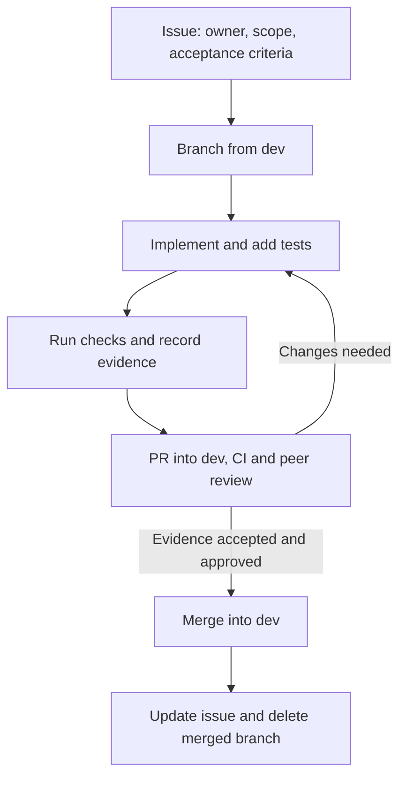

# Team workflow through dev

- `main`: the version agreed by the team. Do not push or merge here without a separate instruction for that update.
- `dev`: daily integration through PRs, CI, and peer review.
- `master`: retained backup; do not modify or delete.
- `feat/*`, `fix/*`, `docs/*`, `chore/*`: one working branch per issue, created from `dev`; delete after merging.

## One work cycle

1. Every task has a GitHub Issue with an owner, goal, scope, acceptance criteria, and dependencies. Link the PR to the issue. Identify any protocol/method changes before coding.
2. Each developer uses a separate branch. Choose `feat/<topic>`, `fix/<topic>`, `docs/<topic>`, or `chore/<topic>` by purpose; this applies to people and coding agents. Use `archive/<topic>` for historical snapshots. Do not edit concurrently on one shared working branch.
3. Appropriate tests, lint, format, and diff checks must pass. Cover failure behavior as well as successful cases. Routine CI needs no raw data, dataset downloads, or GPU.
4. Record the problem, changes, commands/results, and limitations in the PR. Add a report in `docs/reports/` for an actual pipeline/experiment handoff; small changes do not need a separate report.
5. At least one peer other than the author must approve the latest commit, preferably using GitHub **Approve review**. For manual review, an explicit `approved merge` comment with the commit SHA is acceptable from a peer who reviewed the changes. Such a comment is not a technical approval under branch protection. New commits require renewed peer confirmation.
6. Team members merge into `dev` after checks pass, evidence matches, and peer approval is recorded. Agents do not merge autonomously. Update/close the issue once its acceptance criteria are met; a PR into `dev` may not close it automatically. Never promote `dev` to `main` automatically.

## Cleanup after completion

- After a PR merges, confirm its commits/work are preserved on the target branch, switch off the working branch, then delete it remotely and locally. Keep `main`, `dev`, and `master`. Do not delete unmerged work or a branch supporting an active PR. Check both the head and base branch of every open PR, not only its head; deleting a base can auto-close its dependent PRs. Preserve intentionally superseded unique work under an identified archive tag before removing its working branch.
- Close the issue when all acceptance criteria are met, linking the merged PR/results. If it spans multiple PRs, keep it open until the remaining work is complete. Check closure manually for PRs targeting `dev`.
- Merged PRs are already closed. Close abandoned or superseded PRs with a reason and replacement link where applicable; preserve their review history.
- The person or agent completing the handoff performs this cleanup without another confirmation. This does not authorize an agent to merge a PR. GitHub automatic head-branch deletion is currently disabled (`delete_branch_on_merge=false`); enabling it requires repository admin access. Until then, perform the cleanup explicitly.

## GitHub enforcement status

When the foundation was created, the GitHub API reported `main.protected=false`. The executing account had push access but no admin access. The rulesets API returned 403 indicating private-repository feature restrictions. The Actions permissions API returned 404, so that endpoint did not confirm the settings.

Ubuntu/Windows CI and CODEOWNERS **do not mean branch protection is enabled**. The owner needs to check the available plan/settings: restrict updates to `main`; for `dev`, require a PR, one approval, both `checks (ubuntu-24.04)` / `checks (windows-latest)`, and block force-pushes where supported. Until enforcement is available, follow the review/merge convention manually and disclose the limitation.

## Coding rules

The short [coding essentials in AGENTS.md](../AGENTS.md#coding-essentials) apply to people and agents. Reviews focus on correctness, readability, and reproducibility. Use English for maintained documentation, code comments, issues, and PR descriptions; preserve original source documents and historical evidence.

## Four-person development

Agree on interfaces, the tensor contract, and forecast/checkpoint schemas before splitting implementation. Possible work areas are model/loss/training, runner/controller, baselines/configs, and metrics/reporting. Assign individuals after team agreement.

- Share one prequential runner where protocols are compatible; do not implement different timelines for each baseline.
- Have interface consumers review shared contracts/protocols. Do not change source constants to select an input run or experiment.
- Use unique run IDs and separate output locations. Do not write concurrently to one directory or active pointer.
- One person summarizes phase progress; handoffs use PRs and run/report IDs. Maintain one current plan once the team agrees on it.

## Data and artifacts

Preserve raw files and keep them ignored by Git. New processing must produce new outputs with source identities, config, code version, runtime, run ID, and explicit acceptance status. Verification reads data; new QA/reports must not overwrite old evidence. Missing required input or failed QC must stop with a clear failure. Optional supplementary sources may produce warnings when required inputs are unaffected.

Keep large checkpoints/runs locally or in storage agreed by the team. Git stores code, config, and small reviewable reports/artifacts. No orchestration service or experiment server is needed yet.

## Phase handoff map

| Order | Scope | Handoff criteria |
|---|---|---|
| 1 | Restore raw archives from the catalog | Size/checksum verification and a new acquisition manifest; raw bytes preserved |
| 2 | Fresh data audit and processing | Schema/units/time assumptions, missing/zero treatment, fixtures, and a report with run identity |
| 3 | Protocol and model inputs | Agreed splits/cohorts/scaling/windows, prefix/leakage checks, and a report |
| 4 | Model/loss and baselines | Follow Report 1; shape/gradient/freeze checks and development evidence |
| 5 | Runner and controller | Store forecasts before labels; availability/update/switch/checkpoint tests |
| 6 | Lock and final experiments | Config locked before final evaluation, fair comparisons, metrics and cost evidence |

Data acquisition/hourly processing/input implementations now have a shared snapshot and [integrated verification record](reports/data-integration.md). Models, runner/controller and experiments are consolidated by the [2 November integration handoff](reports/dev-integration-final-20261102.md), with separate implementation identities and preserved historical evidence. The table gives the handoff order and criteria, not a competing progress plan. The core method follows Report 1. Parameters selected on development must not be tuned using final results.
