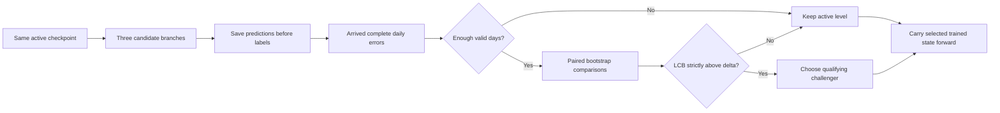

# Confidence controller — Issue #20

Implementation: `ev_control/confidence.py`, algorithm `ev-retention-controller-mbb-v1`.
Method references: Report 1 §6 and the [Sprint 2 requirements](../SPRINT_PLAN.md).
This is an independently authored, model-independent decision helper. It does not
train models, compute their predictions, or implement the #21 runner.

## What it decides

For one target, history budget and seed, the runner starts a block with the active
level already selected. It forks the same model/optimizer state into three branches
with levels `[0, lambda_low, lambda_high]`. All branches predict before labels arrive
and train under the same data, ordering and step-budget rules. At the next boundary,
the helper compares their errors and chooses the level for the **next** block.



Keeping the level means carrying its **trained** model and optimizer, not restoring
the block-start checkpoint. The helper only returns a decision: state management,
prediction storage, paired RNG streams and ordered boundary updates belong to #21.
No previous forecast is changed after its answer becomes available.

## Input and trust boundary

`decide(rows, config=..., active_lambda=..., block_start=..., as_of=...,
stream_id=..., scale_id=...)` consumes `DailyScore` records:

| Field | Meaning |
|---|---|
| `origin` | Midnight starting the forecast's 24-hour day |
| `issued_at` | Prediction issue time; must be at/before origin and before label availability |
| `available_at` | Time all available labels/status for the day can be read; `None` means pending |
| `valid_labels` | Number of valid hourly labels, 0–24; only 24 qualifies |
| `mae` | Three daily normalized MAEs in fixed level order; `None` for incomplete days |
| `scale_id` | The same fixed target energy scale identity for all candidates/days in this call |
| `prediction_ids` | Three distinct identifiers for saved candidate predictions |

For candidate j on day d, the runner supplies

$$e_{j,d}=\frac{1}{24}\sum_{h=1}^{24}|\hat y_{j,d,h}/s-y_{d,h}/s|.$$

Here s is the fixed allowed-history energy scale from #18, not the latent-coordinate
scale used in retention loss. There is no partial-label average and no label filling.
All three errors use identical labels and normalization. `stream_id` must bind the
dataset/city/target/budget/seed; do not pool targets into one decision.

The helper checks score finiteness, nonnegativity, complete-label gate, duplicate
days, identifiers, clock compatibility and declared availability. It cannot prove
that caller-supplied MAE, IDs or timestamps match real saved files. #21 must verify
that lineage. An issued timestamp alone is not proof of causal prediction storage.

Days outside the block are ignored. Pending days are counted without reading their
score values. Arrived incomplete days require `mae=None`. A complete daily label
cannot be available before `origin + 24h`. `available_at == as_of` is allowed: #21
must process that label before deciding and issuing the next forecast.

## Exact decision and bootstrap profile

1. Select arrived, complete days inside `[block_start, block_start + block_days)`.
   Sort chronologically. B counts these days, **not** 24B hours or training windows.
2. If `B < min_valid_days`, retain active without bootstrapping.
3. For each challenger c, form paired improvement
   $d_{c,d}=e_{active,d}-e_{c,d}$. Positive values favor c.
4. On the chronological valid-day sequence, use noncircular overlapping moving
   blocks of L indices. Draw starts uniformly from `0..B-L`, concatenate blocks
   until length B and trim. Generate R resamples, sharing the exact index draws
   between the two challengers. Each replicate is the mean paired improvement.
5. LCB is the linearly interpolated empirical quantile at `alpha/2`: sort R means,
   take position `(R-1)*alpha/2`, and interpolate between adjacent entries.
   This is a percentile bootstrap implementation, not a t interval/basic/BCa bound.
6. The `alpha/2` tail is the explicit Bonferroni two-challenger treatment within
   this decision. A challenger qualifies only if `LCB > delta`; equality keeps active.
7. Choose greatest qualifying LCB, then smallest absolute distance to current lambda,
   then fixed ascending level order `[0, lambda_low, lambda_high]`. Exact numeric
   equality triggers a tie; no undeclared tolerance.

**Missing-day convention requiring peer/development review:** L counts consecutive
*valid observations*, not necessarily consecutive calendar days. Removing incomplete
or unavailable days can make a sampled block span a calendar gap. Every decision
records `valid_day_gaps` (number of gaps between successive used days), coverage and
used dates. This implementation does not claim calendar-gap-preserving resampling.
This profile is proposed for review, not an accepted Final experiment configuration.
Do not silently change it after seeing Final results.

Bootstrap estimates in small, dependent or nonstationary samples can be unreliable.
The correction does not establish exact finite-sample confidence coverage. There is
no across-block sequential error control or guarantee of future safety. Report
repeated-testing, missing-day selection and nonstationarity limitations explicitly.
The controller does not establish that publisher preprocessing was causal.

## Configuration, clock and reproducibility

`configs/issue20/development-example.json` is a **synthetic/development example**:
14-day blocks, positive levels 0.01/0.1, initial level 0.01, Bmin=7, delta=0,
alpha=0.05, L=3, R=2,000 and seed=42. Only the three-level structure and initial
14-day block design come from the prescribed method. The remaining values/profile
require Development selection and review; none was tuned here or locked for Final.

This implementation requires `1 <= L < Bmin <= block_days` and R>=2 to avoid
resampling a single possible full-length block at the minimum sample size.
This is an explicit supported-domain constraint, not a new Report 1 constant.
`initial_lambda` is recorded/validated; #21 initializes active state from it and
subsequently passes the previous selected level as `active_lambda`.

Use the declared dataset clock consistently: fixed +08 for the current UrbanEV
assumption, naive publisher-local hours for CHARGED. Do not reinterpret CHARGED as
UTC. Calls require midnight boundaries and `as_of == block_start + block_days`;
late retrospective decisions fail. DST offset changes fail rather than silently
changing the day length; a different clock policy needs a reviewed interface update.

A local Python RNG is seeded by SHA-256 of algorithm version, configured seed,
stream/scale identity and block boundaries, independent of error values. It does
not mutate global RNG. The result records the derived seed, config, input-pair hash,
coverage, used dates, mean improvement and LCB for each challenger. Pin Python/code
versions when reproducing draws; repeated bootstrap seeds across arbitrary runtime
versions are not a cross-version promise. Config/stream IDs must be fixed before
examining the results, not varied to obtain a switch.

## Reproduce fixtures

```sh
python -m unittest discover -s tests -p test_confidence_controller.py -v
python -m tools.controller_smoke \
  --config configs/issue20/development-example.json \
  --output runs/issue20-fixture-YOUR-UNIQUE-ID
```

The output directory must be new. The CLI writes `evidence.json` with run ID,
code SHA, dirty-tree status, config/module hashes, environment, runtime and six
synthetic decisions. It never accesses datasets, checkpoints or Final labels.
See the [handoff report](../reports/issue20-qyroven.md) for actual checks and limits.
