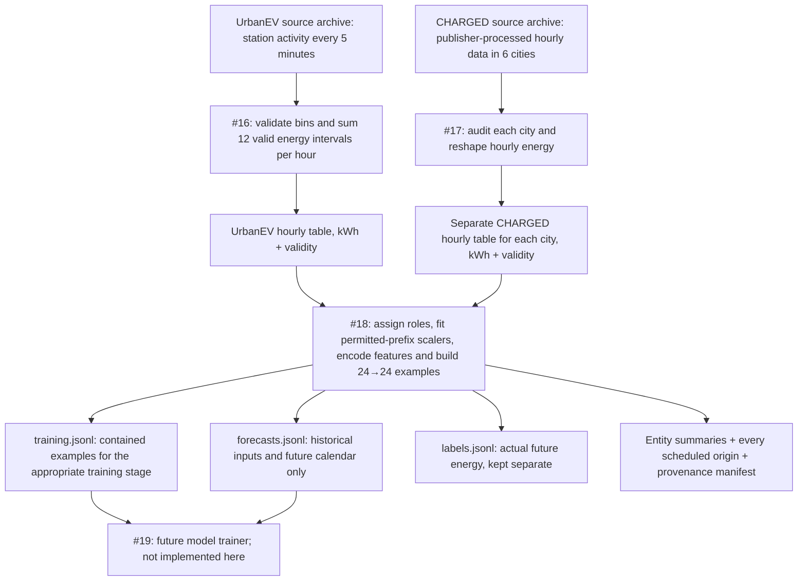

# From the two datasets to model inputs

## Start here: what exists now?

We still have **two separate datasets**. We have created new representations of each; we have not replaced or combined their original files.

| Folder | What one record means | Why it exists |
| --- | --- | --- |
| `data/raw/` | A record in the publisher's original archive/layout | Preserve the source exactly as acquired. |
| `data/processed/` | One station/site, one hourly bin, energy in kWh, and file-QC information | Give both datasets a common hourly interface. |
| `data/inputs/` | One entity's 24-hour history, future calendar features, and separately controlled labels | Supply examples and prediction inputs to the future model. |

For the team-shared files, use [DATA-v1-20261019 downloads](DATA_DOWNLOADS.md): it has links, package hashes and extraction instructions.

All paths below are relative to the repository root, **TFL-EV**. These large files exist locally and are ignored by Git. A clone contains their code, explanations and compact evidence, not the datasets themselves.



The shared box means **shared code and record structure**. Each dataset/city is still processed in a separate run. It does not mean their station series or training pools have been combined.

## 1. Raw: the original two datasets remain intact

| Dataset | Local archive | What we use |
| --- | --- | --- |
| UrbanEV | `data/raw/urbanev/official_2026_05_11/UrbanEVDataset.zip` | Station-level time series from the publisher's station-raw variant. |
| CHARGED | `data/raw/charged/zenodo_15814263/Hourly.zip` | Standard hourly releases for AMS, JHB, LOA, MEL, SPO and SZH. |

UrbanEV contains station information, charger rated powers, station distances and station activity files in `charge_5min/`. We use `volume` as the supplied estimated/derived energy, not as a claim of direct meter measurement. The metadata and other archive variants remain available; they are not all model features.

CHARGED includes site/charger metadata and hourly matrices such as `volume.csv` and `duration.csv`. Its hourly energy has already undergone publisher processing. Calling the downloaded archive "raw" in our folder structure does not undo that processing or recover original observation masks.

UrbanEV Supplemental is not enabled in the current input pipeline. Weather, POI, station distances, prices and TAZ IDs are not added to the seven historical features.

Acquisition/checksums are explained in [data/README.md](../../data/README.md). For source file definitions, use [UrbanEV](URBANEV.md) and [CHARGED](CHARGED.md). The input runs freshly verified processed-file identities; they did not freshly reverify the raw archives.

## 2. Processed: one entity, one hour, one energy value

### UrbanEV: aggregate 5-minute energy to hourly energy

For one station, take the 12 five-minute intervals assigned to an hour and sum their valid `volume` values. This produces an hourly energy total in **kWh**. Do not average the values or multiply them by charger power again.

The current producer requires 12 unique on-grid samples with finite, nonnegative **volume and duration**. If this gate fails, the hour remains invalid/unknown; do not replace its total with zero or present a partial sum as the full hour. Duration is a producer integrity condition, not the variable being summed for energy. The gate and its evidence are reviewed in PR #25; this guide does not change that policy.

Current output:

```text
data/processed/urbanev/issue16-start-v1-20261017/
├── hourly.csv
└── manifest.json
```

Actual first three hourly records for station 1001, rounded here for readability:

| dataset_id | city_id | entity_id | timestamp | energy_kwh | file_valid_mask | valid_sample_count | expected_sample_count | qc_flags |
| --- | --- | --- | --- | ---: | ---: | ---: | ---: | --- |
| urbanev | SZH | 1001 | 2022-09-01T00:00:00+08:00 | 4.083333 | 1 | 12 | 12 | *(empty)* |
| urbanev | SZH | 1001 | 2022-09-01T01:00:00+08:00 | 2.916667 | 1 | 12 | 12 | *(empty)* |
| urbanev | SZH | 1001 | 2022-09-01T02:00:00+08:00 | 5.250000 | 1 | 12 | 12 | *(empty)* |

The first energy value refers to the assumed interval **00:00–01:00**. It is still an hourly table, not yet a model training example.

### CHARGED: audit and reshape existing hourly energy

CHARGED is already hourly, so we do **not** sum twelve samples again. We read the site-energy matrix, validate IDs/time/schema/energy and write one row per site/hour. Released kWh values are preserved; no new interpolation or zero-site removal is applied.

Current output:

```text
data/processed/charged/issue17-hourly-v1-20261017/
├── manifest.json
├── AMS/hourly.csv
├── JHB/hourly.csv
├── LOA/hourly.csv
├── MEL/hourly.csv
├── SPO/hourly.csv
└── SZH/hourly.csv
```

A CHARGED hourly record uses the same nine columns as UrbanEV, but its expected sample count is **1 released hourly value**, not 12 five-minute samples. Metadata/header interpretations are recorded by the adapter; the source archive is not rewritten.

### Reading the common columns

| Column | Meaning |
| --- | --- |
| `dataset_id`, `city_id`, `entity_id` | Identify exactly which dataset/city/station or site the record belongs to. Preserve IDs as text. |
| `timestamp` | Label of the hourly bin under that producer's declared clock profile. |
| `energy_kwh` | Supplied/derived energy for the hour, in kWh; missing when invalid under the producer's rules. |
| `file_valid_mask` | 1 if the hourly energy passes that producer's file checks, otherwise 0. Not proof of an original unfilled observation. |
| `valid_sample_count`, `expected_sample_count` | How many required constituent values passed the producer gate. |
| `qc_flags` | Recorded QC reasons/diagnostics; interpret with the producer contract. |

The common columns do not make the clocks identical. UrbanEV uses assumed local +08:00; CHARGED retains publisher-local labels without a UTC offset. Availability is separately assumed to be hourly-bin end + 0h. These are declared limitations, not verified physical arrival times.

## 3. Inputs: turn each entity's hourly rows into examples

The input loader reads the hourly tables. It does **not** modify them.

### 3.1 Assign each entity one role

| Role | Later use |
| --- | --- |
| Source | Learn the shared source checkpoint from permitted pre-deployment examples. |
| Development | Adapt each target separately and choose experimental settings. |
| Final | Adapt each target separately and evaluate the locked method. |

The existing fixed hash split assigns IDs independently of forecast performance. Roles stay the same across budgets. Splits are by ID, not verified distinct physical location; co-location remains a limitation. CHARGED is split per city. Do not pool UrbanEV and CHARGED for pretraining.

### 3.2 Choose the permitted history and fit its scaler

For a target deploying on December 1 with budget 7, use **November 24–30**, not a hand-picked set of seven complete days. Budget 14 or 28 changes that permitted initial interval; the input length and forecast horizon remain 24 hours.

Fit one scaler per entity from valid energy available within the permitted prefix. Source fitting uses its pre-deployment interval. Divide energy by prefix p95; preserve the original kWh labels too. Never fit using a target's future evaluation values. Freeze the initial scaler during replay. A nonempty prefix with p95 = 0 uses the recorded 1 kWh fallback; an empty valid prefix has no scaler and stays blocked.

### 3.3 Encode the input features

| Model component | One hourly row contains | Shape per example |
| --- | --- | --- |
| Historical input, `x_hist` | Scaled energy; hour sin/cos; weekday sin/cos; weekend indicator; energy-present mask | 24 rows × 7 features |
| Future calendar, `c_future` | Hour sin/cos; weekday sin/cos; weekend indicator | 24 rows × 5 features |
| Actual labels, `y_kwh` | Actual released hourly energy in original units | 24 values |
| Scaled labels, `y_scaled` | The same labels divided by the entity's prefix scale | 24 values |

Future calendar values are known in advance. Actual future energy is **not** an input. The term `future_labels` inside a forecast record names future timestamp labels, not actual future energy values.

### 3.4 Build one-entity windows

An actual example in the current training file belongs to **UrbanEV station 1001**, development role:

```text
History: 24 Nov 2022, 00:00–24:00
                       ↓
Label:   25 Nov 2022, 00:00–24:00
```

The saved origin is November 25 at 00:00 +08:00. History and labels belong to the same station. With seven initial days, there are at most six daily contained 24→24 pairs. Budgets 14 and 28 allow at most 13 and 27. Actual counts depend on valid history/labels and scaler availability.

For this station, the exact permitted prefix has 168 valid hours, scale 20.2125 kWh and six initial training examples. These examples prepare later adaptation; preprocessing has not fine-tuned a model.

## 4. Which input file does what?

Current handoff run root:

```text
data/inputs/issue18-input-handoff-v1-20261019/
├── urbanev-SZH-7d/
├── urbanev-SZH-14d/
├── urbanev-SZH-28d/
├── charged-AMS-7d/
├── charged-AMS-14d/
├── charged-AMS-28d/
└── ... same three budgets for JHB, LOA, MEL, SPO and SZH
```

There are **21 run folders**: seven dataset/city profiles × three budgets. They are not 21 new datasets. Source examples repeat across budget runs; do not sum those repetitions as independent observations.

Each folder contains:

| File | What to read it for |
| --- | --- |
| `training.jsonl` | Initial complete examples, with inputs and labels. Select Source records for pretraining; matching target records for that target's adaptation. Never train a source model on all roles together. |
| `forecasts.jsonl` | Replay inputs eligible at each origin: history and known future calendar, without actual future energy. A record is not a prediction already made by a model. |
| `labels.jsonl` | Separate actual future energy, validity and availability. Only the scoring/update path may use it, after arrival and after joining to a created forecast. |
| `entities.jsonl` | Each ID's role, prefix, scale, sample counts and initialization/block status. |
| `schedule.jsonl` | Every requested target date, including skipped or blocked dates and the reason. |
| `manifest.json` | Run/config/code/runtime/source identities, artifact hashes, counts and acceptance limits. |

**JSONL means one JSON object per line**, not spreadsheet columns. The UrbanEV 7-day training file is about 433 MB; opening the entire file in a spreadsheet is not a useful way to inspect a sample. The hourly CSV table is easier to read first. A trainer can stream JSONL records without loading the whole file into memory.

The `7d` name describes the **target initial-history budget**. Its folder also contains Source examples from the longer permitted Source history; it does not mean every record uses only seven days of source data.

## 5. What happens to missing data?

| Situation | Current policy |
| --- | --- |
| Some historical hours missing | Keep 24 positions; use placeholder energy 0 with mask 0. Real valid energy 0 has mask 1. |
| All 24 historical energy values unavailable | Do not emit an input for that origin; retain `skipped_all_missing_history` in the schedule. |
| Any target label missing or not yet available | No filling. Do not use the example for complete-horizon learning/scoring until all 24 labels are valid and available. Future completeness does not select forecast dates. |
| Defined scale, no complete initial training examples | Mark `source_checkpoint_only`; the future trainer must report the no-initial-adaptation case separately. |
| No valid energy in the permitted scale-fit prefix | Keep the ID blocked and count each requested date as `skipped_undefined_scale`. |

Actual station 1001, 7-day budget: six initial examples, 90 requested replay days, 59 emitted inputs, 31 empty-history skips. Of the 59 inputs, 52 have complete released labels and seven do not. This separates **training examples**, **prediction inputs** and **evaluable days**; they are different counts.

See [Input acceptance policy](INPUT_ACCEPTANCE.md) for exact rules and [the handoff report](../reports/input-handoff.md) for station 1004/1005 and all actual counts.

## 6. How to inspect the data without getting lost

1. In Finder, open **Developer → TFL-EV → data**. You should see `raw`, `processed` and `inputs`.
2. Open `processed/urbanev/issue16-start-v1-20261017/hourly.csv` first. Read a few rows for station 1001: one row is one hour.
3. Next, inspect one record in `inputs/issue18-input-handoff-v1-20261019/urbanev-SZH-7d/training.jsonl`: it packages 24 hourly rows plus the following 24 labels.
4. Use `entities.jsonl` and `schedule.jsonl` to explain why an entity/date has no emitted input. Use the handoff report for readable summary tables.

All local data folders stay out of Git. Teammates need the same verified producer files or a copy of the identified artifacts; cloning this PR alone will not download the prepared data. The handoff evidence contains exact configs/fingerprints and a reconstruction command.

## 7. What is finished, and what comes next?

Data-processing and input code exists in PRs under review. The new handoff contains actual inputs for UrbanEV and all six CHARGED cities, with explicit coverage limits and reproducible counts. It is ready for technical review and development of the model consumer. Formal integration/acceptance and issue closure still require the team workflow.

Next is #19: train a source model on Source examples, then initialize/adapt each target separately. Later forecasting produces actual predictions; evaluation and online updates consume labels only when permitted. Preprocessing itself has trained no model and demonstrated no research effectiveness.

UrbanEV is primary. CHARGED remains supplementary; SZH is analyzed separately because of potential UrbanEV location overlap. Publisher preprocessing and clock/arrival limitations remain, even when every released energy value is file-valid.

This guide explains the existing implementation. It does not change Report 1, add another execution plan, alter old trial results or authorize merging.

## 8. PR review reading map

Use this index to find the explanation attached to each open review slice. Older PRs describe their own snapshots; their fixture counts, trial failures or pending-policy wording are not the current handoff status. The current user-selected policy and shared snapshot are in PR #36; independent approval/integration remain pending. These are reading links, not a second execution plan.

| PR | Scope | Read first |
| --- | --- | --- |
| [#25](https://github.com/HungLD9505/adaptive-retention-ev/pull/25) | UrbanEV hourly processing and duration-rule evidence | [urbanev-hourly.md](https://github.com/HungLD9505/adaptive-retention-ev/blob/24438a539b7ef455bc19aaa3ab4d43b8a8585d16/docs/reports/urbanev-hourly.md); [HOURLY_CONTRACT.md](https://github.com/HungLD9505/adaptive-retention-ev/blob/24438a539b7ef455bc19aaa3ab4d43b8a8585d16/docs/data/HOURLY_CONTRACT.md); [urbanev-rule-comparison.md](https://github.com/HungLD9505/adaptive-retention-ev/blob/24438a539b7ef455bc19aaa3ab4d43b8a8585d16/docs/reports/urbanev-rule-comparison.md) |
| [#26](https://github.com/HungLD9505/adaptive-retention-ev/pull/26) | CHARGED inventory | [charged-inventory.md](https://github.com/HungLD9505/adaptive-retention-ev/blob/699a00d6cc57bcd8598e372f8ca776c674d4cf8a/docs/reports/charged-inventory.md) |
| [#27](https://github.com/HungLD9505/adaptive-retention-ev/pull/27) | CHARGED publisher preprocessing and semantics | [charged-preprocessing.md](https://github.com/HungLD9505/adaptive-retention-ev/blob/892c3327eae2234167e2f34734b943c4166ca4f3/docs/reports/charged-preprocessing.md) |
| [#28](https://github.com/HungLD9505/adaptive-retention-ev/pull/28) | CHARGED suitability and Shenzhen overlap | [charged-suitability.md](https://github.com/HungLD9505/adaptive-retention-ev/blob/88f719eb35dfc9610af2915fbf676f5ca42f7fd9/docs/reports/charged-suitability.md) |
| [#29](https://github.com/HungLD9505/adaptive-retention-ev/pull/29) | CHARGED hourly adapter and contract | [charged-hourly.md](https://github.com/HungLD9505/adaptive-retention-ev/blob/afae635117f93459a69d291a4d4925b21bb11ef8/docs/reports/charged-hourly.md); [CHARGED_HOURLY_CONTRACT.md](https://github.com/HungLD9505/adaptive-retention-ev/blob/afae635117f93459a69d291a4d4925b21bb11ef8/docs/data/CHARGED_HOURLY_CONTRACT.md) |
| [#30](https://github.com/HungLD9505/adaptive-retention-ev/pull/30) | Input feature contract and cyclic-calendar figure | [INPUT_CONTRACT.md](https://github.com/HungLD9505/adaptive-retention-ev/blob/c406ae07606ca48859cf93f8b24dfffab79c7803/docs/data/INPUT_CONTRACT.md); [cyclic-calendar.svg](https://github.com/HungLD9505/adaptive-retention-ev/blob/c406ae07606ca48859cf93f8b24dfffab79c7803/docs/data/figures/cyclic-calendar.svg) |
| [#31](https://github.com/HungLD9505/adaptive-retention-ev/pull/31) | Calendar/clock/mask implementation | [input-features.md](https://github.com/HungLD9505/adaptive-retention-ev/blob/4bc17f158ce7524499999452fcf207d00ea03936/docs/reports/input-features.md) |
| [#32](https://github.com/HungLD9505/adaptive-retention-ev/pull/32) | Splits, history budgets and prefix scaling | [input-split-scaler.md](https://github.com/HungLD9505/adaptive-retention-ev/blob/f9d1a731a20c4666cfcc35e2100dd636b195853a/docs/reports/input-split-scaler.md); [SPLIT_SCALER_POLICY.md](https://github.com/HungLD9505/adaptive-retention-ev/blob/f9d1a731a20c4666cfcc35e2100dd636b195853a/docs/data/SPLIT_SCALER_POLICY.md) |
| [#33](https://github.com/HungLD9505/adaptive-retention-ev/pull/33) | 24-to-24 windows and delayed labels | [input-windows.md](https://github.com/HungLD9505/adaptive-retention-ev/blob/8b53771e58e066fac0a18c34e164e93cb1fb4011/docs/reports/input-windows.md) |
| [#34](https://github.com/HungLD9505/adaptive-retention-ev/pull/34) | Fixture integration and loader API | [input-loader.md](https://github.com/HungLD9505/adaptive-retention-ev/blob/8fd69b247d108f24a5243b89164e34b02e19571c/docs/reports/input-loader.md) |
| [#35](https://github.com/HungLD9505/adaptive-retention-ev/pull/35) | Historical unchanged-loader real-data trial | [input-loader-real.md](https://github.com/HungLD9505/adaptive-retention-ev/blob/3edc1dfe24777bcfe8c07c8f88e63c0a334acf96/docs/reports/input-loader-real.md) |
| [#36](https://github.com/HungLD9505/adaptive-retention-ev/pull/36) | Current policy, actual input handoff and shared downloads | [input-handoff.md](https://github.com/HungLD9505/adaptive-retention-ev/blob/1ea15b0233d02b6fe7b3d6fba107513c0aeba18a/docs/reports/input-handoff.md); [DATA_FLOW.md](https://github.com/HungLD9505/adaptive-retention-ev/blob/1ea15b0233d02b6fe7b3d6fba107513c0aeba18a/docs/data/DATA_FLOW.md); [DATA_DOWNLOADS.md](https://github.com/HungLD9505/adaptive-retention-ev/blob/1ea15b0233d02b6fe7b3d6fba107513c0aeba18a/docs/data/DATA_DOWNLOADS.md); [INPUT_ACCEPTANCE.md](https://github.com/HungLD9505/adaptive-retention-ev/blob/1ea15b0233d02b6fe7b3d6fba107513c0aeba18a/docs/data/INPUT_ACCEPTANCE.md) |

For downloading rather than reviewing implementation slices, go directly to [DATA_DOWNLOADS.md](DATA_DOWNLOADS.md). It links every uploaded archive, the SHA-256 catalog and installation steps. The source archives are optional for consumers of the prepared input ZIPs. The current input policy extends the pinned feature contract; it does not rewrite earlier slice evidence or change Report 1.
