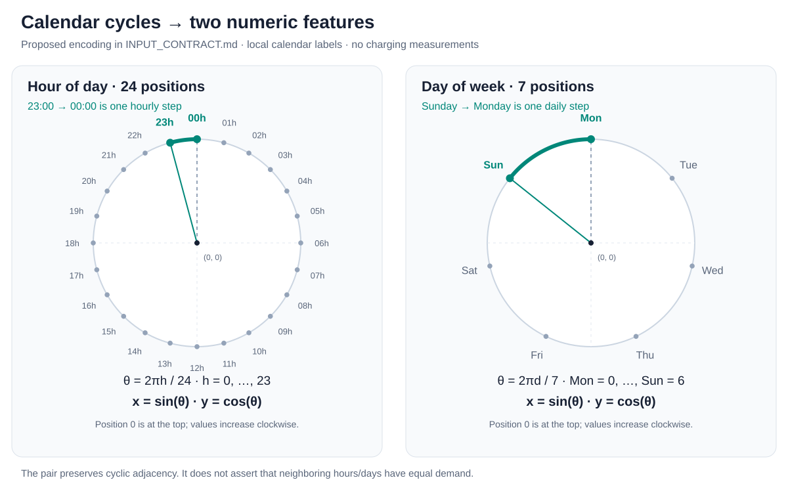

# Model input contract — version 1 proposal

Issue [#18](https://github.com/HungLD9505/adaptive-retention-ev/issues/18), first slice: **contract and feature schema only**. Status: proposed for peer/consumer review, not an implemented loader or accepted input artifact. No split/scaler/window construction, official full-data runs or model training is included.

## 1. Authority and boundaries

[Report 1](../../adaptive_retention_report_1.pdf) §4/7 governs the 24→24 task, initial histories of 7/14/28 days, permitted information, separate entity roles and forecast-before-label ordering. [Research Flow §9](../MASTER_RESEARCH_FLOW.md) provides reference dimensions and settings. The feature order and cyclic encodings below are implementation choices submitted for explicit review; they are not claimed as immutable Report 1 constants.

[PR #25](https://github.com/HungLD9505/adaptive-retention-ev/pull/25) supplies the UrbanEV hourly proposal; [#29](https://github.com/HungLD9505/adaptive-retention-ev/pull/29) supplies the CHARGED profile. Their outputs/contracts remain pending review/integration. Development may proceed with independent fixtures. Official data artifacts and accepted sample counts must wait for reviewed, integrated hourly inputs and a documented input-run acceptance gate.

Preserve the accepted research scope: UrbanEV primary; six standard CHARGED cities supplementary, with AMS/JHB/LOA/MEL/SPO geographic reporting and SZH later-period reporting kept separate. No pooled pretraining, independent unseen-location SZH claim or full-release all-zero filtering. Publisher original/imputed status and strict-online readiness remain unverified.

## 2. Hourly input boundary and clocks

Read an identified successful hourly run and its manifest/profile, not an arbitrary CSV discovered by filename. Preserve `(dataset_id, city_id, entity_id)` as string identity; no joins by row position, integer coercion or matching numeric IDs across datasets/cities. Only explicitly reviewed source runs can become official input artifacts.

- **UrbanEV:** offset-aware local timestamps under the producer's explicit zone/interval assumptions. Use their local calendar fields; do not silently recompute the calendar in UTC.
- **CHARGED:** `charged-hourly-v1-local-naive` retains offset-free publisher-local nominal clocks. Do not attach UTC, invent DST folds/gaps, or treat those labels as verified absolute instants.
- Require an explicit recognized clock profile, bin-start interpretation and label-availability policy in the input config/lineage. Unknown, mixed or contradictory profiles fail; shared column names are insufficient evidence of clock compatibility.
- Process each dataset/city under its own profile. Do not compare/sort naive and aware timestamps in one global chronology. Persist both the original origin label/profile and the ordered hourly labels used for each sample.
- For CHARGED, "24 hours" means 24 consecutive nominal released hourly bins. This does not certify 24 elapsed physical hours on DST transitions. UrbanEV's offset/zone convention is likewise a documented assumption until verified.

Do not round, deduplicate, fill targets or repair a failed hourly run in the input loader. Hourly structural defects return to the producer/QC review. A successful run's per-hour invalid energy remains explicitly missing.

## 3. Sample time definition

Let `t` be the beginning of the forecast horizon in the entity's declared clock profile. The proposed fixed daily origin is nominal local midnight; this must be accepted as the fixed-origin implementation choice before official artifact generation.

| Component | Ordered labels |
| --- | --- |
| History | `t-24h, ..., t-1h`, 24 bins, oldest first |
| Future calendar | `t, ..., t+23h`, 24 bins, earliest first |
| Target energy | Same 24 bins as future calendar |

The forecast covers nominal `[t, t+24h)`. For example, at UrbanEV origin `2022-12-01T00:00:00+08:00`, history is Nov 30 00:00–23:00 and the target is Dec 1 00:00–23:00. This calendar example is not a new sample-eligibility decision.

An initial supervised training sample is permitted only when **both its history and all 24 labels lie inside the assigned historical prefix**, and labels are available by the training cutoff. The 7/14/28-day history budget is not the 24-hour window length. Source data must also precede the applicable deployment cutoff.

Label availability at the exclusive horizon end, if used, remains a separate explicit replay assumption rather than an observed arrival fact. The runner must know the assumption; an artifact containing Y does not make Y available at forecast time. Daily scoring/updating requires all 24 valid and available labels. Never select future forecast dates based on future Y completeness; keep scheduled origins and record missing/unscored days after labels become available.

## 4. Ordered feature schema

Schema identifier: **`ev-input-v1`**, proposed. Arrays are time-major; numerical model arrays use float32. Any change to ordered feature meanings requires a new schema identity and consumer review, even if dimensions happen to stay the same.

Use local nominal hour `h ∈ {0,...,23}` and weekday `d ∈ {0,...,6}` with **Monday = 0**. Define:

- `hour_sin = sin(2πh/24)`, `hour_cos = cos(2πh/24)`.
- `weekday_sin = sin(2πd/7)`, `weekday_cos = cos(2πd/7)`.
- `is_weekend = 1` for Saturday/Sunday (`d >= 5`), else `0`. This is a calendar indicator, not a claim about holidays or actual local working schedules.

### Why represent calendar values as a circle?

A model can consume raw hour numbers; the issue is the geometry of that representation. On a number line, `23` and `0` differ by 23 even though they are adjacent hours. The same issue occurs between Sunday (`6`) and Monday (`0`). A sine/cosine pair makes the wraparound explicit: the last and first positions are separated by the same angle as any neighboring pair.

Each dot is a calendar position, not a charging measurement. In this figure **horizontal x = sine, vertical y = cosine**: zero is at the top and values increase clockwise. This drawing convention matches the feature formulas and `[sin, cos]` order used here. Other axis orientations are possible; do not silently change the implemented feature definitions/order.

For a position `v` in a cycle of `P` positions:

$$
\theta = \frac{2\pi v}{P}, \qquad x = \sin(\theta), \qquad y = \cos(\theta).
$$

For hours, substitute `v=h` and `P=24`:

$$
\mathrm{hour\_sin}=\sin\left(\frac{2\pi h}{24}\right), \qquad
\mathrm{hour\_cos}=\cos\left(\frac{2\pi h}{24}\right).
$$

For weekdays, substitute `v=d` and `P=7`:

$$
\mathrm{weekday\_sin}=\sin\left(\frac{2\pi d}{7}\right), \qquad
\mathrm{weekday\_cos}=\cos\left(\frac{2\pi d}{7}\right).
$$

`2π` is one full turn in radians. Division by the period assigns equal angular steps to the 24 hours or seven days. The model receives the two resulting numbers, not the diagram. The same formulas supply both historical and known-future calendar columns; the energy forecast is still unknown.

**Why both sine and cosine?** Sine alone cannot distinguish 00:00 from 12:00 (both zero). Cosine alone cannot distinguish 06:00 from 18:00 (both zero). Their ordered pair distinguishes every discrete position within the cycle.

Numerical examples below are mathematical illustrations, not sampled EV data. Values are rounded to four decimal places for readability only; they do not prescribe extra rounding in feature generation.

| Local hour h | hour_sin | hour_cos |
| --- | ---: | ---: |
| 00:00 | 0.0000 | 1.0000 |
| 06:00 | 1.0000 | 0.0000 |
| 12:00 | 0.0000 | -1.0000 |
| 18:00 | -1.0000 | 0.0000 |
| 23:00 | -0.2588 | 0.9659 |

| Local weekday | d | weekday_sin | weekday_cos | is_weekend |
| --- | ---: | ---: | ---: | ---: |
| Monday | 0 | 0.0000 | 1.0000 | 0 |
| Tuesday | 1 | 0.7818 | 0.6235 | 0 |
| Wednesday | 2 | 0.9749 | -0.2225 | 0 |
| Thursday | 3 | 0.4339 | -0.9010 | 0 |
| Friday | 4 | -0.4339 | -0.9010 | 0 |
| Saturday | 5 | -0.9749 | -0.2225 | 1 |
| Sunday | 6 | -0.7818 | 0.6235 | 1 |

At 23:00 the hour pair is approximately `(-0.2588, 0.9659)`; at 00:00 it is `(0, 1)`. The points are neighbors on the circle despite the numeric hour labels crossing from 23 to 0. The same geometry places Sunday next to Monday. Cyclic encoding exposes calendar structure; it neither guarantees improved forecasting nor asserts that neighboring hours/days have equal charging demand. The explicit weekend indicator is retained as a proposed feature from Report 1's calendar specification, not as evidence that every city follows identical working schedules.

### Historical input: X_hist[24,7]

| Column | Name | Definition |
| ---: | --- | --- |
| 0 | energy_scaled | Valid available hourly kWh divided by the sample's identified positive energy scale; otherwise the placeholder 0 with mask 0 |
| 1 | hour_sin | Cyclic hour encoding above |
| 2 | hour_cos | Cyclic hour encoding above |
| 3 | weekday_sin | Cyclic weekday encoding above |
| 4 | weekday_cos | Cyclic weekday encoding above |
| 5 | is_weekend | Calendar indicator above |
| 6 | energy_present_mask | 1 only when historical energy is file-valid and available by this sample's cutoff; otherwise 0 |

A true source zero is `[energy_scaled=0, mask=1]`; missing/unavailable X is `[0, mask=0]`. The placeholder is a tensor representation, not a new energy observation or an imputed label. No interpolation/backfill is introduced. Calendar columns remain defined for the declared bins even when energy is missing. Do not append another mask column accidentally: the seventh feature is the historical energy mask.

An all-missing history must be represented faithfully and flagged in metadata; it must not silently disappear based on future labels. Whether a **prefix-only** eligibility rule is needed is a later reviewed decision. Do not interpret "no accepted exclusion rule yet" as approval to fabricate input energy.

### Known future calendar: C_future[24,5]

| Column | Name |
| ---: | --- |
| 0 | hour_sin |
| 1 | hour_cos |
| 2 | weekday_sin |
| 3 | weekday_cos |
| 4 | is_weekend |

Definitions are identical to the historical calendar columns, evaluated at the forecasted bins. Future actual energy, missingness/completeness of future Y, realized price, measured weather, static whole-period activity totals and post-origin statistics are **not features**. No station ID, TAZID, coordinates, POI or UrbanEV Supplemental feature is enabled by this schema.

### Labels and batch shapes

For a complete and available supervised target, `Y_scaled[24]` is hourly kWh divided by the **same identified energy scale** as X; chronological order matches C_future. Also preserve original-unit Y for evaluation/inverse-scale checks. No clipping to [0,1] is implied by p95 scaling; legitimate values can exceed 1.

For a batch of B examples: `X_hist[B,24,7]`, `C_future[B,24,5]`, `Y_scaled[B,24]`. Do not add an implicit singleton energy dimension, transpose time/features or flatten the future calendar without an agreed model interface. Model/head architecture belongs to #19.

## 5. Separate forecast inputs from delayed labels

The future loader interface must distinguish these records:

| Record | Contents | Visibility |
| --- | --- | --- |
| ForecastInput | X_hist, C_future and input metadata | Predictor; contains no Y or future-validity indicator |
| LabelRecord | 24 original-unit nullable energy values, 24 validity bits and availability-policy/reference fields | Evaluation/update path only after the declared availability gate |
| TrainingExample | ForecastInput plus complete finite Y_scaled and original-unit Y | Trainer only when every required label is valid/available within the permitted cutoff |

Missing Y remains null/absent with a false validity bit in the label artifact; **do not replace it with 0** or pass a partially filled target into the 24-hour loss. The all-24 gate determines scoring/updating after availability. A skipped target is a logged event, not permission to revise an already issued forecast or retrospectively choose another origin.

Later code must enforce this separation rather than pass a giant record containing hidden Y to the prediction function. This section defines semantic roles, not three new frameworks/classes that must be implemented literally.

## 6. Scaling and split references — detailed algorithms come next

The shared interface requires an identified, finite, positive energy scale and invertible relation `energy_kwh = energy_scaled * energy_scale`. The Research Flow proposes p95 scaling from permitted history. Scale fitting population, quantile interpolation, all-zero/empty-prefix fallback and persistence granularity must be explicitly designed/reviewed in the next slice; none is silently selected here.

Scalers may not use future values or fit a joint source/target population using unavailable held-out/final data. Applying an agreed scaler rule to a final target's permitted initial prefix is allowed; using its later stream to fit or choose that rule is not. Target initialization must respect its own history budget. The normalization used by all compared candidates must agree and stay fixed for the replay unless a separately reviewed protocol explicitly allows otherwise. The same normalized target input goes to trainable and frozen-reference encoders in retention comparisons. Do not feed metadata full-period totals into normalization or selection.

Existing reference settings stay unchanged: entity-hash 60/20/20, CHARGED splits per city; deployment dates UrbanEV 2022-12-01 and CHARGED 2023-07-01. Hash algorithm/salt, exact boundary allocation, physical/co-location caveats and eligible sample accounting belong to the next reviewed slice. These references are not additional immutable Report 1 requirements. No split IDs, scaler estimates or sample counts are produced by this document.

## 7. Required sample lineage

Keep metadata outside the seven/five model features. Each reconstructable sample/input run must identify:

- Schema version and ordered feature names; dataset/city/entity role and origin; original hourly labels and clock/profile/interval assumptions.
- Producer run ID/manifest and hourly output fingerprint; acceptance scope and upstream observed/imputed limitations.
- Initial budget, deployment/training cutoff and label-availability convention; historical-X missing count/flags; no predictor-visible future Y validity.
- Split identity, scaler identity/fit cutoff and preprocessing/input config identities once those stages exist.
- Code revision, runtime/environment, run ID, reconstruction command and artifact fingerprints for the eventual input run.

Keep SZH's reporting group and CHARGED limitations in lineage without turning them into new model features. Canonical metadata/forecast/checkpoint serialization will be specified in later #18 integration work; their consumers must preserve schema/scaler/profile/run references. No dummy artifacts or speculative checkpoint code are created now.

## 8. Evidence required from subsequent implementation

These are acceptance checks to implement when the corresponding code exists, not tests claimed as already passing:

| Check | Expected evidence |
| --- | --- |
| Calendar/order | Correct midnight, Monday/Sunday and month/year boundary encodings; exact ordered 7/5 feature columns and batch dimensions |
| Missing versus zero | `[0,1]` for genuine zero and `[0,0]` for missing energy/mask positions; finite X/C, no filled Y |
| Future isolation | Predictor record lacks Y/future-validity; altering later energy does not change an earlier input or its permitted-prefix scaler |
| Prefix boundaries | No initial training X/Y outside the exact budget; source cutoff enforced; 24-label gate rejects incomplete/unavailable targets |
| Clock profiles | Aware UrbanEV and naive CHARGED handled deliberately; reject mixed/unknown profiles and silent UTC conversion |
| Inverse scale | Positive identified scaler, zero/empty-prefix policy once agreed, original-unit recovery within documented float tolerance |
| Identity/splits | Reproducible distinct entity roles within each dataset/city; preserve leading-zero IDs; no cross-release ID equivalence assumption |
| Forecast schedule | Missing future labels do not pre-filter scheduled origins; score/update only after availability |
| Actual input runs | Reviewed integrated #16/#17 inputs; counts/exclusion reasons per dataset/city/budget, artifact lineage and reproduction by another developer |

## 9. Review / completion boundary

Review this contract before implementing the next slice: confirm feature meanings/order, cyclic encodings, missing-X placeholder/mask semantics, nominal daily origin, distinct clock profiles and input/label separation. This review does not certify hourly producer assumptions or upstream causality.

No research/input effectiveness evidence, official eligibility counts, completed #18 acceptance, or merge approval is implied. #16/#17 continue through peer review independently. The next work is a separate split/scaler/window design and implementation slice after this contract review, followed by integrated full-data acceptance. No competing sprint plan is created.
