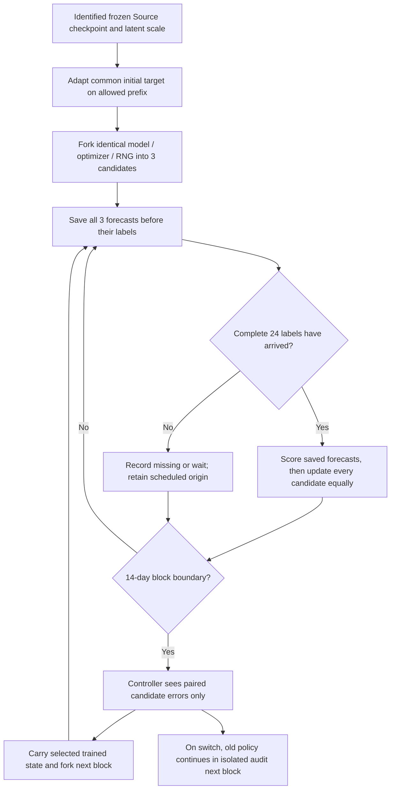

# Prequential runner — Issue #21

This independently authored implementation integrates the pending #19/#20 modules.
Report 1 §§5–8 and [the controller contract](CONTROLLER_CONTRACT.md) define the
method. The smoke config is an unvalidated Development example, not a Final lock.
No CLI path permits Final or Source entities as replay targets.

## One target, one budget, one seed



Each run is isolated to one dataset/city/entity/budget/seed and fixed energy scaler.
History budgets 7/14/28 constrain initial adaptation; they are not block lengths.
The frozen Source encoder and its 64-coordinate scale never change. Models use the
same normalized MAE + lambda * normalized latent retention loss as #19.

The supplied config initializes one target at lambda=0.01 for three prefix epochs,
then performs one online epoch on each newly arrived complete 24→24 example. No
replay buffer/window or extra historical resampling is introduced. This update
schedule is explicit, unvalidated and subject to Development selection. Every
candidate receives the same example, order, optimizer profile, epoch/step budget
and paired RNG state. Only lambda differs within a block.

## Event order and missing data

`ev_runner.engine.Runner` processes each declared-clock midnight in this order:

1. Poll previously issued days, oldest first. The label provider returns pending,
   incomplete, or a complete vector. No partial-day MAE or update is allowed.
2. Score complete vectors against immutable saved predictions, then update all three
   current candidates with that day's input and normalized labels. Log missing days
   and keep delayed days pending. Never invent a missing history/label as zero.
3. At a block boundary, pass only the block's arrived complete daily scores to #20.
   Decisions apply to the next forecast. Late labels from a previous block can update
   current branches when they arrive, but cannot rewrite the old decision or enter
   the new block's comparison population.
4. Carry the selected **trained** model/optimizer/RNG into all three new candidates.
   Keeping the active level also keeps its trained state, not the block-start state.
5. Fetch only the current origin's predictor-visible features, predict all candidates,
   and durably save them. If all history is missing, log a skipped origin, not an
   alternative forecast date. Scheduled clock advances even on missing days.

The predictor-visible records contain no future energy, target masks or answers.
`ev_runner.replay.Replay` verifies the accepted input artifacts, roles, scales and
schedule. Hashing label bytes checks provenance without forwarding values to a
predictor. Its delayed provider decodes only the requested target/day after the
scheduled horizon/delay bound, then enforces all actual hourly availability values.
Other label rows remain opaque lines. The adapter targets the authenticated #18
JSONL writer representation; alternate serialization requires a reviewed adapter.

The runner polls at midnight: a label arriving between midnights is used at the next
midnight. This is a declared conservative daily schedule, not proof of a physical
publisher arrival time. Preserve UrbanEV offset and CHARGED naive-local clock
limitations; there is no invented UTC alignment or upstream strict-online claim.

## Audit branch

After a switch, clone the trained former active branch with its old lambda and
continue it through the next block. Save its forecasts and update it on the same
arrived examples. It has separate model/optimizer/RNG state and separate cost/steps.
Its predictions/errors never enter controller inputs or candidate selection.

At the next boundary, report paired `new active MAE - old-policy audit MAE` on valid
shared days, with daily values and coverage. Positive values favor the old policy
retrospectively. This is not a causal judgment that the decision was wrong. A harmful
switch threshold/analysis rule must be selected and locked under #23; the runner does
not invent an official threshold. An audit still open at smoke end is incomplete;
do not present its partial coverage as a complete next-block analysis.

## Persistence and exact resume

Each target output is new, outside immutable data directories. `binding.json` binds
input manifest/run/target/budget/scale, Source checkpoint, fixed latent scale, config,
executed module hashes and runtime environment. Resume requires identical bindings.

`tick-NNNN/` contains durable `forecasts.json`, ordered `events.jsonl`, weights-only
`state.pt` and a SHA-256-linked `commit.json`. State contains candidates, optimizers,
Python/CPU/CUDA RNG, pending days, block scores, active level, audit and counters.
Every fork is checked for identical state hashes. Frozen Source is checked after
every tick. Nonfinite labels/updates fail rather than silently producing a checkpoint.

A tick stages in `.pending-NNNN` and commits by directory rename. Resume verifies
and copies all committed ticks to a **new** output directory, preserving old forecasts.
The supported resume point is a committed daily boundary. An interrupted pending tick
fails closed for inspection; this implementation does not automatically roll back or
rewrite forecasts issued during an uncommitted tick. It is not arbitrary mid-step
recovery. Same Python/Torch/device/code environment is required for exact reproduction.

## Commands and measured scope

```sh
python -m unittest discover -s tests -v
python -m tools.issue21_colab_smoke \
  --inputs-root /path/to/identified/input-snapshot \
  --source /path/to/source-seed42/final.pt \
  --source-sha256 28d61828a35be69b04f907df9128e7cf4743868060addd113cc61b60363e2905 \
  --output /path/to/new-unique-run
```

The real-data CLI requires CUDA; routine tests use small independent fixtures and
no datasets/network/GPU. The smoke cohort is declared before scores: UrbanEV target
1001, seed42, budgets7/14/28, 29 scheduled days, three lambda candidates, plus a 7-day
budget replay interrupted after ten ticks and resumed. It is not the full cohort,
all seeds, baseline suite, Development tuning or Final evaluation.

Instrumentation reports inference/update/controller time, GPU peak allocated/reserved
memory, all candidate steps and separate audit steps/time. The matrix records measured
seconds per target-day and a transparent illustrative capacity projection.
The current stage timer starts after Replay construction: it includes Source load,
initial adaptation and tick/checkpoint I/O, but excludes input validation/loading,
Python process startup, unit checks and packaging. Do not call it full wall time. An official
full-matrix cost remains conditional on #22/#23's method/cohort/seed/ablation grid and
separate baseline/source/tuning measurements; the smoke projection is not that lock.

See the [actual handoff report](../reports/issue21-qyroven.md) for execution evidence,
checks, artifact hashes and outstanding acceptance. Pending dependency PRs must be
reviewed/integrated before the runner PR; no independent CI result authorizes a merge.
