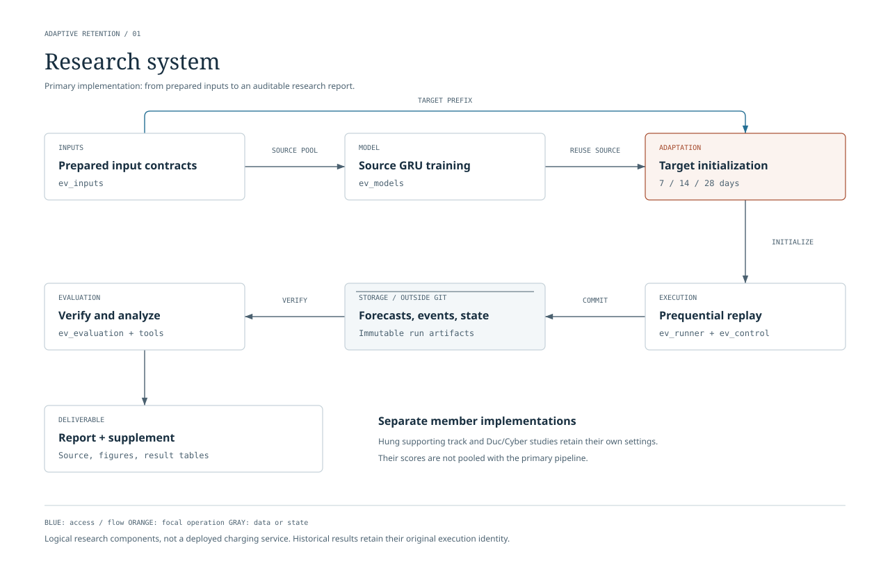
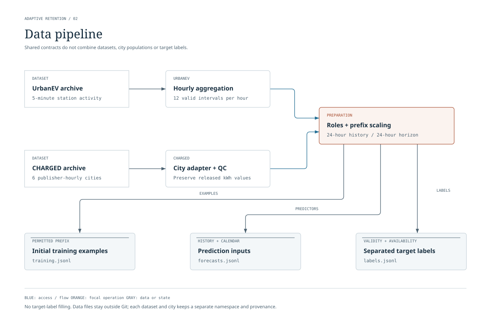
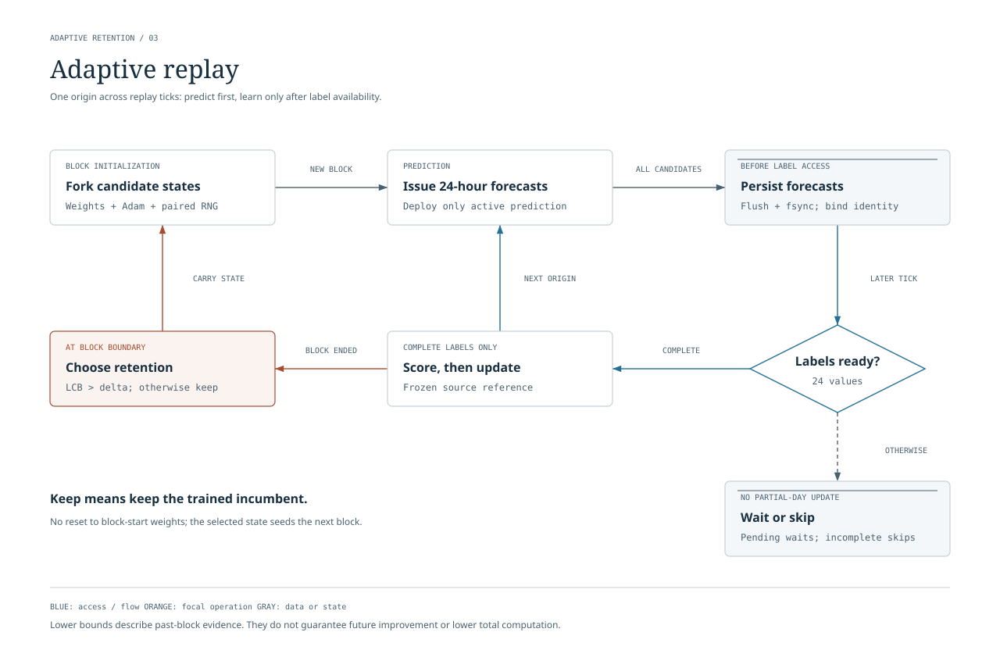

# System diagrams

These three views explain the integrated primary research implementation. They are
logical diagrams, not live execution traces, a deployment claim or evidence that
Adaptive outperforms Fixed. All source references pin commit
`8d3746d940d9757d63efbaf4f90373b46bc22b8c`; see [sources.json](sources.json).
The report's historical results retain their original frozen execution identity.

## 1. Research system

[Editable HTML](system.html) · [Vector SVG](system.svg)

Prepared source examples train the Source GRU; target-prefix examples initialize a
separate target. Replay writes forecasts, events and state for verification and
analysis. The report summarizes previously accepted evidence; the diagram is not
an executable report-generation command. Hùng's supporting track and Đức/Cyber
studies retain different method and validation identities.

## 2. Data pipeline

[Editable HTML](data-pipeline.html) · [Vector SVG](data-pipeline.svg)

UrbanEV's 5-minute records are aggregated under the complete-hour QC gate. CHARGED
already contains publisher-hourly data, adapted separately for each city. The
preparation box is a shared contract, not a pooled source/target training set.
Training examples, predictors and target labels are different files. Labels remain
subject to validity and availability gates; no missing target value is filled.

## 3. Adaptive replay

[Editable HTML](adaptive-loop.html) · [Vector SVG](adaptive-loop.svg)

This view follows one forecast origin across replay ticks. In the actual tick,
previously issued labels are handled first, then a due boundary, then the current
forecast is issued and saved. Pending or incomplete labels for an older origin do
not stop the whole replay clock. Only complete available label vectors supply
scores and updates. Boundary choice uses paired past-block evidence; insufficient
valid days or no qualifying challenger keeps the incumbent trained state. The
selected weights, optimizer and RNG state seed the next block's candidates.

Fixed and other comparisons have different policies. The primary Final path also
checks an immutable authorization/config/source/runtime lock before execution
(`ev_runner/run.py`, lines 87–100); this overview does not bypass that gate or
request a new run. No future accuracy or compute guarantee follows from selection.

## Design and verification

Design guidance: [cathrynlavery/diagram-design](https://github.com/cathrynlavery/diagram-design),
read at commit `0cf73c3fcc56667ad91a9a04c439ac6ccfabc9d1` (MIT). The figures are
original source-derived compositions, not copies of its example diagrams. The
local project skin uses the report's blue/orange family, white paper and system
font fallbacks. No external fonts, scripts, telemetry or image resources load.
Names use sans-serif, technical labels monospace and headings serif. Fonts may
look slightly different across operating systems; this is not an exact Geist or
Instrument Serif rendering claim.

All three HTML files passed the skill's offline `self_check.py` and repository
`verify-geometry.py`. SVG exports passed XML parsing and were visually inspected
using macOS Quick Look previews inside Codex. No Chrome or browser automation was
used for these final figures. The draft Archify experiment was superseded and is
not part of this package. Browser layout/DOM checks were not performed.

The editable HTML embeds each SVG directly. Standalone SVG is the maintained
GitHub display format and scales without raster pixelation. Preview PNGs are local
review artifacts outside Git. These documentation changes do not alter model,
controller, data, report assets or numerical results.
