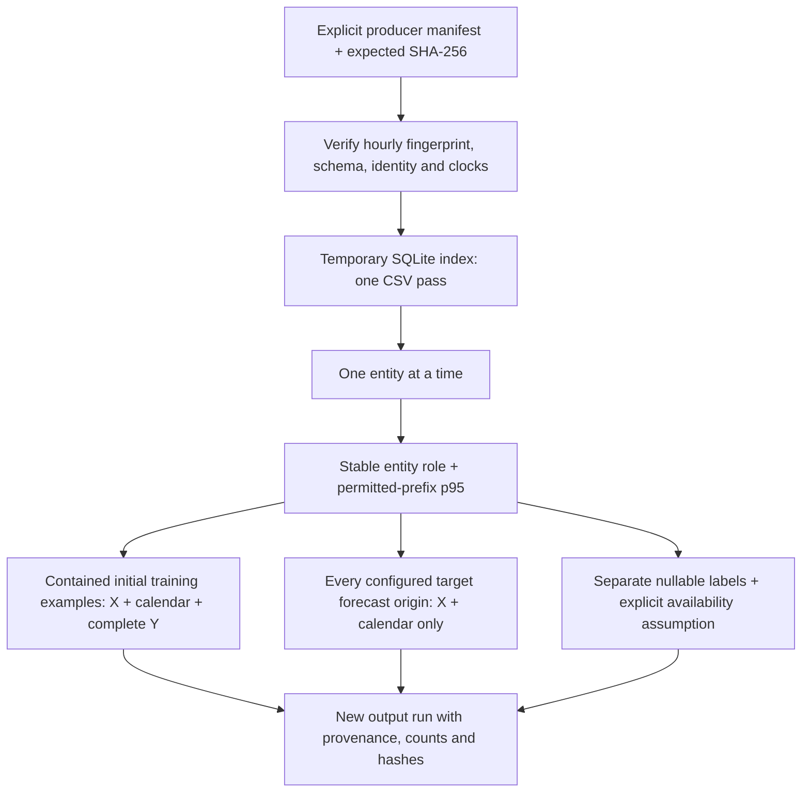

# Issue #18 — integrated loader, development validation

## Status and scope

User-authorized loader implementation integrates the proposed feature, split/scaler and window helpers with hourly CSV/manifest IO. Acceptance is **development validation only**. Official input/cohort acceptance, real-data sample counts, model effectiveness and #18 completion remain pending. Report 1 §7 is unchanged.

Branch starts from `dev` commit `62c7e2aa3dfe89014d22dd7813cd8f5ea32b512e`. Pinned prerequisites included in this PR:

| Component | Original implementation |
| --- | --- |
| PR #30 contract | `c406ae07606ca48859cf93f8b24dfffab79c7803`, contract SHA-256 `b10178d106713670e7ba7f884dd640559ce1788b3c792447843300457df63adf` |
| PR #31 features/tests | `9aa65bf2f0049bd6f79e7a41fe263caec9de512f` |
| PR #32 split/scaler/tests | `e3ee687` core files only |
| PR #33 windows/tests | `f741340` core files only |

Core prerequisite bytes are reused unchanged, not rewritten or silently accepted/merged. These files appear in the diff while their PRs are unmerged; reconcile later reviewed revisions explicitly. Unlike earlier isolated tests, this slice tests feature → split/scaler → windows together through CSV IO. It uses **independently authored producer-format fixtures**, not executions of #16/#17 producer pipelines or real releases.

Producer layouts inspected: PR #25 `24438a5`, PR #29 `afae635`. Loader recognizes UrbanEV technical QC status/Asia-Shanghai profile and CHARGED technical-success/local-naive profile. This is format compatibility evidence only; it is not full producer-to-model integration evidence.

## 1. What the loader does



- `ev_inputs/hourly_reader.py`: known manifest/profile reader, fingerprint checks and temporary disk index. UrbanEV CSV is entity-major; CHARGED is time-major. Both are read once for parsing, plus bounded-block integrity hash passes. No full-city Python list is created; one entity's hourly series is held in memory. The temporary SQLite file is removed after closing, including failure cleanup. This is a standard-library file index, not an external service.
- `ev_inputs/loader.py`: validates explicit config, assigns roles, enforces source/target prefix bounds, fits per-entity scales, builds initial examples and every scheduled development/final forecast, and writes separate artifacts. Source entities supply pretraining examples only. No cross-city or cross-dataset pretraining pool is constructed.
- `tools/model_inputs.py`: minimal CLI; exits 0 only for technical success, 1 for failed/incomplete runs.
- `iter_forecasts`: streams predictor-only records from an identified successful development run. It verifies manifest/artifact hashes and refuses unexpected record fields; it does not open labels. The model consumer selects `x_hist` and `c_future`. Tensor batching belongs to the model consumer; no NumPy/PyTorch dependency is added here.

### Sample ownership, shared source training and separate target adaptation

**Every 24-to-24 sample belongs to exactly one entity.** Its 24 historical bins and 24 target bins use the same `(dataset_id, city_id, entity_id)`. For example, station A's June 30 history pairs with station A's July 1 labels. Never pair A's history with B's labels, concatenate bins from different entities into one window, or sum station energies into a shared target series.

For the subsequent #19 trainer, one shared source model learns from samples of multiple **source-role** entities within the selected dataset/city experiment. A minibatch may contain separate samples from A, B and C; each sample retains its own history/labels and identified per-entity scale. Shared parameter learning does not merge their physical time series. Cross-city/cross-dataset pooling is not introduced.

Each development/final target then starts from the same selected source initialization and adapts separately using its own exact 7/14/28-day initial prefix, followed by its own permitted online stream. Target D's learned adaptation state or history must not initialize target E or enlarge E's history budget. The frozen source reference remains shared/frozen under Report 1; target states and their scaler identities remain separate. Development targets select settings; final targets evaluate the locked procedure.

**`training.jsonl` contains role-tagged examples for different training stages, not one undifferentiated pretraining pool.** The #19 trainer must select source-role records for source pretraining and the matching target identity for target initialization/adaptation. In the fixture's 41 examples, 29 belong to source pretraining, six belong to the development target and six to the final target. Do not pretrain on all 41 together. This fixture has only one source entity, so it does not demonstrate learning from multiple source stations.

The loader constructs and identifies these records; source model training, minibatch assembly, checkpoint copying and independent target optimization are future #19 responsibilities, not implemented behavior or effectiveness evidence in this PR.

## 2. Explicit config

Each invocation handles one dataset/city and one target history budget. Example values below are illustrative; they do not select the official salt, producer run or arrival policy:

```json
{
  "producer_manifest": "../processed/charged/example-run/manifest.json",
  "producer_manifest_sha256": "<exact 64-character SHA-256 of that manifest>",
  "dataset_id": "charged",
  "city_id": "AMS",
  "deployment": "2023-07-01T00:00:00",
  "replay_stop": "2023-10-01T00:00:00",
  "source_start": "2023-04-01T00:00:00",
  "history_days": 7,
  "split_salt": "<predeclared reviewed salt>",
  "availability_delay_hours": 0
}
```

Paths in CLI config are resolved relative to the config file. Bounds must be local midnights within the declared producer window. UrbanEV requires explicit `+08:00` config timestamps; CHARGED requires naive timestamps. Source fitting/training uses `[source_start, deployment)`; each target uses its exact `[deployment-budget, deployment)` prefix. Calendar/order/schema are pinned to the contract. Unknown fields, implicit delay defaults and mixed/contradictory clocks fail.

Optional `entity_ids` is an explicit list of preserved string IDs for a development fixture/subset run. Its selection is recorded; unknown or duplicate IDs fail. It must not be chosen using final outcomes or future completeness. Omitting it processes the declared hourly inventory. This is ID separation, not certification of physical location separation. No co-location grouping or new eligibility threshold is introduced.

```sh
python -m tools.model_inputs --config /path/to/config.json --output data/inputs/new-unique-run-id
```

The destination must not exist and must be separate from producer/raw storage. Input bytes are read only. Large CSV/JSONL runs stay in ignored local storage.

## 3. Output files and model boundary

| File | Contents | Intended consumer |
| --- | --- | --- |
| `forecasts.jsonl` | One target origin per line: X_hist[24,7], C_future[24,5], role/identity/clock and identified scale/run | Prediction path; no future Y/validity/availability fields |
| `labels.jsonl` | Matching identity/origin, 24 nullable original-unit Y, validity and availability | Evaluation/update path after the availability gate |
| `training.jsonl` | Complete contained initial examples, including Y_kwh and Y_scaled | Trainer, within source or exact target prefix only |
| `entities.jsonl` | Role, budget/bounds, fitted scale/fingerprint/fallback, candidate/trainable/skip counts and unresolved entity failures | Audit/handoff |
| `manifest.json` | Config + config hash, source manifest/hourly identities, upstream limitations, policies, code/source hashes, runtime, status/counts and artifact hashes | Reconstruction and acceptance review |

For a target deploying July 1 with seven days, initial candidates are June 24 history → June 25 Y through June 29 history → June 30 Y. Its first deployment input is June 30 history plus July 1 calendar. July 1 Y is exported separately, never fed into that predictor input. Later replay history grows naturally with time; the initial scaler stays frozen. Initial training uses the full permitted-prefix scaler fitted by the initialization cutoff, not a fresh scaler per old sample origin.

The forecast schedule depends only on configured dates. Missing future labels remain in `labels.jsonl` as null; they do not remove an already scheduled forecast. Historical missing/unavailable energy becomes placeholder 0 with mask 0, while genuine zero retains mask 1. All-missing replay history remains representable and is counted. Saved label availability is metadata under a declared convention, not permission to use it early; `ready_labels` from #33 remains the scoring/update gate.

`iter_forecasts` usage:

```python
from pathlib import Path
from ev_inputs.loader import iter_forecasts

for record in iter_forecasts(
    Path("data/inputs/new-unique-run-id"), expected_manifest_sha256="<recorded manifest SHA-256>"
):
    x_hist = record["x_hist"]  # [24, 7]
    c_future = record["c_future"]  # [24, 5]
    # The future #19 model receives these two arrays, not labels.jsonl.
```

This is a development artifact API (`ev-loader-run-v1`), not a stable production/checkpoint API. No forecast prediction, model training, batch shuffling, controller update, forecast persistence ordering or runner event logging is implemented.

## 4. Missing data and failure behavior

- Label-missing or late initial candidates are counted separately; no partial Y/filling is used. Valid zeros remain trainable.
- Empty valid/available scaler population is recorded per entity as `undefined_scale`. It is not treated as a zero prefix or silently excluded. The overall run becomes `incomplete_undefined_scales`, CLI exits 1 and the predictor reader refuses it. Partial files remain diagnostic artifacts, not an accepted cohort. Fixing the policy requires review, not editing the failure away.
- Zero-p95 fallback remains the proposed 1 kWh rule from #32, recorded with its name. Sparse positive spikes can remain large after scaling. No development tuning or acceptance of this rule is claimed here.
- Wrong identity/profile, failed producer status, fingerprint mismatch, nonfinite/negative valid energy, contradictory mask/counts, malformed CSV, gaps/duplicates/order errors or mismatched inventory fail. Structural holes are not silently filled or sorted.
- Failures after run creation leave `status=failed` and an error in the new manifest. Bad config/source identification can fail before creation. Existing runs are never overwritten.

A shared source file is checked before and after staging. Source archive hashes in the producer manifest are retained as upstream lineage; **this loader does not freshly verify raw archives**. Manifest hashing binds file identities, not scientific validity or authentic arrival times.

## 5. Verification and limitations

The committed evidence JSON records an actual offline suite run and one retained AMS-format fixture demo. Fixture inventory: three named entities, 768 nominal hourly bins each, constant 20 kWh; selected salt is **fixture-only-v1**, not a production choice. Under the fixed fixture identities, roles are one source, one development and one final. Source gives 29 initial samples; each seven-day target gives six. Total: **41 initial trainable examples and four target forecasts over two replay days**. These are fixture counts only.

New tests exercise both CSV orderings, all six CHARGED profile identifiers, constant-offset UrbanEV, prefix budgets, future suffix mutation, delayed labels, zero/fallback, undefined scales, source/target separation, unchanged input files, fingerprint/profile/path failures, structural gap failure evidence, no overwrites, separate-label reader and CLI exit behavior. They integrate unchanged core helpers; isolated tests remain included.

The first Windows CI run caught platform-dependent separators in executed-source provenance keys. The implementation now serializes repository-relative keys with `/` on every OS; the existing integration assertion is retained. The original fixture demo/evidence remains historical, and a separate post-fix validation record identifies the correction.

Run all README checks with Python 3.12. No raw downloads, real-data loader run, long training, full-scale memory/performance test or official sample-count audit is included. SQLite disk usage/runtime at full release scale is not yet measured. Tests establish behavior under fixture assumptions, not strict-online readiness or model effectiveness.

Before official acceptance: reconcile peer-reviewed #16/#17/#30–#33 revisions, decide salt/co-location handling and p95 fallback on development, explicitly approve clock/arrival assumptions, run reviewed real inputs and report actual counts/failures per city/budget. Keep UrbanEV primary, CHARGED supplementary, SZH separate. Do not tune using Final, close #18 or claim official #19 handoff yet.
