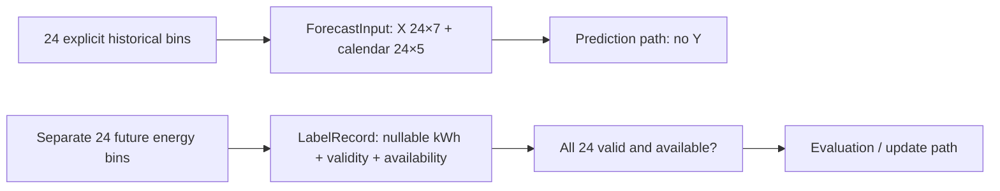

# Issue #18 — fixture-only 24-to-24 windows and delayed labels

## Status and authority

Implements the next user-authorized #18 slice: daily windows, predictor/label separation and contained initial-training gates, using independent fixtures only. Report 1 §7 remains the method reference. This is reviewable helper implementation, not an accepted input run, complete loader, runner or completed #18.

Contract pin: [INPUT_CONTRACT.md at c406ae07606ca48859cf93f8b24dfffab79c7803](https://github.com/HungLD9505/adaptive-retention-ev/blob/c406ae07606ca48859cf93f8b24dfffab79c7803/docs/data/INPUT_CONTRACT.md), SHA-256 `b10178d106713670e7ba7f884dd640559ce1788b3c792447843300457df63adf`.

The branch starts from `dev` at `62c7e2aa3dfe89014d22dd7813cd8f5ea32b512e` and explicitly cherry-picks **only the reusable feature implementation/tests** from PR #31 commit `9aa65bf2f0049bd6f79e7a41fe263caec9de512f`. Feature files are unchanged. This dependency is included in the PR diff until integrated on dev; it is not a second feature implementation or an approval/merge of #31. PR #32 split/scaler code and hourly producer code are not included. Reconcile changed dependencies after review and test the combined branch before official use.

## 1. What one sample contains

Illustrative nominal local origin: **2023-07-01 00:00**.

| Component | Bins | Representation |
| --- | --- | --- |
| History | June 30, 00:00 through 23:00 | `x_hist`: 24 rows × 7 ordered features |
| Known future calendar | July 1, 00:00 through 23:00 | `c_future`: 24 rows × 5 calendar features |
| Future energy | Same July 1 bins | Separate `LabelRecord`; no energy/validity/availability of future Y in predictor input |



The module uses immutable standard-library dataclasses and tuples. Numerical model features/Y_scaled hold float32 values; original-unit Y is retained as Python floats. There is no NumPy/Torch tensor batching, persistence or training in this slice. The later loader must produce the agreed batch arrays without changing order.

## 2. Small API and failure rules

| Function | Responsibility |
| --- | --- |
| `scheduled_origins(start, stop, clock_mode=...)` | Produce every daily origin in configured `[start, stop)` without reading labels |
| `initial_training_origins(prefix_start, cutoff, clock_mode=...)` | Produce daily candidate origins whose 24 history + 24 future bins fit the prefix |
| `build_forecast_input(history, ...)` | Encode precisely 24 historical bins plus future calendar; accepts no future-data argument |
| `build_label_record(future, ...)` | Build a separate nullable original-unit label record |
| `ready_labels(record, as_of=...)` | Return all 24 kWh values only after the complete-label availability gate; otherwise `None` |
| `build_initial_training_example(forecast, labels, prefix_start=..., cutoff=...)` | Enforce matching identity/origin/clock/bins, full prefix containment and the label gate; scale Y using the forecast's same identified scale |

Rows carry `(dataset_id, city_id, entity_id)` strings, timestamp, energy, `file_valid` and explicit `available_at`. IDs with leading zeros are preserved. Foreign-entity rows fail. Exactly 24 consecutive bins in chronological order are required: no silent sorting, duplication repair or invented timestamp rows. A missing energy value must arrive as an explicit invalid producer bin. Structural gaps fail back to the input loader/producer boundary.

A genuine historical zero has energy feature 0 and mask 1. Invalid, unknown-availability or not-yet-available history has placeholder 0 and mask 0, with calendar still defined. An all-missing history remains representable; no future-label-based exclusion is introduced. A contradictory valid/available malformed value fails instead of being repaired.

Invalid Y stays `None` in `LabelRecord`, even if its source row contains a number. Valid zero Y is preserved. The label gate rechecks 24 aligned bins, clock, identity, flags and numeric validity, then requires **every label valid and available by `as_of`**, no earlier than the end of the complete horizon. One missing or delayed label blocks the whole day. No partial target loss, target filling or retroactive forecast-date removal is implemented.

For example: 23 labels are available by July 2 00:00, but one arrives at 02:00. At 00:00, `ready_labels` returns `None`; at 02:00 it can return all 24 if every value is valid. The eventual runner must decide/log its update schedule; this helper does not move an update earlier or replace a saved forecast.

## 3. Prefix boundaries and scaling

Initial supervised samples require history and target entirely inside `[prefix_start, cutoff)`, and all labels available by cutoff. The end of a bin equal to cutoff is allowed; a bin starting at cutoff is outside the prefix. No model training or scoring is performed by these helpers.

With a complete nominal daily grid, 7/14/28 days contain **6/13/27 candidate daily samples**, respectively: the first day supplies history and the final origin is one day before cutoff. These are fixture/structural counts, not real eligible sample counts. Missing/late Y can reduce usable training examples; it must not pre-filter the scheduled future replay origins.

For the earliest contained sample in a seven-day prefix ending July 1, history is June 24 and Y is June 25. The final contained sample uses June 29 history and June 30 Y. The first deployment forecast then uses June 30 history and July 1 future calendar. No initial training sample includes July 1 energy.

The forecast builder requires a positive supplied scale, scale ID and input-run ID. It fits no scaler and does not select a fallback. Initial Y uses that exact scale; no clipping, same normalization for X/Y and both retention encoders. Original-unit recovery is multiplication by scale. Invalid/nonfinite scaled labels fail.

The caller/loader must enforce actual entity ownership/provenance, source role/pre-deployment bounds, exact target-budget bounds, and that the supplied scale was fitted only on permitted data. Arbitrary strings passed as IDs do not certify that provenance. PR #32 proposals about hash allocation, co-location and zero-p95 fallback remain pending review; this slice does not resolve or change them.

## 4. Clock and availability assumptions

Daily origin/start/stop labels are local midnight. UrbanEV fixture support is offset-aware local time with constant offset across the window; CHARGED is offset-free publisher-local nominal time. No UTC conversion, zone attachment or DST fold/gap inference occurs. Offset changes within a schedule/window fail; timezone/profile validation still belongs to producer integration. The 24 bins are not a claim of 24 elapsed physical hours across DST in a naive release.

`available_at` is explicit caller input. Unknown availability is `None` and blocks using that value. A supplied availability earlier than its bin end fails. Availability checks accept sub-hour arrival times but require the same naive/fixed-offset clock as the sample. The conventional bin-end availability, if selected for a real replay, remains a declared assumption, not evidence of actual data arrival. File presence and fixture tests do not establish strict-online readiness or undo publisher preprocessing.

## 5. Verification and evidence

Run the README checks on Python 3.12:

```sh
python -m tools.sources list
python -m unittest discover -s tests -v
python -m ruff check .
python -m ruff format --check .
git diff --check
```

The accompanying `input-windows-evidence.json` records the actual fixture run, config/input identity, code revision, hashes, runtime and test results. Tests cover literal shapes/order and calendar values, zero/missing/unknown/delayed history, no future fields/argument in predictor input, schedule independence from future completeness, complete-label timing, nullable Y, malformed label records, zero-Y training, inverse units, initial-prefix containment/counts, entity/clock/bin failures and nonfinite scaled labels. New window tests run with the pinned feature tests, not split/scaler/producer integration.

Raw archives were not read or freshly verified. Catalog listing is metadata-only. No official artifacts, real eligible sample counts, benchmark results or research effectiveness are claimed. Git stores only code, fixtures and small handoff evidence.

## 6. Handoff / remaining #18 work

Keep #18 open and earlier PRs available for peer review. No merge is authorized. Next work is the integrated loader: reconcile reviewed contracts/features/split/scaler/windows and producer profiles; enforce lineage and role/budget/availability constraints; create new identified outputs; report actual eligibility/failure counts per dataset/city/budget. The replay runner still needs forecast persistence before labels, skipped-event logging and update scheduling. Do not mark #18 complete or hand off official inputs to #19 before integrated acceptance. Preserve UrbanEV primary and all six CHARGED supplementary cities, with SZH analyzed separately and upstream limitations explicit.
