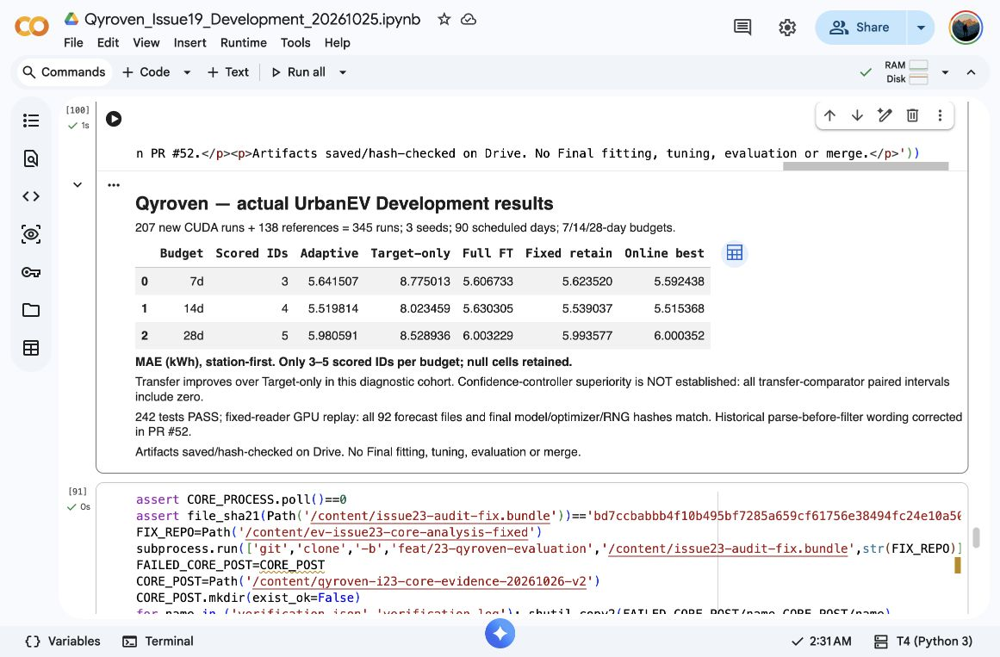

# Issue #23 — core-transfer comparator extension

## Pre-execution declaration, 2026-10-26

Add Full Fine-tuning (lambda 0), Fixed Retention (lambda 0.01), and Online Best-lambda
to the identified 138-run UrbanEV readiness experiment. This adds 207 runs, not 207
independent station samples. Keep all 23 entity-budget combinations, seeds 42/43/44,
90 scheduled days, missing/null units and identified Source weights. No selection
based on the newly observed comparator outcomes. Diagnostic settings remain
unchanged; this is not completed tuning, a full baseline matrix or a Final lock.

Reference matrix SHA-256:
`f94f4ed5eab3f9a3b47259aacff3c200668ba7ffe30f5249957575d3ce0d6b29`.
Cohort SHA-256:
`6884857291b79b35f83cc7d78b6fc7a2b5fe0283ebe85c0321a5eb1a5ee283f0`.
Source-pool matrix SHA-256:
`a1a8ec96074402564671e952c184e499eb4e30aa8f9e7b10a4e0cfe0a5e7566e`.

`tools.development_comparators` inherits each paired reference run's exact config,
changing only the method definition. It rejects changed algorithm-module hashes,
input/Source/cohort identities, mismatched paired configs and missing/duplicate
reference cells. The original Adaptive and Target-only runs remain immutable and
are reused as references, not rerun for more favorable results. New outputs use
the declared latest-state persistence mode; per-run logs, failures, metrics, bound
configs, code identity and daily forecast/event/state chains are retained.

The comparison can assess the diagnostic transfer/retention/confidence differences
under these settings, with the same daily score population. It cannot establish
optimal fixed retention, calibrated proxies, population superiority, or a matched
winner against Hung's different topology/configuration. Core comparison metrics
must keep source-only initialization and zero-score strata explicit.

Execution status: completed on Colab CUDA under runtime code `c210d32`; original
pre-execution declaration is retained above. No local real-data training, Final
fitting/tuning/evaluation, merge or issue closure was performed. Historical decoder
scope is corrected explicitly below.
The post-hoc analysis checks identical issued/scored populations, records all five
methods and all null cells, produces station-first original-unit MAE/RMSE/gain/NTR,
paired station/calendar-block intervals, weekday/weekend summaries, continuous
history coverage, switching reasons and descriptive isolated-audit gaps. Analysis
is independent of controller decisions; it cannot modify predictions or select a
Final configuration. No sparse/dense or harmful-switch threshold is invented.

Memory accounting limit: these readiness/core drivers do not reset CUDA peak
counters between cells. Saved peak values are process high-water observations, not
isolated per-method memory benchmarks. Do not rank methods by them. A separate
reset/isolation measurement is still needed for the final cost comparison.

See the [input-reader boundary correction](input-reader-boundary.md) for precise
historical decoding scope and the subsequent role/entity-before-deserialization fix.

## Actual results and interpretation

Executed 2026-10-26, new run root `qyroven-i23-core-comparators-20261026-v1`.
207/207 new runs completed: 69 paired units across three comparators, joined to 138
immutable Adaptive/Target-only reference runs. There are 20 unique entity IDs in 23
entity-budget combinations; seeds are repeated measurements, not independent sites.
99/207 new runs and165/345 combined runs have no valid score. All 33/69 null paired
units are retained, including zero-initial-training and no-complete-label strata.

Diagnostic settings; three seeds; 90 scheduled days. No Final or tuned-winner claim.

| Budget | Scored stations | Adaptive | Target-only | Full Fine-tuning | Fixed Retention | Online Best-lambda |
|---|---:|---:|---:|---:|---:|---:|
| 7d | 3 | 5.641507 | 8.775013 | 5.606733 | 5.623520 | 5.592438 |
| 14d | 4 | 5.519814 | 8.023459 | 5.630305 | 5.539037 | 5.515368 |
| 28d | 5 | 5.980591 | 8.528936 | 6.003229 | 5.993577 | 6.000352 |

MAE in kWh, equal station weight after paired seed averages. Budget cohorts differ.

| Budget | Adaptive minus comparator | Gap kWh | Exploratory95% interval |
|---|---|---:|---|
| 14d | target_only | -2.503644 | [-3.834427, -1.257010] |
| 14d | full_finetuning | -0.110491 | [-0.263574, 0.013493] |
| 14d | fixed_retention | -0.019222 | [-0.127474, 0.076798] |
| 14d | online_best | 0.004447 | [-0.155098, 0.179764] |
| 28d | target_only | -2.548345 | [-3.889285, -1.463655] |
| 28d | full_finetuning | -0.022638 | [-0.144778, 0.104309] |
| 28d | fixed_retention | -0.012986 | [-0.056178, 0.021676] |
| 28d | online_best | -0.019761 | [-0.089345, 0.040607] |
| 7d | target_only | -3.133506 | [-6.660315, -0.742957] |
| 7d | full_finetuning | 0.034774 | [-0.094679, 0.165219] |
| 7d | fixed_retention | 0.017987 | [-0.105461, 0.128591] |
| 7d | online_best | 0.049069 | [-0.094132, 0.249338] |

Negative gaps favor Adaptive. These are marginal, selected-cohort bootstrap intervals, conditional on fixed seeds. No population or causal guarantee.

Adaptive improves on Target-only in this selected diagnostic cohort. It is worse
than all three transfer comparators at 7d; at 14d it is close to Online Best-lambda
and slightly worse; at 28d its advantage is small. **Confidence-controller superiority
is not established.** Every paired interval against a transfer comparator includes
zero. No seed/config/threshold was changed after seeing these results.

Intervals use paired station resampling and shared circular calendar blocks of
seven days over the 90-day schedule,2000 replicates, seed20261026. The same sampled
calendar blocks apply across stations; three fixed seeds are averaged inside the
station unit. These are exploratory marginal intervals, not multiplicity-corrected
population guarantees. Only 3/4/5 scored IDs per budget, nonrandom selection, possible
physical co-location, circular seam/nonstationarity and differing budget cohorts
limit inference. Source weights remain the earlier one-epoch diagnostic checkpoints;
this is neither converged Source selection nor a locked/tuned final experiment.

## Integrity, provenance and retained failures

- Training code: `c210d32b30ea4560183732694608cd04e6d0ab34`.
- Successful analysis code: `a392505e504b3d2e575b28581bfbe25eb5c4418d`.
- Full archive: 229,805,070 bytes, SHA-256
  `eaa476986cd751e5051d59fcea296397095ba51335902a8299b5bfa99262d247`.
- [Drive archive](https://drive.google.com/file/d/1MX5JStd3DLDdlCeG8oCCi-eJxhBXRvSi/view),
  [catalog and all individual links/hashes](issue23-core-artifacts.json),
  [summary](issue23-core-summary.json), [345 run rows](issue23-core-runs.csv).
- New verifier physically hashed 38,295 daily files. 18,837 historical state files
  are intentionally omitted under the declared latest-state policy. Complete latest
  model/optimizer/RNG/pending/audit state and all forecast/event/commit chains remain.
- Full downloaded ZIP passed CRC and hash checks; all 207 final branch states were
  CPU-loaded and content-rehashed, three Source checkpoints loaded.38,676 copied
  reference trace files match the earlier archive. Reference full checkpoints remain
  in the earlier complete readiness archive linked from the catalog.
- 69 Adaptive/Online Best-lambda pairs have byte-identical forecast files for all 966
  scheduled ticks before the first controller decision (900 issued days). This
  verifies paired initial behavior, not identical outcomes after policy selection.
- Local read-only verifier and five-method analysis match Colab outputs byte-for-byte;
  [download verification](issue23-core-download-verification.json) records scope.
- The first analysis failed on a legitimate null audit mean when there were zero
  audit pairs. The parser now preserves null rather than filling zero; regression
  tests cover null, real zero, negative and invalid gaps. Failed status/logs and the
  first analysis code are retained in `failed-analysis/`. Training was not rerun.

Historical analysis deliberately authenticates algorithm-module hashes. Reproduce
with archived analysis code `a392505` and the included code bundle. A newer reader
implementation must not bypass that guard or relabel historical outputs.

## Cost, switching and context

Actual new-matrix wall time: 1167.112s; sum of 207 run elapsed counters: 1017.937s.
These include pipeline effects and are not isolated throughput rankings.

| Method | Initial steps | Online candidate steps | Audit steps | Switches | Sum run elapsed (s) |
|---|---:|---:|---:|---:|---:|
| Adaptive | 126 | 6966 | 372 | 36 | 587.857 |
| Target-only | 126 | 2322 | 0 | 0 | 199.218 |
| Full Fine-tuning | 126 | 2322 | 0 | 0 | 394.448 |
| Fixed Retention | 126 | 2322 | 0 | 0 | 215.472 |
| Online Best-lambda | 126 | 6966 | 1012 | 94 | 408.017 |

Each row sums 69 runs; Adaptive/Target-only costs come from the earlier reference.
The first consumer pays shared JSON decoding/validation/cache setup; later methods
benefit from warm caches. CUDA peak counters were not reset between cells, so saved
peaks are process high-water observations, not isolated per-method memory figures.
Do not rank methods by those peaks or elapsed totals.

Adaptive reasons: 132 no-qualifying-challenger, 246 insufficient-evidence, 36 switches.
Online Best-lambda: 168 lowest-mean selections, 246 insufficient-evidence, 94 switches.
120 isolated audit summaries include 20 zero-pair/null means. They describe post-switch
branches on available labels; no harmful-switch threshold or recovery-time metric
is invented. NTR against Target-only is 0/3,0/4,0/5 scored IDs by budget. Detailed
weekday/weekend, continuous valid-history fractions, errors/coverage and audit gaps
are preserved in the JSON; no post-hoc sparse/dense exclusion was introduced.

## Reader correction and next acceptance gates

The old shared consumer decoded discarded arrays before filtering. This was not
Final fitting/tuning/evaluation, but earlier stronger no-Final-decoding wording was
incorrect and is withdrawn. [Boundary correction](input-reader-boundary.md) records
the issue, new header-before-body reader, independent tests and consumed-record
parity. Historical artifacts keep their original code identity.

Pending: independent review; Source convergence and comparable finite Development
tuning; proxy calibration; full required baseline/ablation multi-seed replication;
feasible compute/storage matrix; isolated cost measurement; independent immutable
configuration lock. No #23 completion, merge or Final execution is claimed.

Latest implementation verification: 242 fixture tests PASS locally and on Colab;
Ruff lint/format PASS locally. Reader-fix commit `7576124` passed Ubuntu/Windows
CI [run40226017319](https://github.com/HungLD9505/adaptive-retention-ev/actions/runs/40226017319).
The separate real GPU reader parity replay matched predictions, states and scores;
see the boundary-correction report for full evidence. Subsequent evidence-only
commits require their own CI status and do not change executed code identities.
