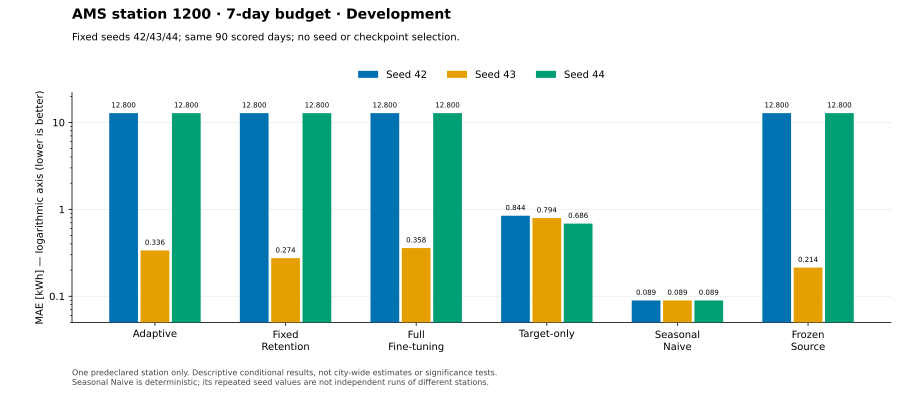

# Issue 23 — completed-run backup and recovery

The [Colab template](../../notebooks/issue23_durable_city.ipynb) defaults to a
Source-only storage probe using original JHB checkpoints and an exact hash-pinned
d5f6157 code bundle (including the canonical-JSON backup fix). It does not train in probe mode. Explicit new, resume and
read-only rescue modes use accepted city inputs and unchanged primary selection;
training modes require CUDA. Keep the same authorized account.

The interactive-runtime incidents exposed a storage gap: complete notebook metrics
are not complete forecasts/events/checkpoint delivery. This change adds optional
mounted-Drive publication to the separate-city execution CLI. It does not modify
model, controller, runner, loss, candidate, cohort, seed or evaluation code.
Existing running9057364 jobs are not patched or restarted by this change.

## Publication and recovery contract

`--backup-root` and `--drive-mount` must be supplied together. An ordinary local
directory is refused as a claimed Drive mount. Use a unique backup directory and
a new local output directory; keep every previous run/archive unchanged.

Each completed Source publishes its selected epoch checkpoint, checksum sidecar,
training record, completion record and stdout. Each completed target publishes its
issued forecasts, events, daily commit chain, latest model/optimizer/RNG state,
report and stdout. Existing independent Development-only daily/state verifiers
must pass before publication. A null-metric run remains a completed artifact.
CPU Source verification preserves Torch RNG; it performs no fitting or inference.

One ZIP is copied per completed run. Size, SHA-256 and ZIP CRC are read back from
mounted storage before its receipt is committed. A failed copy stops execution
before starting another target. Pending/orphan/corrupt files are preserved and
refused on automatic resume; they require inspection, never silent replacement.
This is mounted-filesystem verification, not proof of Google server-side sync.
Independent cloud/anonymous download checks remain a handoff requirement.

`--resume-backup` restores verified completed Sources/targets into a NEW output
directory and skips them. Context binds the accepted manifests/scalers, Source
population/config, complete expected execution, primary selection, core file
fingerprints and runtime environment. A changed context or non-prefix selection
is refused. Completed Sources keep their original weights/identity; no favorable
seed/checkpoint/config reselection is introduced. A still-active or inaccessible
job must be inspected before dispatching a replacement.

The granularity is a completed Source/target, not an arbitrary in-flight epoch or
mid-day optimizer operation. An interrupted unfinished run is not automatically
certified/recovered. Existing daily runner resume remains a separate verified
interface. Intermediate Source epoch checkpoints are not all copied by this
completed-run archive. GPU equality with backup enabled and DriveFS failure modes
remain unverified until an actual cloud run is possible.

Backup verification/I/O and resume verification have separate timers. Per-run and
Source compute timers remain intact. After resume, `wall_seconds` describes the
current invocation only; lost pre-interruption wall/backup overhead is not
reconstructed or claimed as complete experiment cost.

## Colab usage

Use the existing authorized account, mount Drive, and select an identified clean
checkout containing this change. Do not rotate accounts to evade usage limits.
If no GPU is available, storage probes and read-only rescue may use CPU; real
training still requires CUDA. Kaggle Files-only persistence is not a Drive mount.

```python
from google.colab import drive

drive.mount("/content/drive")
```

Add these arguments to the unchanged identified city training command:

```text
--backup-root /content/drive/MyDrive/<team-folder>/<unique-city-backup>
--drive-mount /content/drive
```

To continue a verified backup, keep the same backup directory/context and use
`--resume-backup` with a new `--output`. Do not reuse a partial local output.

To rescue an existing completed prefix without training:

```sh
python -m tools.backup_completed_city \
  --snapshot <existing-study>/progress.json \
  --inputs-root <accepted-inputs> \
  --cohort <identified-city-cohort.json> --cohort-sha256 <recorded-sha256> \
  --primary-analysis <identified-primary-analysis.json> --primary-sha256 <recorded-sha256> \
  --backup-root /content/drive/MyDrive/<team-folder>/<unique-rescue-directory> \
  --drive-mount /content/drive
```

The rescue command captures one immutable prefix snapshot. It preserves the live
study and does not establish process liveness or whole-matrix acceptance. Its
receipts are compatible with later training resume under the same context.

## Verification scope

Six independent storage fixture tests cover byte-identical Source/null-target
restore after removing the temporary study, intentional historical-state
omissions, RNG preservation, overwrite refusal, changed context, failed copy,
pending/orphan archives, non-Development targets, changed configs/daily bytes,
unexpected files and traversal payloads. No raw dataset download, GPU or model
fitting is required. The final implementation suite passed327 tests in5.975 seconds;
Ruff lint/format, source listing and diff checks passed. Source listing is not a fresh raw audit.

Actual read-only CPU verification then archived three original UrbanEV Source
checkpoints and the first original declared retained proxy run, removed only the
disposable staging COPY and restored all295 file hashes identically. Daily and
latest-state proofs match the previously verified original; no training, inference
or Final labels were used. The first trial on legacy JHB stopped because its
standalone target stdout was not retained; no empty log was fabricated. JHB's
verified committed forecasts/events/states and aggregate logs remain unchanged.
See [exact evidence, code/proof downloads and scopes](issue23-durable-recovery-evidence.json).

Implementation4f174bd passed GitHub Actions40350149501; documentation/template
commitde587d8 passed40354758097. The maintained notebook template has been
syntax/lint checked, not executed as a whole.

The actual Colab CPU trial `qyroven-storage-drive-20261026-v2` then passed327 tests
in23.715 seconds, Ruff lint/format, mounted-Drive publication and restoration of
three original JHB Sources, and CPU RNG preservation. A separate anonymous
remote download verified the proof package and all three checkpoint archives by
size, SHA-256, ZIP CRC and original checkpoint bytes. The
[Drive evidence folder](https://drive.google.com/drive/folders/1c9hIubhDQrHbKuMoUvtMsGVOthQugsJY)
contains the executed script, config/context, receipts, logs and runtime versions.
The first cloud attempt stopped before publication because the shared team folder
was not directly exposed in My Drive; its outputs were preserved. Adding a My
Drive shortcut to the existing approved folder resolved the path without moving
or changing permissions on the shared data. The successful trial used a new ID.

This verifies actual Source-only storage and independent download, not target-run
GPU continuation or immunity to future provider/storage failures. No new fitting,
inference, Final lock/evaluation, peer approval or merge is claimed. Colab GPU
allocation remains usage-limited. Kaggle still displays `Session is starting`;
current MEL liveness and complete SPO raw export remain unverified, so the old
job has not been restarted. Next execution must first inspect/rescue that existing
state and retain the accepted protocol and original Source identities.

## Exact primary missing-artifact replay

`python -m tools.replay_missing_primary` authenticates the existing recovery plan
and original matrix, keeps the physical-absence partition and original Source
weights, and requires CUDA plus mounted Drive publication. Supply `--plan`,
`--plan-sha256`, `--family proxy|matched`, `--inputs-root`, `--source-root`, a NEW
`--output`, `--backup-root` and `--drive-mount`. The Source root must include the
original selected checkpoint, sidecar, report and stdout for every seed. Newly
created outer completion descriptors are explicitly labeled, not presented as
historical files. No missing logs or labels are synthesized.

Every newly completed target passes independent daily/state checks and publishes
its archive/receipt before the next cell executes. `--resume-backup` restores only
a contiguous completed prefix of the originally declared missing cells into a new
output under the same context; changed environment/config/input identities fail
closed. New numeric differences from original metadata are retained, never used
for reselection. Restored rows retain their independent backup-verification
scope; comparison differences/daily proof arrays cover newly executed rows only.
Invocation wall/backup costs are explicit, not reconstructed original total cost.

Five offline fixture tests cover authenticated subsets, changed source/plan/matrix
identities, reordered/overlapping/duplicate cells, changed protocol, and invalid
resume prefixes. Read-only actual preflight validated648 proxy and690 matched
cells and archived all three original Sources for each family without training.
The full332-test suite, Ruff lint/format and diff checks passed before dispatch;
actual GPU execution is reported separately and is not implied by those tests.

### First GPU dispatch and JSON representation fix

The T4 dispatch on2026-10-26 passed332 cloud tests, lint/format and all pinned
code/kit/input downloads. The first missing proxy cell completed92 ticks with59
issued and52 scored days, then publication correctly stopped at the report check.
Actual CPU readback of its final state established that decision `used_origins`
were tuples in memory and lists in JSON: direct equality failed while JSON values
were identical. No training or method defect was inferred from this serialization
mismatch. Reports are now compared and passed to archive verification in canonical
JSON form; changed values still fail. The regression test and full333-test suite,
Ruff lint/format and diff checks pass. The failed dispatch's original outputs,
Sources, logs and receipts remain preserved; rescue/continuation must be reported
as a separate execution using the fixed code, never a silent overwrite.

## Complete city pipeline with mandatory backup

`python -m tools.city_pipeline` promotes the previously executed independent city
orchestration into maintained code. It preserves the five accepted stages:
training, independent daily verification, latest-state verification, analysis,
and canonical export. New required `--backup-root`, `--drive-mount` and
`--handoff-root` arguments enforce identified mounted storage and separate unique
output/backup/handoff directories. Existing accepted cohort, primary-summary,
density hashes and expected Source-example count arguments are still mandatory.
The module and `--repo` must refer to the same clean checkout.

Every completed Source/target is verified and archived before continuing. Stage
start/command, stdout and exit/timing records are also published. Failure stops
before the next stage and preserves pending bytes; no automatic cleanup/restart
or missing-log fabrication. After export, all catalogued parts, selected Sources,
code bundle, proofs and analysis are copied/read back by size/SHA, with the catalog
published last. Missing, extra, changed or duplicate payloads fail. Independent
remote download and full off-runtime/peer acceptance still follow separately.

`--resume-backup` restores only verified completed prefixes into NEW outputs and
handoff directories under the same exact context. Method/seed/data/Source policy
is unchanged; no new per-city tuning, Final execution, or claim about inaccessible
old SPO/MEL outputs is introduced. Source/target backup timers, stage timers,
canonical-handoff time and pipeline wall time are recorded separately. Provider
wait, package installation and download overhead belong to the outer dispatch,
not an invented total in the inner pipeline.

Seven additional offline fixtures cover backup argument propagation, explicit
resume, byte-preserving copy/overwrite refusal, corrupted pending copy, durable
stage failure, changed-source copy identity, wrong-checkout refusal and canonical-export population/hash checks. Full cloud execution
of this maintained pipeline is recorded only when actually observed.

The maintained city pipeline atd5f6157 passed340 local tests in5.753 seconds,
Ruff/source-list/diff checks and CI40369603121. Its actual Colab bootstrap passed
340 tests in30.830 seconds and Ruff checks, then the city queue was observed
waiting on the live selected-proxy-bridge PID13716. The queue holds LOA→SZH→AMS;
MEL had already been launched earlier, but its old job and full SPO raw outputs
remain inaccessible and are not overwritten/replaced. No new city training was
claimed at that observation. Each new city receives its own input, three Sources,
cohort, backups and canonical handoff. See the
[exact code, queue and verification evidence](issue23-durable-recovery-evidence.json).

The maintained notebook pin was refreshed tod5f6157 and its exact shared bundle
size/SHA. All cells remain unexecuted; per-cell syntax and combined Pyflakes/error
checks passed. This avoids directing new training to the historical4f174bd report-
representation bug. Historical storage-probe evidence retains its original code ID.

## Bounded Kaggle outbox: explicit external publication barrier

Colab's GPU runtime ended and its CPU Drive mount failed. A separate Kaggle probe
actually obtained a Tesla T4, but CUDA/Python/kernel differ from the Colab runs.
The original SPO/MEL notebook was not restarted. Existing mounted-Drive commands
and their real-mount requirement remain unchanged.

`python -m tools.replay_checkpoint_chunk` is an additional bounded transport
workflow for the authenticated UrbanEV Development plan. It is **not** a fake
Drive mount or automatic remote-backup implementation. It requires cloud CUDA,
a clean unchanged core, a new output below `/kaggle/working`, exact plan-pinned
execution environment/NumPy and original input/config/Source identities. It calls
the existing runner without modifying model/controller/retention algorithms.

A call executes at most twelve original-order target runs. Each Source/target is
locally archived with the existing daily/state/CRC/receipt checks. Independent
verification and canonical export follow. `handoff.zip` wraps the verified export
parts, selected Source checkpoints, code and the bounded range record. The command
then exits with `awaiting_external_publication`; it never starts another chunk.
That status certifies local content, not remote durability or full-family success.

Before the next nonzero offset, the external operator must:

1. Download the actual wrapper through the notebook's normal file controls.
2. Check wrapper/part hashes, CRC and paths, restore it, and independently reproduce
   the complete daily/input/latest-state proofs using the accepted local inputs.
3. Upload the unchanged wrapper to the approved Drive folder and read it back to
   verify the same size/hash/CRC/content.
4. Write a separate hash-pinned `verified-kaggle-outbox-publication-v1` receipt with
   plan/family/start/end/run IDs, actual Drive URL/size/hash and both completed-check
   flags. Pass its path/hash to the next call.

The receipt gate rejects missing/changed scope, gaps, mismatched IDs and unverified
publication declarations. It validates an external operator assertion; it does
not independently authenticate OAuth or make a self-authored JSON into remote
proof. Actual download/verification/readback evidence must accompany each receipt.
The first cloud call is one run to test this complete handoff before larger chunks.

If the operator is offline, no next chunk starts. An unacknowledged local chunk
can still be lost to provider eviction, requiring at most twelve target replays;
previous remotely verified chunks and original Sources are preserved. This is a
bounded failure window, not a guarantee of unattended publication. Storage,
verification, transfer, operator wait and GPU-idle costs must be reported separately
from model work. No local real-data training, Final access or favorable reselection
is enabled. Six independent offline tests cover ranges, receipt barriers and
wrapper corruption/path/population/overwrite and copy-time-change rejection.
Actual cloud acceptance is reported only after execution and independent readback.

### Single-seed export boundary discovered by the real one-run trial

The Kaggle bootstrap at103bf2c passed346 cloud fixtures (23.176s), Ruff and exact
code/kit/input hashes. Its real first run
`urbanev-SZH-1405-7d-source_error-seed42-recipe1` completed local backup and both
independent daily/latest-state verifiers. Export then correctly rejected three
Source descriptors for a bounded matrix containing only initial seed42. The
failed export and trained run are retained; this was not a fitting failure and
no next chunk was dispatched.

The bounded driver now projects canonical Source descriptors to the actual
initial seeds in that chunk, while attaching a separate hash-bound package of
**all three original Source checkpoints/reports/logs**. This preserves uncertainty
ensemble dependencies even when an individual chunk does not initialize all
three seeds. The established canonical export's exact-Source validation is not
weakened. A regression test covers one-seed projection, all-three dependency byte
preservation and rejection of changed Source bytes. Full347 local fixtures PASS
(6.043s); actual corrected cloud/canonical handoff acceptance remains separate.
Source/target weights, predictions, configs, expected hashes and core algorithms
are unchanged. Recovery must copy and re-export the completed first run, not
silently retrain it or rewrite its original report.

### Separate-city Source outbox (implementation; cloud acceptance pending)

`python -m tools.city_source_outbox` prepares exactly one own-city Source seed
(42,43 or44), then stops before any target. It reuses the existing authenticated
city cohort, frozen primary recipe, Source trainer and `RunBackup` verification;
it does not copy UrbanEV/Hung weights, tune per city or change model/loss/runner
algorithms. A new output below `/kaggle/working`, clean code, positive metadata
Source count, hash-pinned cohort/primary/environment profile and deterministic
CUDA/NumPy identity are required. Output setup is rechecked for code dirtiness
before fitting. Inputs/raw data and existing runs cannot be overwritten.

The environment profile is captured and pinned before fitting:
`{"schema":"ev-city-cloud-environment-v1","environment":<actual environment>,"numpy":<actual version>}`.
Do not regenerate it silently to accept a changed runtime. The CLI arguments are
`--inputs-root`, `--cohort`, `--cohort-sha256`, `--primary-analysis`,
`--primary-sha256`, `--environment-profile`, `--environment-sha256`, `--seed` and
`--output`. Paths and hashes must refer to the actual accepted cloud files.

A completed Source is weights/metadata/latent checked and committed as one ZIP
and receipt, plus context. `source-handoff.zip` includes only this complete pair,
its context, a member manifest and an explicit local-only handoff record. No
automatic next seed, target or Final execution occurs. The external operator must
actually download, safely restore/CPU-check the original namespace/population,
seed/config/code/checkpoint/64-dimensional latent, upload and freshly read back
Drive before accepting it. All three accepted same-city Sources are required for
the later target/uncertainty stage. This Source-only CLI is not yet a bounded city
target runner or a complete city handoff. Do not refit already usable Sources or
blindly replace unresolved old SPO/MEL artifacts.

Generic `RunBackup` receipt wording now says filesystem readback, accurately
covering both an actual mounted caller and an explicit local outbox. Mounted
callers still must pass `require_drive_mount`; no guard was removed. Remote
acceptance still needs actual independent download/content evidence.

Local356 fixtures passed (6.014s), including8 new independent Source wrapper,
mutation/context/path/environment and no-CUDA guards; Ruff lint/format and diff
checks passed. Routine checks require no raw data/network/GPU. A metadata-only
preflight authenticated all existing city cohorts, the primary summary and all
budgets, without fitting: AMS134,640 Source examples; JHB2,340; LOA12,330;
MEL3,060; SPO2,610; SZH79,740. Each existing city plan declares378 target cells;
these counts do not assert execution. New Source GPU fitting and portable Source
publication remain unverified. No Final access, merge or issue acceptance.


## Recovery checkpoint — 2026-10-27, published prefix 135

The frozen runtime-fair UrbanEV recovery plan now has **135/742** target replays
externally published and independently restored. This is recovery-plan progress,
not the percentage of the thesis or the complete experiment matrix. Historical
648 proxy outputs and the451 matched prefix remain separately preserved; these
collections overlap and must not be added as unique experiments.

The latest12-run chunk, offsets123–134, completed on cloud GPU. Its35,631,751-byte
[canonical archive](https://drive.google.com/file/d/1Mmx8eFQNP_v-_fGEZ5k3Li-wJqdkSbl9/view)
has SHA-256 `5eef50ca177b8ab3c5db3fd4af0db66a5e28e4e9ae6f103e4f14aa2dea62eb29`.
A fresh Drive download passed safe restoration, complete daily/input/state checks
and all three original Source checkpoint reloads. The
[publication receipt](https://drive.google.com/file/d/1DoWUf-wfIK80JUSYx-gTQsZQs0bEVA_m/view)
and [independent proof](https://drive.google.com/file/d/175III5KRbw9UOVfErLhFdgF1BzVFO_oV/view)
are uploaded separately. Exact run IDs and hashes are recorded in
`issue23-primary-recovery-plan-evidence.json`.

Only after this publication was verified was the next bounded chunk135–146
submitted. Its completion and backup are not yet claimed. Each chunk stops after
at most12 runs pending external publication. A lost runtime can still lose its
unpublished chunk; already published chunks can be restored without retraining.
The notebook/runtime alone is not durable storage.

The exact committed code at `cab601d` passed356 tests in5.986 seconds locally.
The new separate-city Source outbox remains implementation-tested only; no new
city Source GPU training is claimed. CHARGED six-city completion, the remaining
runtime-fair comparisons, independent Final-lock approval and Final evaluation
are outstanding. No merge, protocol change or Final execution occurred.

### Independent city Source readback

`python -m tools.verify_city_source --help` documents the CPU-only verifier for
the single-seed Source wrapper. Supply the downloaded archive and its observed
SHA-256, the three accepted city input manifests, and the same pinned cohort,
primary-selection and environment-profile files used by the producer. It rebuilds
the expected context from those dependencies rather than trusting the wrapper.
It rejects extra/aliased paths, changed manifest or producer claims, reloads the
actual checkpoint and latent scale using `RunBackup`, checks the Source example
count and writes `source-verification.json` into a new output directory.

This is content verification, not remote storage verification. The operator must
upload the exact archive, download it again from Drive, run this verifier on the
fresh bytes, and publish the separate proof before accepting the Source. No
target may silently use an unaccepted city Source or an UrbanEV checkpoint.
The verifier does not fit a model or inspect Final values. Four additional
synthetic tests cover genuine CPU reload, changed dependencies/producer/count,
unsafe or extra members and overwrite rejection; the full360-test suite passed
in6.020 seconds. Real city GPU execution and remote proof remain pending.

### Actual LOA Source42 acceptance and verifier correction

The clean cloud checkout `b4376dc88d62c55ae23af56f3c0f595c2bfe463f`
passed360 CPU tests plus Ruff lint/format, then trained only the predeclared
LOA Source seed42 for10 epochs on12,330 same-city Source examples. The accepted
input ZIP SHA-256 is `eca98b9b1be158e91379d98599c3b89a6fef3106c30f7cf05961369d8d44a13e`;
the [launch kit](https://drive.google.com/file/d/1M6R4YEvfCRcbkqlI-eOfNioKal9R8km3/view)
pins code, primary recipe, cohort and CUDA/NumPy profile. Source/outbox work took
35.623069401 seconds, including local verification/packaging; this is not the
whole provider allocation or exact billed GPU cost.

The first independent verifier attempt stopped after CPU restoration because it
compared Source-only `ev_models/` fingerprints with the runner's four-package
fingerprint. Source and outer producer commit, clean flag and all actual model
hashes agreed. The verifier now compares the Source-scoped projection while
retaining exact full-core checks on the outer handoff/context. The regression
fixture includes a nonempty runner fingerprint to expose this distinction.
The failed proof/logs are preserved under
`runs/issue23-loa-source42-publication-20261027-v1`; only verification was repeated,
with a fresh Drive download and new output directory. No checkpoint was changed
or Source refitted. The360-test corrected suite passed in6.294 seconds locally.

The [Source wrapper](https://drive.google.com/file/d/1b4uLKPW5tYsFc8EruxgpE4LPgwVORqHm/view)
is868,439 bytes/SHA-256
`18549a2aed3e7d4277206aebbb16f0da5382d920976a91e82d213c8139eb3af8`;
its actual epoch10 checkpoint is
`ca703dc98859cefc8ac9145a97970c0b0c2f083eb07fcc39d56fd417d3d1b419`.
The [actual Drive-roundtrip receipt](https://drive.google.com/file/d/1t4nqCC1yuxY4Yvj1O1OOQH6EN8xyg6Td/view)
and [independent CPU proof](https://drive.google.com/file/d/1lI5vZjgNoxJY8uH6WXpd_6ViNGIL6H5q/view)
preserve exact recipe/input/Source/latent identities and original training log.
LOA target adaptation/evaluation and seeds43/44 were not completed by this receipt.
This is Source acceptance only, not a city result or method-effectiveness claim.

### Bounded city target consumer — implementation only

`tools.city_target_outbox` consumes three independently published same-city Source
pairs, restoring/rechecking their actual checkpoints before any target fitting.
`source-kit.json` pins context, Source archives/receipts and the three external
publication receipts. Those receipts are operator assertions backed by actual
download proofs; the local CLI does not authenticate Google Drive or manufacture
remote acceptance. The CLI rebuilds city inputs/cohort/primary recipe/environment,
rejects cross-city/changed identities and keeps new outputs separate from inputs
and the Source kit. It never imports or invokes Source training.

The complete predeclared budget/entity/seed/method order and Source-kit identity
are hashed before execution. All14 unique variants, budgets7/14/28 and seeds42/43/44
remain; the existing full city cohort is unchanged. A call executes at most12
targets, checks daily/input/latest states, exports canonical parts plus all three
Source dependencies and stops for external publication. Every subsequent call
requires the exact previous same-city/plan/range publication. There is no
automatic next chunk, Final role or full-city acceptance. `--help` documents
the hash-pinned dependencies and offset/count arguments.

Six new fixtures cover complete method/budget/seed order, Source-kit changes,
unaccepted publication, changed weights/namespace, cross-city continuation and
the cloud-CUDA gate. The full366-test local suite passed in6.412 seconds;
Ruff lint/format passed. This does not yet prove target GPU execution, complete
city integration or remote target publication. Those require actual cloud runs
and independent readback. Core `ev_models`, `ev_control`, `ev_runner` and
`ev_baselines` remain byte-identical to `1ac2ae0`.

## Execution checkpoint — 2026-10-27, primary prefix195 and LOA1

This checkpoint supersedes earlier progress counts without changing the frozen
population or recipe. **195/742** new-runtime UrbanEV replays are durably
published and independently restored. The latest
[183–194 archive](https://drive.google.com/file/d/1ekdRidg9ET8rTiI66GL3COh6KAcoGqgu/view),
[receipt](https://drive.google.com/file/d/1IuuCJwzeurEt1hxH2diwev8Msg-08F3q/view)
and [independent proof](https://drive.google.com/file/d/1NRXffIdMtJ3FP6Un9KFjeUQZ1xhpkrq_/view)
record complete daily/input/latest-state and original Source checks. Primary
offsets195–206 were dispatched; completion/publication are not claimed here.
This count is neither thesis completion nor unique experiments across overlapping
historical collections.

All three predeclared LOA Sources completed10 epochs on12,330 same-city Source
examples in seed order42/43/44. Each actual wrapper was uploaded, freshly
downloaded and independently restored/CPU-loaded. Seed42 evidence is above.

| Seed | Epoch10 checkpoint SHA-256 | External proof |
|---|---|---|
|43|`31ee68e5ed021f4318b9fc1a239c30a914c8d2c8f3b40fabe2462cca43538086`|[wrapper](https://drive.google.com/file/d/1BBL1vezCemLPOlp7YgJ8cwivb6q4zCgs/view), [receipt](https://drive.google.com/file/d/1bPZTExQ3BB0PPRS-aLeZIZhTwJCaAwXC/view), [proof](https://drive.google.com/file/d/16pr4yaAxp450CQaRl68C66lgOjHq4lO9/view)|
|44|`1549235c7bbb948005bdd970cb4a04d8527639f5f5d22bffa44ff3143dd47b8e`|[wrapper](https://drive.google.com/file/d/1Ilg5TueVkuaOKu9OM5I4Sf1xJNZcj60m/view), [receipt](https://drive.google.com/file/d/1NNVhg-BBizUiEZ_l1_qvHCcyzQvnIVhj/view), [proof](https://drive.google.com/file/d/1ofahGsNGBajMDxmgN05Inky8EjHi2D-1/view)|

The [target launch kit](https://drive.google.com/file/d/1EMz-p_MhuZ8vDzWgXGLuhCqS1NIml7we/view)
pins all three accepted Sources and the unchanged378-cell LOA order before
target execution. The clean target checkout
`aa9f91cdc828e0d48c693a26b306208ec41de640` passed366 cloud CPU tests plus
Ruff lint/format; setup took32.140028441 seconds. No GPU model fits overlapped.
Preparation/transport/verification overhead remains separate from model timers;
these timers are not provider billing estimates.

Exactly the first frozen cell, `charged-LOA-201-7d-adaptive-seed42`, completed
90 issued and90 scored Development days,270 candidate updates and6 audit updates.
MAE is1.267744379 kWh; RMSE is1.611225697 kWh. This is **one cell**, not a
baseline comparison, a favorable selection or a complete city result. All377
other cells remain required. No Source was refitted or configuration reselected
after observing this value.

The [target archive](https://drive.google.com/file/d/1NVFIpDSSJLOfTvZsb6u45amf5WnEEduu/view)
is12,584,285 bytes, SHA-256
`cc24309d24cd473838b0ce3073d8aec328b6a104f563a6c0771bf5f2887073b5`.
Its [receipt](https://drive.google.com/file/d/1JA2oyl5K_ThHKBcoPtdOoo2IW6e6kR-q/view)
and [independent proof](https://drive.google.com/file/d/1D3PwdC8mRSTl4ESMDp201qen48Ox3TuA/view)
follow an actual fresh Drive download, safe full restoration, frozen city/input/
config/code/Source checks, complete daily/input/latest-state equality and CPU
reload of all three Source dependencies. No bundled code or training ran locally.
The companion recovery-evidence JSON records exact receipt/proof hashes.

SPO/MEL recovery, remaining cities/primary cells, complete paired analysis/cost,
independent Final lock and Final evaluation remain outstanding. No merge, issue
closure, Final access or claim of Adaptive superiority occurred.

### Windows CI archive-path correction

[Actions40411194731](https://github.com/HungLD9505/adaptive-retention-ev/actions/runs/40411194731)
at `98bd459` passed Ubuntu and failed Windows job121882009748. All366 fixtures
ran; the sole error was `test_one_seed_descriptor_keeps_three_source_dependency_package`:
`shared_source_package` converted a relative native Windows path with `str`,
producing backslashes that the portable ZIP path guard correctly rejected.
The fix uses `Path.as_posix()` for ZIP member names, keeping the guard strict.
The fixture now requires the exact twelve portable Source member names.
The complete local366-test suite passed in6.133 seconds; Ruff lint/format passed.
Windows confirmation requires the new CI run, not inference from macOS.

This changes archive naming on Windows only. Existing Linux cloud member names
already use forward slashes and have independently passed transport/content
verification. Frozen running checkouts and accepted artifacts were not modified,
and no models were refitted. Core method files remain unchanged.

## Durable checkpoint — primary224/742, LOA13/378

All212 selected-proxy recovery runs are independently published. The
[last proxy archive](https://drive.google.com/file/d/1Z8vaMCHHedl9IUj02MHC0xqlpFeE6Y5T/view),
[receipt](https://drive.google.com/file/d/1wjx1LMZMb4cmT2kFzkspS0sWuLiG4Qrv/view)
and [proof](https://drive.google.com/file/d/1wS3dtGeaYyO2la8g8VUHoKgp3Ev2vrIX/view)
complete this family. A read-only comparison of all212 with the original frozen
references found zero differences in nine checked fields: MAE/RMSE, scheduled/
issued/scored counts, prediction identity, candidate/audit update steps and final
branch-state hashes. Maximum checked metric delta is0. The
[comparison script/results](https://drive.google.com/file/d/1asM5j-EBqFQBA5UsS9rshVyaE6lFtUJx/view)
ZIP is8,776 bytes/SHA-256
`1759f0b3e30986bc8d9762effa708c38d7c463b11358b7d128e6fe1709a25177`;
fresh Drive download/CRC/all member hashes passed. This is reproduction evidence,
not algorithm effectiveness, equal runtime cost or permission to omit the530
matched replays required by the frozen runtime-fair plan.

The first12/530 matched replays also completed and were independently restored
after actual Drive download: [archive](https://drive.google.com/file/d/13aGOScQAS-7ehP3TBypfCICvtAePxYRU/view),
[receipt](https://drive.google.com/file/d/1l1QIewlT7arzrpLkFOPKEu4UQMNYJawT/view),
[complete proof](https://drive.google.com/file/d/1T2UyJsOkIohua7Z14g9llXqevedus7cN/view).
The first matched-family call had no previous matched receipt; its operator
required the complete proxy212 publication, without falsely passing that as a
same-family predecessor. Next matched offsets12–23 were dispatched; live PID2791
was polled with nine local completions, not accepted as a published chunk.
The CPU operator supports this explicit empty-predecessor boundary; three valid
and four invalid boundary fixtures passed without network or fitting.

LOA now has13/378 frozen target cells independently restored, with all three
published Source dependencies retained. The additional12-run
[archive](https://drive.google.com/file/d/1073tqC5GYB_kEtXRnsv01gZKUPgO-u2A/view),
[receipt](https://drive.google.com/file/d/1Z2h9-JQyITtTVKA3SjYJ7cdAPTRtAmm9/view)
and [proof](https://drive.google.com/file/d/1px-GuRhl3CLWRTKl3X26ntKaEGDAwF1w/view)
passed complete frozen bindings, daily/input/latest-state equality and three
Source CPU reloads. This remains an incomplete city/multi-seed comparison;
365 cells are outstanding. No results were used to change ordering or recipes.

[CI40411978648](https://github.com/HungLD9505/adaptive-retention-ev/actions/runs/40411978648)
at code `e7e167278c21ade9c0eb63a300563e09f8eebe8d` now passed both
Ubuntu24.04 and Windows jobs after the portable Source-archive path correction.
The failed prior CI remains linked above. No artifacts, fixtures or scientific
thresholds were altered to hide it. Remaining matched/city runs, full analysis,
independent Final approval and Final evaluation are still mandatory.

### Latest accepted prefix: primary236/742, LOA13/378

Matched offsets12–23 are now independently published, bringing the new-runtime
recovery prefix to **236/742** (212/212 proxy and24/530 matched). Their
[archive](https://drive.google.com/file/d/1FUGDvQol2n8XQPyiILmssQ1rP0hJ5_0P/view),
[receipt](https://drive.google.com/file/d/1qfDb5aVEghzSj7RUzuyDsJHpahxNq5V4/view)
and [proof](https://drive.google.com/file/d/1MEDYsNAF_f6ey52il_ar2XbmONPKJ3tI/view)
passed actual Drive readback and full Source/daily/input/latest-state equality.
Next matched offsets24–35 were dispatched only after this publication. Actual
PID2850 was polled live; its completion and publication are not claimed. LOA's
verified13-cell prefix and all three Source checkpoints remain preserved.
Neither count indicates a completed experiment matrix, thesis or Final gate.

### Latest durability checkpoint: primary260/742; original SPO Sources recovered

Matched offsets24–47 have now passed actual Drive redownload, exact archive
fingerprints and independent daily/input/latest-state comparison with Source
CPU reload. The accepted recovery prefix is **260/742**: proxy212/212 and
matched48/530. These are recovery executions, not a count of unique scientific
experiments or a percentage of thesis completion.

The latest12-run [archive](https://drive.google.com/file/d/18ebdrI7l6BuT1iqe2IWLHHgbq06w5PnT/view),
[publication receipt](https://drive.google.com/file/d/1mdmVTP5OiEPEN5QAry0QSZJzoJnMi_gr/view)
and [independent proof](https://drive.google.com/file/d/15RdE7LHZ3pspkuVwbt-sVJZEaW19xbLC/view)
are outside the Kaggle runtime. Its archive SHA-256 is
`7da739340542d7d0f51cc44c5efbcab78cfb9d26cc87ea892c420f3071870715`.
Offsets48–59 were dispatched only after that receipt was uploaded, and were
polled live. Their completion and remote publication are not yet claimed.
LOA remains13/378 independently published targets with all three Sources.

All three original SPO Source weights, run reports and stdout were compared
byte-for-byte against the authenticated historical metadata ZIP. Their complete
core-code fingerprints and runtime profile match the current fixed methods.
They were repacked without fitting; the original producer remains
`9057364e6a8e663b9ba9c204621d109c02bed3e0`. New wrappers have been uploaded and all three passed independent CPU verification
after fresh Drive download, including the exact2,610 Source examples per seed.
Publication receipts and verification proofs are also on Drive; their identities
and hashes are recorded in the accompanying evidence JSON.
This does not recover or accept the missing original378 SPO target raw payloads.

Each bounded job stops after at most12 runs pending external publication.
A runtime failure can still lose an unpublished chunk; verified published
chunks can be restored without refitting. Run IDs, source/input/config/code
bindings, checksums, daily records, latest states and verification logs are
retained. Full Sprint3 analysis and independently approved Final remain pending.

### Primary284/742 and first SPO reconstruction independently published

Matched offsets48–71 passed fresh Drive redownload and complete independent
Source/daily/input/latest-state checks. The new-runtime recovery prefix is
**284/742**, comprising212 proxy and72 matched replays. The latest
[archive](https://drive.google.com/file/d/1PzzxtRlZVdA9VaAK6R5-5pWPaJcDl6X1/view),
[receipt](https://drive.google.com/file/d/18VlfPs99iwSz9SF6zEfFTFnY2638RMAQ/view)
and [proof](https://drive.google.com/file/d/1yjKPgLX2p-JHfGfkaTdv3jmI8mRC1aMH/view)
are preserved outside the runtime. Next matched offsets72–83 were dispatched
and polled live; they are not yet counted as externally published.

SPO now has a complete378-cell frozen reconstruction plan using the three
original authenticated own-city Source checkpoints. The
[launch kit](https://drive.google.com/file/d/1mEQqKrQn2vPWfPRsZJHtHJyvkBXI0X5d/view)
passed exact input/Source checks and366 clean cloud CPU tests, lint and format.
No Source was refitted. The old runtime was rechecked and still showed
Session is starting and failed draft save; its original target raw export
remains undelivered. Reconstruction preserves the entire predeclared cohort,
all14 variants, three budgets and three seeds, independent of outcomes.

The first reconstructed target, `charged-SPO-17-7d-adaptive-seed42`, completed
all90 Development days and passed fresh Drive download, full independent
daily/input/state equality and all three Source CPU reloads:
[archive](https://drive.google.com/file/d/1QfQRvOqz6FcKb58RRoMX3qYzhqQIlhw6/view),
[receipt](https://drive.google.com/file/d/1rRJQqALcnE864IO25DSfoj0dkFsvr9kR/view),
[proof](https://drive.google.com/file/d/1Htl4gtWnIuSCaDcMOvcwWaab4Md4EoEa/view).
Its nine predeclared original/reconstruction metric/count/prediction/update/
latest-state fields match exactly. MAE is0.615875263 kWh and RMSE0.940861169 kWh.
This is1/378 reconstructed cells, not a baseline comparison, restored original
raw bytes, full-city acceptance or scientific effectiveness claim.
LOA remains13/378. No Final, peer approval or merge is claimed.

The first SPO original/reconstruction [comparison proof](https://drive.google.com/file/d/17GKk6VRQLd8x1Go_qXYnZLLNbPxvetDm/view)
passed fresh Drive size/SHA/CRC/all-member checks. Next SPO offsets1–12 were
dispatched as PID3439 only after the prior publication receipt and primary
GPU job had completed. This is a live dispatch, not accepted completion.

### Primary308/742; SPO13/378; all remaining-city inputs independently checked

Matched offsets72–95 are externally published and independently restored,
bringing the recovery prefix to **308/742** (212 proxy and96 matched).
Latest [archive](https://drive.google.com/file/d/1-PISKuy39c7KceE4aQhxuBgZybTdJfvZ/view),
[receipt](https://drive.google.com/file/d/15ckg5jgGsd8Kvyy8mhSr8cnlsn8HjHmj/view),
[proof](https://drive.google.com/file/d/1sapm3DjagHGea67IFSEdAf6IgK1S-Pbo/view).
No historical/recovery counts are added as unique scientific experiments.

SPO offsets1–12 also passed actual Drive readback, full independent daily/
input/latest-state checks and all three Source CPU reloads:
[archive](https://drive.google.com/file/d/1vLcx7Jfa5PNkLDkuATdQhc0zhtxZSaZF/view),
[receipt](https://drive.google.com/file/d/1eakPttA2zYXK0taxkwf9vt7XtxTVTdH8/view),
[proof](https://drive.google.com/file/d/1geTqFpwSMm1p6Xelc-RrLJQM-8u0zOBZ/view).
All12 match the nine declared original metadata fields; combined with the
first target this is13/378 reconstructed cells. The Source-repack, assembly,
cloud-launch, publication and comparison [operators/proof](https://drive.google.com/file/d/19oa4CF2E-CBvarG4YGq3y_VHle9ctq0X/view)
passed actual fresh Drive bytes/SHA/CRC/all-member verification.

MEL, AMS and SZH accepted input archives were freshly downloaded on cloud,
checked against release fingerprints, and validated against fixed cohorts.
The [cloud preflight proof](https://drive.google.com/file/d/1RLDbIZtio7ACfmRaX51yZX-3quluL8g3/view)
passed fresh Drive readback and [independent local metadata checks](https://drive.google.com/file/d/1X4EWt7HIbMtjBcRXzemOhchdYLzEKxsF/view)
for all three cities. Source training-example counts are3,060,134,640 and79,740
respectively. This is preparation only; no Final values decoded or fitting
in that preflight. The clean existing b437 Source checkout's360-fixture gate
was reused, not rerun and counted as three new suites. Original MEL Source/
target payloads remain unverified; they are not counted or overwritten.

First AMS own-city Source seed42 was dispatched as PID3623 using the unchanged
10-epoch primary recipe, original fixed seed/profile and accepted AMS Source
entities only. Its handle was polled live and epoch1–4 checkpoint files were
observed. Completion, final model publication and AMS target results are not
yet claimed. A completed intermediate epoch is being exported solely as
resume insurance, never as checkpoint selection or a completed Source.
No GPU fits overlapped. Source43/44 still require separate verified handoffs.

LOA offsets13–24 have now passed fresh Drive redownload and independent
full Source/daily/input/latest-state checks, bringing its prefix to25/378:
[archive](https://drive.google.com/file/d/1IczH1PPzEDpCEspHEc8sB2uGP3Vtzeqm/view),
[receipt](https://drive.google.com/file/d/1b-0gsYNbKzjwzLY3MtyHZf6AILvzLlGI/view),
[proof](https://drive.google.com/file/d/1VpTled81SFSO5xYPhWOiIOmO-Va6wZJ6/view).
AMS Source42 was subsequently polled live with epoch1–8 checkpoint files
observed; it remains incomplete until the10-epoch final handoff is verified.
All city and primary full-matrix, statistical analysis, independent lock
approval and Final gates remain outstanding.

### AMS Source42 final handoff accepted; next primary chunk live

AMS Source42 completed its fixed10 epochs and134,640 Source examples. Its
[final archive](https://drive.google.com/file/d/1_Kvx5MS4HZy1W4VCKxvejU-YRy2Gzah5/view),
[receipt](https://drive.google.com/file/d/1fZuIJO1uCLBHNfzQmABW3OJptGrIGBOM/view)
and [independent proof](https://drive.google.com/file/d/1GpGsHGx0xDjWb8drcNOl2521CvHIHfGI/view)
passed fresh Drive download, exact bytes/hash, full independent CPU Source
checkpoint, original input/population/config/code/seed and64-dimensional latent
scale/count checks. Final checkpoint SHA-256:
`a368c3ebabeb9cb91180ff01ee41b271dbbdf888b610083834bbc75a5b2eda2d`.
The Source outbox operation took381.5812 seconds including validation/training/
local packaging; this is not provider billing or isolated GPU fitting time.
Seeds43/44 and every AMS target remain required; Source42 is1/3 Sources only.

A fixed [epoch5 recovery archive](https://drive.google.com/file/d/1e14G14MmzW1z17STgsl7ON90rMMLHXK4/view)
and [CPU verification proof](https://drive.google.com/file/d/10AHN-VeXF0KmgSEcgIm7CGe-ND3Q63aK/view)
were also preserved mid-run. Actual Drive readback/checkpoint/optimizer/RNG
verification passed. This insurance checkpoint was selected by fixed epoch
index, never loss, and was not used as the final Source. No interrupted cloud
GPU resume was executed or claimed; exact continuation still requires the
original compatible runtime/CUDA topology and fixed recipe.

Matched offsets96–107 were dispatched and polled live after Source42 stopped.
Only308/742 primary replays, SPO13/378 and LOA25/378 are externally accepted
at this snapshot. No Final, study completion, peer approval or merge is claimed.

### Accepted primary320/742; AMS Source43 in progress

Matched offsets96–107 passed actual fresh Drive download, exact frozen
bindings, complete independent daily/input/latest-state equality and all three
Source CPU reloads. Latest [archive](https://drive.google.com/file/d/1ES7XX3IRSxWxVfWsm3lyxFlu5kRMKoW_/view),
[receipt](https://drive.google.com/file/d/1FTdXDwcH5ClWdsOwanYVTniqAH-Zpjy7/view),
[proof](https://drive.google.com/file/d/1tGsrk6KZ8u7n7k94rvtzEaTcihvtPFxy/view).
The prefix is320/742:212 proxy plus108 matched. Next matched108–119 is not
dispatched while AMS Source43 uses the GPU.

AMS Source43 was dispatched as PID3715 only after Source42's actual published
receipt was downloaded and SHA/content checked. Its live process, epoch1
checkpoint and134,640-example training log were observed. The fixed10-epoch
run is not complete or externally published; seed44 and every AMS target
remain required. Source42 is safely preserved as documented above.

The [all13 SPO original/reconstruction comparison proof](https://drive.google.com/file/d/13oq2z2HhGt50PjC-ms3_yL0K1820F3F1/view)
also passed fresh Drive bytes/SHA/CRC/all-member checks. All13 published
reconstructed cells match nine declared original fields. This does not waive
the remaining365 SPO cells or prove effectiveness. LOA remains25/378.
No Final, peer approval, merge or full Sprint3 completion is claimed.


### Durable primary344; all AMS Sources, MEL replication and SZH progress

Actual published and independently verified primary recovery is344/742:
212 proxy and132 matched. New matched ranges108–119 and120–131 passed fresh
Drive bytes/SHA, independent daily/input/latest-state equality and Source reload.
The latest [archive](https://drive.google.com/file/d/1MqGffTYWabUwQ-gfjRCE62dwE4WNaYdU/view),
[receipt](https://drive.google.com/file/d/1a9nLQ6IVf4AnihbC0FPBvZwyrCTrgMWl/view)
and [proof](https://drive.google.com/file/d/1UpSs6LI2-c2eeD5LsbYvReVuuVCT3Nwj/view)
are external to the runtime. Exact identities for both ranges are recorded in
the evidence JSON beside this report. These are recovery cells, not percentage
completion or unique full-study results.

AMS Sources42/43/44 completed their fixed10 epochs on134,640 examples each.
All three archives passed fresh Drive download and independent CPU checkpoint,
input/population/config/seed and64-dimensional latent-scale verification.
AMS first target1200/7d/adaptive/seed42 passed90 scheduled/scored days and the
same external publication gate: MAE12.79950616845391 kWh and
RMSE12.802859758457855 kWh. This single cell establishes neither superiority
nor full-city completion. [Archive](https://drive.google.com/file/d/1Xu6sQl4XJmHZKIAp72r4tXBp9L_8-gIo/view),
[receipt](https://drive.google.com/file/d/1Az5pgLKMBXlhHEeEWkDeKY888GBff62h/view),
[proof](https://drive.google.com/file/d/1yz-rWkbQUKv1tnXC3PfDPt8XVBbb-alt/view).
The next bounded range1–12 was dispatched as PID3995 only after all GPU child
processes were terminal success and the actual prior receipt was available.
It is not counted as published until independent external verification passes.

The original MEL session remains inaccessible for portable checkpoint recovery.
A [predeclared complete replication](https://drive.google.com/file/d/1QZHk7kOVcU61pfi4EmOLLgakf-m804aX/view)
retains the same city inputs, cohort, fixed seeds,10 epochs and378-cell matrix,
with new output paths. Original cached59 targets are not mixed or adopted.
MEL Sources42 and43 now passed fresh Drive and independent CPU verification;
seed44 and all new targets remain outstanding. Latest
[Source43 archive](https://drive.google.com/file/d/1F6-5gLRNVs0IX4Z2yTBe9BGG9kk30tPk/view),
[receipt](https://drive.google.com/file/d/1bdHXG_QRuku_c-B4QzsEVeALQHHCvwP7/view),
[proof](https://drive.google.com/file/d/1IepGwkzdFJXmWhWiOOTAoF9IImNtCkbh/view).
This is new execution, not recovery of original MEL bytes.

SZH Source42 completed10 epochs on79,740 own-city Source examples and passed
fresh Drive and independent CPU verification. [Archive](https://drive.google.com/file/d/1GN_i74J_TP4oAufxO3u9GJMAn27r6XdZ/view),
[receipt](https://drive.google.com/file/d/1o51qHhADQ8l9mQpOUGw1pov1bKClrxz2/view),
[proof](https://drive.google.com/file/d/1YWurNknyab0t5FnPK6j0M_uhHHqvtBrd/view).
Seeds43/44 and its target matrix remain outstanding. No UrbanEV Source
weights or cross-city pooling were used. SZH retains its separate temporal/
possible-overlap interpretation.

**Research finding requiring review:** on the first predeclared AMS1200
Development forecast input, Sources42 and44 produce near-zero predictions
(mean1.00e-9 and6.86e-10 kWh) with near-zero Softplus derivatives, while
Source43 predicts mean12.9387 kWh. Final normalized Source train MAE is
0.20237,0.02092,0.20237 respectively. The
[diagnostic script/results/Source bindings](https://drive.google.com/file/d/1yFj43gCsmsHa8pvTqfjhjevioAIoyv1l/view)
are preserved. This was CPU inference on one input, without opening Y/Final
records or fitting. Saturation is observed; its cause and population-wide
impact are not proven. Keep all three seeds. No favorable checkpoint selection,
reinitialization, loss/architecture change or claim of method effectiveness.

The last actual storage scan found14.916 GiB generated working content and
4.141 GiB filesystem free. No cleanup was performed. Preserve raw/input
archives, Sources, code, logs and all unpublished or failed partial work.
JHB remains378/378, LOA25/378 and SPO13/378 accepted. Full Development,
statistical comparisons, independent Final lock approval and Final remain
outstanding. No peer approval, merge or Sprint3 completion is claimed.

### All remaining city Sources verified; AMS25 paired diagnostic

AMS now has25/378 accepted target cells. Both new ranges passed fresh Drive
bytes/SHA, exact frozen bindings, complete independent daily/input/latest-state
proof equality and all three Source CPU reloads. Latest
[archive](https://drive.google.com/file/d/1aqyG5zgbrKhmK5vmUKuzKsvmEVAP3GTR/view),
[receipt](https://drive.google.com/file/d/1yxKvmUrC-Pbevi1vs4aL8tgXQkL_zPlQ/view),
[proof](https://drive.google.com/file/d/1DdnPozyh0oyLCVVwD3e7LcOAlsKdDNT0/view).
A separate [read-only diagnostic](https://drive.google.com/file/d/1Dz8LGDyvuoG6P3am2jRw491yUPUz6hhj/view)
rehashes all25 daily forecast/event commit chains and verifies the exact same
90 scored origins. The diagnostic archive also passed fresh Drive bytes/SHA,
CRC and both-member equality. It contains its rerunnable script and exact
publication bindings; no fitting or Final records were used.

The following are **partial Development observations for the first predeclared
AMS entity1200,7-day budget**, not city/population estimates. Seed42 has all14
variants, seed43 currently11; seed44 and the rest of the matrix remain required.
Do not average this unequal prefix across seeds or select the favorable seed.

| Method | Seed42 MAE, kWh | Seed43 MAE, kWh |
| --- | ---: | ---: |
| Adaptive | 12.799506 | 0.336414 |
| Fixed Retention | 12.799506 | 0.274458 |
| Full Fine-tuning | 12.799506 | 0.358287 |
| Target-only | 0.844062 | 0.794008 |
| Seasonal Naive | 0.089383 | 0.089383 |
| Frozen Source | 12.799506 | 0.213617 |
| Online Best | 12.799506 | 0.288696 |

This prefix exposes seed sensitivity and a poor Source-initialized seed42 case.
Adaptive also trails Fixed Retention and Seasonal Naive for seed43 here. The
observed Source42/44 Softplus saturation may help explain poor transfer, but
causality and the population-wide effect are not established. Complete the
predeclared comparisons, retain all seeds and report negative results. This
finding does not authorize silently changing architecture/loss/initialization,
selecting checkpoints, dropping seeds or opening Final.

MEL Source44 passed independent CPU verification after a fresh Drive download,
completing its three fixed10-epoch,3,060-example Source models. Latest
[archive](https://drive.google.com/file/d/1LJy2CrzDLVLCVkKW-vQVTJfqNVpWTZr1/view),
[receipt](https://drive.google.com/file/d/18LP3615GZ_kIZuM6dOfgtWuKAFf_FliP/view),
[proof](https://drive.google.com/file/d/1gNK6EaOZ-GDAbz1wgfjv29huJLvh4jBj/view).
All three were restored into a pinned [new target replication kit](https://drive.google.com/file/d/1qhzYHXuRZuUsq5mBEHBrKS3jFMhyq6NH/view).
Its first target15/7d/adaptive/seed42 passed90 issued/scored days and external
verification: MAE27.663882754392425 kWh, RMSE45.01648552700619 kWh.
[Archive](https://drive.google.com/file/d/1uy03jl_QbOJd-9cT3Kj-mChiG3R2VO8R/view),
[receipt](https://drive.google.com/file/d/1zIz2raIF0xzRofq4j-g0H4jTpzABwHXk/view),
[proof](https://drive.google.com/file/d/1tFiZ_8hKBJbnXvDoJPfXRgC7Dkz_4j3v/view).
This is1/378 new replication targets; original cached59 are not mixed/adopted.
Without paired baselines, this one value is not an effectiveness conclusion.

SZH Sources43/44 both completed10 epochs on79,740 own-city Source examples
and passed fresh Drive download, exact Source/input/population/config/seed
binding and independent CPU/latent-scale checks. Latest Source44
[archive](https://drive.google.com/file/d/1fX1rBJF3BD5m85Qgi9IssbBEJHBgkf4Q/view),
[receipt](https://drive.google.com/file/d/1LTejvqtAgDHrRVDFeY-vdAqP27g-o3JA/view),
[proof](https://drive.google.com/file/d/1EZjuEJkCTfUgXI2jsh5OVj4Realab8Fw/view).
The [three-Source SZH target kit](https://drive.google.com/file/d/1UetucVF4vQhrv5Luh3OeU_9ateDGS2ry/view)
was independently CPU restored locally and in cloud preparation. Both MEL and
SZH reuse the clean pinned aa9 target checkout and its existing366-fixture/
lint/format gate; these are not new366-test suites. All six CHARGED cities now
have their own three accepted Source checkpoints (including the independently
restored original SPO Sources), not pooled city/UrbanEV weights. Target matrices
remain incomplete outside JHB; SZH remains a separate temporal/possible-overlap
supplementary analysis and CHARGED upstream preprocessing limitations remain.

Primary matched offsets132–143 also passed external verification. Accepted
new-runtime recovery is356/742:212 proxy plus144 matched. Latest
[archive](https://drive.google.com/file/d/1Ed0kRN1bgmGd7Wm9gp-RlbgXltG6wQXI/view),
[receipt](https://drive.google.com/file/d/1_X_o5knuufv56PD8yniPxm-syfFMCS4C/view),
[proof](https://drive.google.com/file/d/1gHp-lfAy8KZXbMZoIiFZXthcTlT-9LOz/view).
Next144–155 was dispatched only after terminal success, the actual preceding
published receipt and the no-live-GPU-child guard. It is not counted as accepted
until independent external verification passes. No Final, merge, peer approval,
full experimental matrix or Sprint3-completion claim.

SZH first target4/7d/adaptive/seed42 subsequently passed independent external
verification on90 issued/scored days: MAE18.16418929969041 kWh and
RMSE23.541384442375847 kWh. [Archive](https://drive.google.com/file/d/1yhAfkSyaEOsoA7EVSBIWA6D1v-3VQq0w/view),
[receipt](https://drive.google.com/file/d/176MKOjs9brj4NM2J-G4DAYYmuM1oVjFu/view),
[proof](https://drive.google.com/file/d/1BJh0sOfZq7gogeOekSey-jR_2s7Ft1k_/view).
This is1/378 cells, not a paired baseline or independent geographical-validation
claim. All six CHARGED namespaces now have at least one actually executed,
externally verified Development target. Their matrices remain separate.

Matched144–155 passed actual fresh Drive and independent full-content checks,
raising the accepted recovery prefix to368/742:212 proxy plus156 matched.
[Archive](https://drive.google.com/file/d/1liFGw_VRkZ36UF_E6N2rbxyd-kdkmk5u/view),
[receipt](https://drive.google.com/file/d/14Y3YKNYmQsCMXFxdf3bZtt382LlFmKuM/view),
[proof](https://drive.google.com/file/d/1_NzISbQ-uJOPoRdYj7tyGE26LIQ75pNH/view).
The next bounded matched156–167 is dispatched after actual prior publication
and terminal-success guards. MEL replication1–12 also reached terminal success;
its external publication gate is pending at this observation. No unverified
batch is included in the accepted counters. Core research modules are unchanged;
these updates only record new run/provenance/negative-result evidence.

MEL replication1–12 passed fresh Drive and complete independent Source/daily/
input/latest-state checks, bringing its new verified prefix to13/378.
[Archive](https://drive.google.com/file/d/1U-8xQkh_1QUfHMyeWGpIw03VggdHK4KX/view),
[receipt](https://drive.google.com/file/d/159x5vjm00OORpkJ-JFilYiBmqE3d1m8B/view),
[proof](https://drive.google.com/file/d/1k6HJxHBQ98e98bAi0guQI02CfSpmZfZR/view).
Current accepted city target prefixes are JHB378, LOA25, SPO13, AMS25,
MEL13 (new replication) and SZH1, each against its separate378-cell plan.
These are neither pooled data nor full-study effectiveness results. Continue
from each actual published receipt; preserve all incomplete/failed work.

Matched156–167 passed fresh Drive and complete independent Source/daily/input/
latest-state equality, raising accepted new-runtime recovery to380/742:
212 proxy plus168 matched. [Archive](https://drive.google.com/file/d/1pf7C7sEKb5dO2ET4VHEXhvFi4M4KQalS/view),
[receipt](https://drive.google.com/file/d/1YX0YPMD0Ny89675eFr8yVi8K5WegJ7gs/view),
[proof](https://drive.google.com/file/d/1CqJBoGXulBbPlA5n40hZA09uOBK-VDmv/view).
Next primary168–179 has not been dispatched. AMS25–36 is now running as
PID4492, actually polled live after all other GPU children stopped; the previous
actual AMS13–24 publication receipt was downloaded and pinned by the launcher.
Its accepted city counter remains25 until the external gate passes. Never
restart it solely because browser observation times out. No Final/merge/full-
completion claim. Only maintained handoff/evidence files changed in Git;
research model/controller/runner/baseline bytes remain identical to1ac2ae0.

## October27 — durable428 prefix, complete first AMS seed group and storage guard

The latest externally accepted new-runtime prefix is **428/742**, comprising
all212 selected-proxy cells and216/530 matched cells. This is recovery progress,
not the fraction of the thesis completed. All four additional12-cell primary
batches (168–180,180–192,192–204,204–216) passed fresh Drive download, exact
frozen configuration/input/code/Source binding, full independent daily/input/
latest-state equality and all3 Source CPU reloads. Exact receipt hashes and
Drive IDs are recorded in the [evidence catalog](issue23-primary-recovery-plan-evidence.json).
Latest primary [archive](https://drive.google.com/file/d/1zdTBjUz8cgjvm5GU9XAI1lqAAjalpUWK/view),
[receipt](https://drive.google.com/file/d/1dCFJ-4z8m9g_ySnHwcs-aWEigd4C96xS/view),
[proof](https://drive.google.com/file/d/15XbjmBd2IZVM-Nkj9FgjlIt3DWJHz3mf/view).
Next matched216–228 was dispatched as PID5091 only after actual prior publication,
terminal success, no live GPU child and the working-storage guard. It has no
automatic successor and is not included in accepted counts.

Current separately verified CHARGED target prefixes are JHB378, AMS49, LOA37,
SPO37, MEL25 (new complete replication) and SZH1, each against its own378-cell
plan. All18 own-city Source checkpoints remain preserved; no pooling or new
Source fitting was used for these target batches. SPO's additional24 reconstructed
targets match all9 declared original fields exactly, extending the original
metadata comparison to37 targets; this does not recover the original raw bytes.
Latest SPO [archive](https://drive.google.com/file/d/1swpwnFzmHeOneosRfGz6AbcaZyRN_HoQ/view),
[receipt](https://drive.google.com/file/d/1K_JM0Z-GQX9EXJLoFbpGQo3-AcwmbW6T/view),
[proof](https://drive.google.com/file/d/1j5ScEyVfZwHhM8RjGW3-VcNe-RHKk61v/view).
All accepted handoffs exist locally and on Drive. Unpublished/failed work remains
preserved and is never counted as externally accepted.

### Complete first AMS group: adverse result retained

The first predeclared AMS1200/7d group now has all14 variants ×3 fixed seeds,
42 authenticated daily chains and identical90 scored forecast origins. The full
analysis includes CSV, JSON, PNG/SVG, scripts, environment and input/Source identities.
[Analysis bundle](https://drive.google.com/file/d/1VPRlng7dPVGzEYMR8XKDfLqpi5fbISUD/view),
238,205 bytes, SHA-256
`b52c5896e921b8f848f06484c0d64626c09c240019d286d2ebdbcd194506acfa`;
fresh Drive readback passed bytes/hash/CRC/all14 manifest members. Extract the
bundle under this repository's `runs/issue23-ams-first-three-seed-analysis-20261027-v1/`
for its documented relative paths. Plotting used a separate Matplotlib environment;
the training environment and research implementation were unchanged.

| Method | Seed42 MAE,kWh | Seed43 | Seed44 |
|---|---:|---:|---:|
| Adaptive |12.799506|0.336414|12.799506|
| Fixed Retention |12.799506|0.274458|12.799506|
| Target-only |0.844062|0.794008|0.685789|
| Seasonal Naive |0.089383|0.089383|0.089383|



Across all90×24 issued Adaptive predictions, seed42 ranges from
2.2545e-10 to3.1230e-8 kWh; seed44 from3.1881e-10 to6.7671e-9 kWh.
Seed43 ranges from10.3928 to13.9017 kWh. Thus near-zero predictions persist
through this complete replay under the frozen update budget, rather than only
appearing on the earlier single diagnostic input. Adaptive loses to Seasonal
Naive for all three seeds on this one station. Differences below2e-10 between
Adaptive and Fixed for42/44 are not interpreted as meaningful wins.

This is **one station/budget**, not population efficacy or a significance test.
Source/model/controller RNG vary together across seeds; this is not a controlled
causal Source-quality ablation. The cause and wider impact remain unresolved.
All seeds, checkpoints and negative results are retained. No method, head,
initialization, loss, epoch count or checkpoint selection was changed. The first
analysis script rejected expected seed-specific Source fingerprint differences;
the corrected verifier requires every other input field identical and each
Source exactly pinned. The failed script/log are retained; no experiment or
metric was changed to make the analysis pass.

### Storage durability and resumption boundary

A read-only filesystem check found `/kaggle/working` and `/tmp` on different
devices. A reversible move relocated34 **already externally verified** primary
scratch directories,114,408 files, into the runtime's own `/tmp` cache. Every
file hash was checked before relinquishing its old location and again through
the retained original-path aliases. Raw/input files, Source banks, code, root
export ZIPs and unpublished/failed chunks were untouched. No payload was discarded.
Working free space increased from2.509 to5.907 GiB; a later live observation was
5.343 GiB after subsequent writes. This is measured storage, not a runtime estimate.

[Move proof](https://drive.google.com/file/d/1gr-b7R16DSb3T3lCWMA4q6c6Mp7gw-tR/view)
(5,887,185 bytes, SHA-256
`ef4e5d9376184da00f4cfc2739baf1f196aaf9954b40c6705234c3af3223d82c`)
and [independent Drive readback](https://drive.google.com/file/d/16esaQkwHCxeshzui_MC6rjcBpQH6eSFe/view)
preserve the allowlist,34 file manifests, move journal, alias verification and
result. Local verification proves the archive/manifest consistency; the cloud
worker performed the actual file reads. New dispatches reject live GPU/cache-move
children and less than1 GiB working headroom. Existing city launchers were pinned,
compiled and [published](https://drive.google.com/file/d/11MhREnfcPZNrs4XgqsCW4xMHgdEUZIJD/view)
without changing their research configurations.

Both working and tmp runtime storage are **volatile**. Durability comes from the
canonical exports on Drive plus verified local copies. Those exports retain all
committed forecasts/events and the latest accepted model/optimizer/RNG state;
they do not promise every historical intermediate model state. If the runtime
vanishes, restore the accepted publication chain and continue the first unfinished
bounded batch. At worst an unpublished batch may need replay; completed published
batches and Source models do not need retraining. No claim of zero possible loss
inside a live/unpublished batch is made.

Sprint3, full paired analyses and Final acceptance remain incomplete. Final has
not been opened or executed. No autonomous approval, merge or issue closure.

Matched216–227 subsequently completed and passed fresh Drive download and all
independent Source/daily/input/latest-state checks, raising the accepted prefix
to **440/742 =212 proxy+228 matched**. Latest
[archive](https://drive.google.com/file/d/1DoFThQH4vB8HCflKzBE0LzyHRcpLFPMG/view),
[receipt](https://drive.google.com/file/d/19Ca1a0UoK6xabvOQZ5mqYpvCp0qgLWWt/view),
[proof](https://drive.google.com/file/d/1rSJ3_6kC9ABoOX2xX3GBK43BAzm_6oRx/view).
The SPO additional24-target [original-metadata comparison proof](https://drive.google.com/file/d/13JrrWLHBRm7e_CRT2IF5A1KhuSBbITSL/view)
also passed actual fresh Drive bytes/hash/CRC/all4 manifest members. Primary228–240
has not been dispatched. SZH1–13 was dispatched as PID5148 only after all GPU
children stopped, using its existing exact published receipt and fixed own-city
Source bank. SZH accepted count remains1 until the external gate passes.
The last working-storage observation was5.224 GiB. No new research code changed;
JSON syntax, diff whitespace and core-module byte identity checks passed.

## October27 continuation — primary476 and separately verified city increments

The next three12-cell primary batches passed independent external acceptance,
raising the frozen runtime-fair recovery prefix from440 to **476/742**:
212 selected-proxy and264/530 matched. All accepted batches have actual local
and Drive copies, exact frozen inputs/config/Source/code/environment bindings,
complete independently recomputed daily/input/latest-state equality and all3
Source CPU reloads. The newest [primary archive](https://drive.google.com/file/d/1bQKR1IcqdmESf9XYy6OpOFJcDC_v93MJ/view),
[receipt](https://drive.google.com/file/d/1F-LPYW3nZ4uoZ7KCjio6ci8cJX2TFDyp/view)
and [proof](https://drive.google.com/file/d/1DhN6wy-BYhGzVKRKguu334nzi-TNMi6G/view)
are catalogued with bytes/hash in the evidence JSON. This counts plan cells,
not unique experiments across overlapping old/new collections or thesis percent.

Separately, SZH1–12, AMS49–60 and LOA37–48 passed the same independent city
publication gates. Current accepted target prefixes are:

| Namespace | Accepted / planned | Latest increment receipt |
|---|---:|---|
| JHB |378/378|Previously complete and independently restored|
| AMS |61/378|[49–61](https://drive.google.com/file/d/1_SeSU8mOAun88DAdLKBDQuw-BZ2iZemw/view)|
| LOA |49/378|[37–49](https://drive.google.com/file/d/1eldoarngG12nPmEaVgBXv4zffW-8lkpt/view)|
| SPO |37/378|Previously published37, original metadata comparison retained|
| MEL |25/378|New complete replication; original cached59 not adopted|
| SZH |13/378|[1–13](https://drive.google.com/file/d/10pZPo9TAtPoyvvty0n8MDy5tcE5sAISZ/view)|

All18 own-city Source checkpoints are retained; these increments did not refit
Sources or mix cities. The original matched-completed Drive folder was inspected
read-only and is reachable with published Source/receipt/archive entries. Its
virtualized first visible rows are not a complete folder inventory. An empty
scoped connector search is not proof missing original bytes are irrecoverable;
239 original matched payloads remain undelivered, not proven destroyed. The
new frozen replays remain distinct replacement evidence requiring review.

The lead's reply to the Final-cohort question asked for clarification; it did
not select the66-pair candidate or authorize Final. The readiness report now
explains pair versus physical station,42 method/seed cells per pair and the
2,772 versus147,420-cell alternatives. No Final values were decoded or executed,
and no configuration or scientific method was changed. Full Development,
compute/capacity review, Final-capable interfaces and independent immutable-lock
approval remain outstanding. No new efficacy claim follows from these prefixes.

Latest continuation boundary: primary264–276 has not been dispatched. MEL25–37
was dispatched after all GPU children stopped and its existing exact prior
publication/Source/launcher identities were verified; it is excluded from the
accepted25 until external verification passes. The last observed working free
space was4.459 GiB, with the1 GiB launch guard retained. No raw/input/Source/code
or unpublished output cleanup occurred. The bounded read-only probe now reports
exact current PID/log and uniquely identified output, avoiding stale older cell
output as evidence of a live job.

MEL25–36 subsequently passed independent fresh Drive bytes/hash, complete frozen
city/Source/input/config/code bindings, daily/input/latest-state proof equality
and all3 Source CPU reloads. Its new-replication accepted prefix is now37/378;
[archive](https://drive.google.com/file/d/1gygOiKXmSKb4wavx4FpH03QANpfVo6-1/view),
[receipt](https://drive.google.com/file/d/1kbfAWc3Fw5JI8u-PDOagMJj4MQehLn16/view),
[proof](https://drive.google.com/file/d/1XCBbE4bMX-yt-RkKzU-qY48YQH9sbHcr/view).
No original cached59 adoption or original-byte recovery is claimed.
Next primary264–276 was dispatched as PID5561 from the actual published preceding
receipt; that exact handle was polled live (`None`) with4.316 GiB working free.
Accepted primary count remains476 until the external gate passes. All other
GPU children were terminal before dispatch. The current turn completed actual
artifact acceptance, not merely a status restatement or wait. Goal remains active;
Final scope and independent lock approval are unresolved, not implicitly accepted.
Only maintained evidence/clarification changed in Git; no research code changed.
