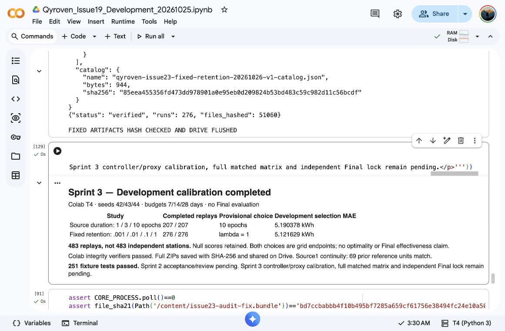

# Fixed Retention calibration — pre-execution declaration

Declared before running this grid on 2026-10-26, under Issue #23. After independent
verification of the complete Source-duration study, recompute its provisional
Source choice and use the same chosen duration for seeds42/43/44. The original
Source study remains immutable. A choice at its duration-grid boundary remains
a limitation, not a convergence or optimality guarantee.

Assess four **positive fixed lambdas: 0.001, 0.01, 0.1, 1.0**. The fixed-retention
baseline is positive by definition; lambda0 is the separately recorded Full
Fine-tuning comparator from the Source study. No Source weights are retrained or
selected separately for favorable Fixed Retention results. The same predeclared
23 entity-budget combinations and three seeds require **276** 90-day Development
replays, including null-score and source-only initialization units.

Keep the source/target architecture, latent formula/scales/epsilon, target initial
epochs, online updates, batch size/order, learning rate and score rules unchanged.
One positive lambda applies to both initial target adaptation and online updates.
These values span three orders of magnitude as a finite compute budget; they are
not claimed to be exhaustive or equally appropriate across penalty definitions.
Parameter-retention loss has different units and is not calibrated by this grid.

Selection averages paired seeds within stations, then stations within budgets and
the three budget means equally, using original-unit MAE. Exact ties prefer smaller
lambda. Reuse the common candidate-accounting helper; require all cells and equal
coverage, retain nulls and reject score/count contradictions. All sources, profiles,
cohorts, code and outputs are identified. New outputs only; CUDA only for real runs.

No adaptive/proxy controller settings are changed automatically. This selects a
provisional Fixed Retention baseline on Development, not a Final lock, a completed
proxy/controller calibration or evidence that retention improves over lambda0.
The earlier five-method comparison used one-epoch Source weights and must not be
pooled with this new Source-duration family as if weights/configs matched. Every
remaining method requires comparable Development assessment and a matched rerun
under the eventual common Source configuration before Final approval.

Execution status: completed and independently verified on Colab T4 under code `6e3aa21719c5b140875e9ba5bbce14c6fd42bfa9`.
251 fixture tests passed locally and on Colab before launch. The identified
Source-duration matrix SHA-256 is
`1a6cdead0ac7b2112ee0189c648d00bc9a2c439192b570b22f41389038d0be27`;
its independent verifier passed all 207 runs before this calibration started.
Source10 is provisional and shared across all three seeds. Actual finite-grid
results and distribution are recorded below; no Final lock or automatic adaptive/
proxy-controller change follows. The sole schedule remains SPRINT_PLAN.md;
task acceptance remains in #23, with independent review and Final lock pending.

## Actual complete result

All 276 replays completed under code `6e3aa21719c5b140875e9ba5bbce14c6fd42bfa9`:
69 paired entity-budget-seed units times four fixed lambdas. 132 null-score runs
remain explicit. The recorded loop time is 949.966 s; target elapsed counters sum
to 845.118 s. Startup/initial input validation and later verification/packaging/upload
are excluded. Source10 pretraining is reused from the identified Source study; its
cost must be included once in a complete experiment budget, not omitted or counted
again for every target. Per-run peaks reset after common prefix/replay preparation.

| Lambda | 7d MAE (kWh), 3 IDs | 14d MAE, 4 IDs | 28d MAE, 5 IDs | Equal-budget score |
|---|---:|---:|---:|---:|
| 0 (Source10 Full Fine-tuning reference) | 4.899140 | 5.144953 | 5.527041 | 5.190378 |
| 0.001 | 4.894094 | 5.161141 | 5.525888 | 5.193708 |
| 0.01 | 4.889056 | 5.139251 | 5.541796 | 5.190034 |
| 0.1 | 4.846813 | 5.120451 | 5.526969 | 5.164745 |
| 1 | 4.808104 | 5.056981 | 5.499802 | 5.121629 |

The provisional positive-lambda choice is **1**, the maximum tested. Its selection
score is 1.32% below the matched Full Fine-tuning reference on this Development
cohort. This is a selection observation, not unbiased Final effectiveness or an
optimal-lambda guarantee. The endpoint is flagged here; no automatic grid expansion.
Lambda 1 has higher station-averaged MAE than Full Fine-tuning at 1/3, 2/4 and 2/5
scored IDs for 7/14/28d respectively. A better mean therefore does not imply uniform
benefit. These counts are not NTR, whose defined comparator is Target-only.

The Source10 choice and Fixed Retention result do not establish an Adaptive
Controller benefit. Earlier Source1 Adaptive results must remain in their own
comparison family. Confidence/proxy calibration and all mandatory matched
baseline/ablation replications remain pending independent review and execution.

## Integrity, hashes and artifacts

- [Artifact URLs/hashes](issue23-fixed-retention-artifacts.json),
  [station/seed selection accounting](issue23-fixed-retention-selection.json),
  [full-download verification](issue23-fixed-retention-download-verification.json).
- Full ZIP: 176,917,243 bytes; SHA-256
  `0396287fd48dbf6803d02d97e0f6c15a346dbb7a7e657cd8caa9d6349c12d620`.
- Colab's independent verifier recomputed all 276 runs and physically hashed 51,060
  daily files; 25,116 historical states were intentionally omitted under the declared
  latest-state policy. Complete latest model/optimizer/RNG states and every forecast/
  event/commit chain remain. Source/profile/config/code/environment/logs are included.
- The entire ZIP was downloaded and SHA/CRC checked. Three Source10 checkpoints
  and 276 latest target states were CPU-loaded/content-rehashed. Every Source/lambda
  binding matches the declared choice and actual method config.
- All 276 issued **and scored origin sets** match the corresponding Source10 Full
  Fine-tuning references exactly. The selection recomputes locally with identical
  values. No local real-data training or Final fitting/tuning/evaluation was used.
- All five new Drive files were moved into the shared Issue23 folder. This changes
  distribution, not acceptance or merge status. The original Source study remains
  separately archived and immutable.

## Reproduction

Restore the Source study ZIP with its `study/` and `evidence/` directories and use
a clean checkout of the recorded calibration code. Checkpoints resolve relative to
the authenticated Source study directory, rather than the original machine path.

```sh
python -m tools.fixed_retention_sweep \
  --inputs-root /content/ev-data/data/inputs/issue18-input-handoff-v1-20261019 \
  --profile configs/issue23/fixed-retention-study.json \
  --profile-sha256 487834ac304fcab0a5be8aae22f5fa50eea09b78c9b63330248654db05c86adc \
  --selection configs/issue23/readiness-cohort.json \
  --study /content/source-duration/study/matrix.json \
  --study-sha256 1a6cdead0ac7b2112ee0189c648d00bc9a2c439192b570b22f41389038d0be27 \
  --verification /content/source-duration/evidence/verification.json \
  --output /content/qyroven-fixed-retention-reproduction
```

Use CUDA and a fresh output directory. Review the exact finite tuning limits and
common Source/configuration identities before any Final lock; this CLI cannot
authorize Final evaluation.

Drive metadata reports these files as shared. Actual download access from a
second team account has not been independently tested.


