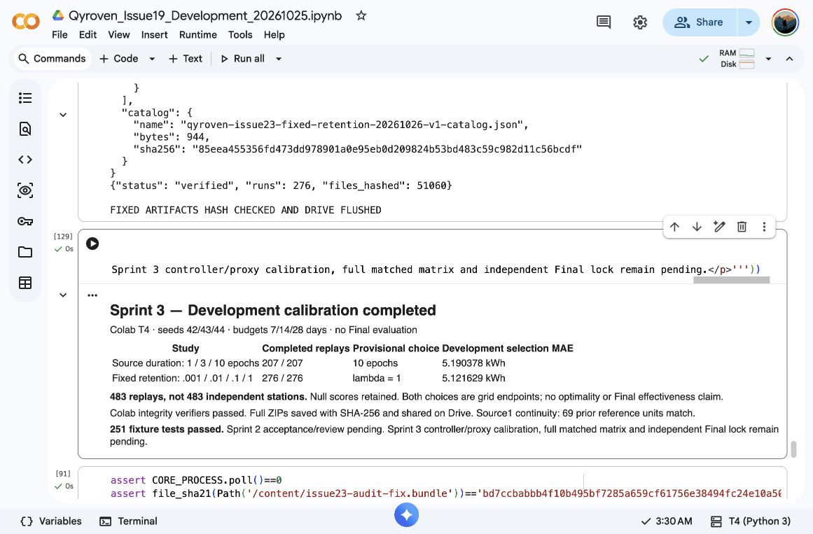

# Issue #23 — evaluation helpers and independent verification (partial)

Executed 2026-10-26. This is a partial technical handoff, not completion of #23.
No Final fitting, tuning, evaluation, configuration lock, effectiveness claim or merge.

## Current execution and report gate — October 27, 2026 (ICT)

The [authenticated recovery evidence](issue23-primary-recovery-plan-evidence.json)
now records a real Colab T4 recovery, not only a prepared kit. The continuation
preserves the original648 missing proxy and690 matched cell population and three
original Source checkpoints. The first14 proxy targets were observed independently
verified and receipted on mounted Drive; this is a dated snapshot, not completion
or a runtime-retention guarantee. An anonymous download of the first rescued
actual target passed size/SHA/CRC and reproduced its full daily/latest-state proofs
locally. No local training, Final access or new tuning was performed.

The first dispatch stopped on a tuple/list JSON representation difference in its
backup report comparison. Actual final-state readback identified the cause. The
fixed backup compares canonical JSON values and still rejects changed values;
333 local tests, cloud fixture checks and CI40363288016 passed at1ac2ae0. A launcher
budget-assumption error stopped a continuation before any new training; the next
continuation derives budgets from the unchanged missing-cell partition. Original
failed runs/logs remain retained and the first completed cell was rescued, not
retrained. See the [durability contract](issue23-durable-recovery.md).

Full Sprint3 completion remains gated on all mandatory experiment/artifact
acceptance, remaining CHARGED city scopes, independent immutable lock before Final,
locked Final runs/analysis, and a second-developer reproduction/report review.
Earlier sections below are historical phase evidence and do not override current
calibration/replication results in the [primary collection](issue23-matched-collection.md)
and [city handoff](issue23-charged-matched-development.md). In particular, current
Development point results do not establish Adaptive superiority over Fixed
Retention. No reduced mandatory matrix, positive-only selection, peer approval,
autonomous merge or issue closure is claimed.

## Implemented and tested

- `ev_evaluation/metrics.py`: complete24-hour original-unit errors; MAE and RMSE;
  exact paired-origin gates; station-first aggregation over at least three declared
  paired seeds; explicit zero Target-only MAE handling and NTR denominator.
- `tools/verify_comparison.py`: stdlib, read-only artifact verification independent
  of the model/runner score implementation. It authenticates input/daily files,
  checks chronology and recomputes every candidate/deployed original-unit score
  against the identified Development target's labels with availability checks.
- [Evaluation contract](../data/EVALUATION_CONTRACT.md): proposed units, pairing,
  honest missing-cell handling, uncertainty scope and capacity warning.

The initial205 independent fixture tests passed locally; Ruff lint/format and diff
checks passed. CI for code head `8b7acf55c8f80d19b0b7783b9f96ddaeeca28a28` passed both
Ubuntu/Windows in run40216623673. Subsequent changes integrate #22 evidence/docs
and this report; latest-head CI is required separately.

The verifier actually executed in Colab with file SHA-256
`23aa9b8b9c0b66774868061ce6b3d848d562ad199e957d52e0fa2d5219817ced`.
It verified42 UrbanEV and252 CHARGED cells:39,690 daily files and all corresponding
candidate/deployed MAE/MSE/aggregate RMSE/counts/commit chains. No model was retrained
or predictions replaced during verification. The exact models/runs/configs are
identified in the [comparison handoff](issue22-qyroven.md); all artifacts and
verification outputs are in its [catalog](issue22-artifacts.json).

A fixed three-method UrbanEV spot-check was downloaded back, checksum/CRC checked,
reverified against local inputs and its final checkpoints loaded safely on CPU.
Separate Colab checks hash-verified and CPU-reloaded all21 Source checkpoints with
namespace/seed/architecture/64-dimensional latent-scale validation. These are
integrity checks, not evidence of scientific superiority or upstream causality.

## Additional execution: three-seed,90-day readiness

The independent CUDA driver at `3a8b56e80beacf04e93c9f6e512733996d017151` completed
138 UrbanEV runs: Adaptive and Target-only across23 predeclared entity-budget
combinations, seeds42/43/44 and90 scheduled days. The [readiness handoff](issue23-readiness.md)
contains paired coverage, actual original-unit results, null strata, Source identity,
exact GPU continuation, shared Drive links and full downloaded-archive verification.
This supplements, rather than replaces, the earlier294 full-method smoke cells.
It is not a full-method three-seed experiment or a comparison winner against Hung.

Current code has217 fixture tests PASS locally and on Colab; Ruff lint/format and
diff checks PASS. CI run40220038000 at code head `3a8b56e` passed Ubuntu and Windows.
The optional new `latest` persistence profile was tested for dense-mode prediction/
state parity, failure handling and exact continuation on actual CUDA. Default dense
runs and all previous artifacts remain unchanged. Its limits are explicit in the
[evaluation contract](../data/EVALUATION_CONTRACT.md).

The read-only verifier executed on all138 additional runs, physically hashing25,530
daily files and reporting12,558 intentionally omitted historical full states. All
138 final branch states and three Source checkpoints were downloaded/hash-checked/
CPU-loaded; the entire156.7MB ZIP passed CRC. A second local read-only execution
produced byte-identical verifier outputs and station/seed summaries. No local
real-data training or Final fitting/tuning/evaluation was performed. The
[reader-boundary correction](input-reader-boundary.md) withdraws the earlier stronger
claim about discarded Final-array decoding and records the subsequent hardening.

[Independent component comparison](implementation-comparison-readiness.md) records
which GRU/retention/gradient/controller fixtures match Hung and the material head,
quantile/RNG and diagnostic-config differences. Full implementation equivalence and
historical experiment integrity are not inferred from matching component fixtures.

## Remaining work and approval boundaries

The full-method comparison smoke has one target per namespace and main seed42 only.
Source ensemble seeds42/43/44 are not three comparison replications. Official
Development cohorts, comparable finite tuning grids/budgets, Source convergence
choices, proxy calibration and three or more full-method comparison seeds remain
unfinished. Exploratory station/calendar-block uncertainty and context/switch analyses
for five methods are now available in the core-transfer extension below. The aggregate helper
refuses missing seed cells and supplies no invented population confidence interval.

An exact feasible full experiment matrix and artifact-retention policy are still
required. The new persistence profile addresses disk cost for138 measured runs, but the
[all-ready population capacity estimate](implementation-comparison-readiness.md)
still leaves the full compute gate unresolved. It does not authorize dropping
mandatory budgets/methods/seeds or silently changing the cohort. After Development decisions, record immutable code/config/
data/cohort/checkpoint identities and obtain independent lock approval before any
Final evaluation. This PR neither grants that approval nor exposes a Final runner.

The branch starts from dev and locally integrates the author's pending #47/#49/#50/
#51 with normal Git merges. Refresh against reviewed/integrated dev before merge;
no GitHub PR merge was performed. All work is independently implemented, without
copying Hung's model/controller/runner code.

See the [input-reader boundary correction](input-reader-boundary.md) for precise
historical decoding scope and the subsequent role/entity-before-deserialization fix.

## Additional execution: five-method core-transfer comparison

[Core comparator handoff](issue23-core-comparators.md) adds207 actual CUDA runs to
the138 readiness references:345 runs,69 paired entity-budget-seed units, five
methods,90 scheduled days. Full Fine-tuning, Fixed Retention and Online Best-lambda
are compared with Adaptive and Target-only under the inherited diagnostic profile.
The entire new229.8MB archive was downloaded and independently verified; analysis
and verification outputs match Colab byte-for-byte. The selected cohort supports
transfer versus Target-only under these settings, but does **not** establish a
confidence-controller benefit over the three transfer comparators. All those
paired marginal intervals include zero. No favorable reruns or Final lock followed.

The extension supplies weekday/weekend, continuous history coverage, switch reasons,
paired original-unit metrics, exploratory station/calendar-block intervals and
isolated audit gaps. It does not complete calibration, the full required method/
ablation matrix or independent review. See the reader-boundary correction for the
historical parse-before-filter limitation and subsequent hardened consumer.

## Source-duration selection and positive-lambda calibration

The [bounded Source-duration study](issue23-source-duration.md) completed three
Source training trajectories (10 epochs each) and207 Full Fine-tuning Development
replays over the same23 entity-budget combinations and three seeds. All outputs
were independently verified/downloaded. The finite-grid choice is10 epochs, with
a boundary warning rather than an optimality/convergence claim. The Source1
subset reproduces all69 earlier Full Fine-tuning units exactly.

The [positive Fixed Retention grid](issue23-fixed-retention.md) completed all 276
replays on that common provisional Source10 family, using four declared positive
lambdas and three seeds across all budgets. The provisional choice is lambda 1,
also at the grid boundary. Its equal-budget Development MAE is 5.121629 kWh versus
5.190378 for matched Full Fine-tuning. This is conditional tuning evidence, not
unbiased effectiveness, completed controller/proxy calibration or a Final lock.
Both full archives were downloaded, SHA/CRC checked and independently verified.
All 276 issued and scored origin sets match their Full Fine-tuning references.
251 fixture tests passed locally and on Colab. Distribution metadata reports all
13 new Source/Fixed files shared in the team folder; another team member's actual
download access has not been independently tested.

Earlier Source1 Adaptive comparisons remain a separate diagnostic family and
cannot be ranked against Source10 baselines as a matched experiment.
