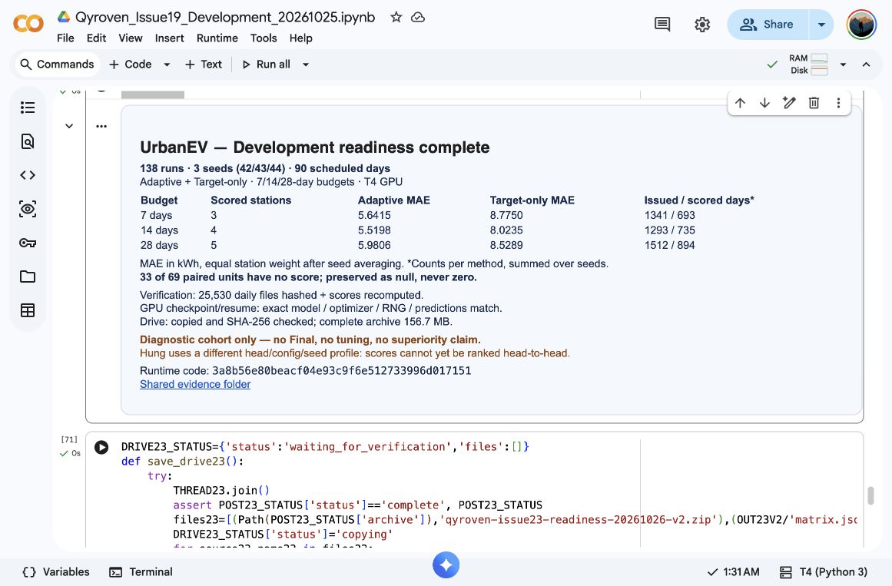

# UrbanEV Development readiness — three seeds, 90 scheduled days

Diagnostic execution only. No Final, no tuning and no matched ranking against Hung.

| Budget | Targets | Paired seed units | Scheduled / issued / scored days per method | Zero-score units |
|---|---:|---:|---|---:|
| 7d | 6 | 18 | 1620 / 1341 / 693 | 9 |
| 14d | 8 | 24 | 2160 / 1293 / 735 | 12 |
| 28d | 9 | 27 | 2430 / 1512 / 894 | 12 |

Every paired unit has both Adaptive and Target-only runs. Zero-score units remain null; they are not zero-error successes. Counts sum over three seeds. With no initial trainable examples, Adaptive starts from its Source checkpoint while Target-only starts from random weights; the per-run initialization is explicit in the CSV. This stratum is never pooled with initially adapted targets.

| Budget / initialization stratum | Scored stations | Adaptive macro MAE (kWh) | Target-only macro MAE (kWh) | NTR numerator / denominator |
|---|---:|---:|---:|---|
| 7d/initial_adaptation | 3 | 5.641507 | 8.775013 | 0 / 3 |
| 14d/initial_adaptation | 4 | 5.519814 | 8.023459 | 0 / 4 |
| 28d/initial_adaptation | 5 | 5.980591 | 8.528936 | 0 / 5 |

MAE is averaged over paired seeds within each station, then equally over stations. NTR uses the station-level seed-averaged MAE comparison. No cross-budget ranking or population confidence interval is supplied. Adaptive versus
Target-only compares the whole transfer/retention package; it does not isolate the
confidence controller or prove adaptive retention better than fixed retention/full
fine-tuning. Those comparisons still require matched full-method replications.

Latest-state GPU resume: exact predictions/decisions/model/optimizer/RNG state hashes and prefix bytes match.

Matrix SHA-256: `f94f4ed5eab3f9a3b47259aacff3c200668ba7ffe30f5249957575d3ce0d6b29`. Runtime code: `3a8b56e80beacf04e93c9f6e512733996d017151`.

Sum of main-run wall times: 787.075s; main-run artifacts: 209,607,860 bytes. These exclude reused Source training, verification, packaging and the extra resume exercise.

## Evidence and reproduction

Executed on2026-10-26, Colab T4, runtime code `3a8b56e80beacf04e93c9f6e512733996d017151`.
See the [shared Drive folder](https://drive.google.com/drive/folders/1AWX7ztnjzHqsn_yiEWSURxzKokxtWbnc),
[artifact URLs/sizes/checksums](issue23-readiness-artifacts.json),
[69 paired rows](issue23-readiness-pairs.csv),
[full station/seed summary](issue23-readiness-summary.json) and
[local download verification](issue23-readiness-download-verification.json).
The entire156,721,668-byte ZIP was downloaded back, SHA-256/CRC checked, all138
main final model/optimizer/RNG branch states content-rehashed on CPU, and all three
Source checkpoints hash-checked/CPU-loaded with finite64-dimensional latent scales.
The same read-only verifier ran locally against the identified #18 inputs: its
output and all summary files are byte-identical to Colab's. No real-data training
ran on the developer's laptop. Source models were reused by identified seed,
not retrained or selected from these new Development scores.

The verifier physically hashed25,530 daily files and recomputed all candidate and
deployed errors, label-arrival checks and commit chains. It explicitly records
12,558 historical state files omitted by the new declared `latest` policy; it does
not pretend to hash absent bytes. Latest full states plus all forecasts/events/commit
records remain. Earlier dense runs are untouched. Fixture parity and an actual
10-tick-prefix CUDA continuation matched exact predictions, decisions, branch
model/optimizer/RNG hashes, candidate/audit counts and unchanged prefix bytes.

A first attempt at code `388ea5e` failed before training because runner config
validation did not accept the new persistence field. That failed matrix is
preserved in the archive; the fix and regression tests are in `3a8b56e`. The postprocessing cell
also needed an explicit pathlib import before it could start; no training was
rerun or output overwritten for that notebook setup correction.

The three Source weights remain the previously declared one-pass diagnostic
checkpoints. This run adds online/missing-data readiness evidence; it is not Source
convergence selection, proxy calibration, full baseline replication or Final lock.

## Comparison with Hung

The69 paired units use the same predeclared6/8/9 identity metadata published by
Hung, without copying his implementation/weights. Scheduled/issued/scored counts
per method match his report exactly at1620/1341/693,2160/1293/735 and2430/1512/894.
Our33 null units comprise27 no-initial-training seed units plus6 initially trainable
1987 units at14d/28d with no complete scoring labels. This is coverage agreement,
not independently verified performance equivalence. His large historical training
archive has not been downloaded/authenticated here.

No station with missing scores is converted into a successful zero-error case.
The scored-station NTR is0/3,0/4 and0/5 for this small diagnostic cohort; no interval
or population generalization is claimed. Budget cohorts differ, so these rows
cannot establish that one history budget is better than another.

[Component comparison, method differences and re-execution instructions](implementation-comparison-readiness.md)
identify the head-topology/quantile/RNG/config differences and the unresolved
full-matrix compute shortfall. Those decisions require explicit peer review before
matched scientific ranking; no configuration was changed to favor these scores.

The repository CSV follows the project LF text-normalization rule. Catalog hashes
identify original Drive files (whose CSV uses CRLF), not the LF-normalized repository
rendering. The rows and values are unchanged.
