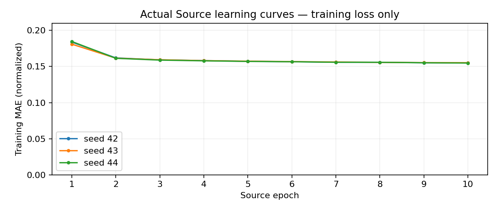

# Source-duration Development study — pre-execution declaration

Declared 2026-10-26 before executing this grid. This extends Issue #23, not the
research method or the sole sprint schedule. Sprint 2 implementation and real
smoke evidence exist in #47/#49/#50, but peer acceptance/integration and the full
capacity gate are pending; Sprint 2 is not formally accepted.

The earlier Source checkpoints used one epoch. The finite grid now compares
checkpoints after **1, 3 and 10 Source epochs**, with paired seeds **42/43/44**.
For each seed, train one ten-epoch trajectory over the same permitted pre-deployment
Source pool; retain every epoch, optimizer/RNG and Source-derived latent scales.
No Source target selection, architecture, loss or data-contract change is introduced.
This is bounded duration assessment, not proof that ten epochs ensure convergence.

Use the previously identified Development cohort (6/8/9 IDs for budgets7/14/28,
90 scheduled days) including null and source-checkpoint-only strata. Compare
**Full Fine-tuning only** to assess a common transferable initialization without
selecting Source duration for a favorable confidence-controller result. Initial
target training remains three epochs and online updates one epoch, with the same
fixed optimizer and chronological complete-label gates. Nine candidate Source
checkpoints feed **207** target replays; these are not independent station samples.
The profile and cohort hashes are recorded before execution. Previous artifacts
remain immutable and cannot be mixed into the new study as if code/weights matched.

The provisional ranking averages seeds within station, stations within each budget,
then the three budget means equally, in original-unit MAE. All candidates must
have the same forecast/scoring counts per paired unit; null units remain listed.
An entirely unscored budget prevents ranking. Exact ties prefer fewer epochs.
The same small nonrandom/possibly colocated cohort and different budget populations
limit generalization. Source-only versus initial-adaptation membership stays in
per-run records; scores cannot be pooled without explicit stratum disclosure.

The best endpoint at epoch10 raises a grid-boundary warning; it does not trigger an
automatic grid extension. Training loss curves and Development results are both
reported, with no formal convergence guarantee or automatic Final configuration
promotion. This profile assesses Source duration only: learning rate, target/update
budgets, retention/confidence settings, parameter-retention scale and proxy mappings
remain distinct finite Development decisions, not silently tuned here.

`python -m tools.source_epoch_sweep` requires CUDA (Colab/Kaggle), authenticated input
and cohort/profile hashes, fresh outputs and the hardened role/entity reader. No
long local training or Final fitting/tuning/evaluation. Per-run CUDA peaks are reset
after shared prefix/replay preparation; Source/preparation/audit costs stay explicit.
Durable epoch checkpoints support interruption recovery; the matrix-level driver
does not yet offer resume orchestration. Preserve failed outputs rather than overwrite.

Actual counts, measured runtime, code SHA, logs, metrics and Drive links are
recorded in the completed-execution section below. Independent review, full comparison/ablation
replication, proxy calibration and immutable Final lock remain required.

## Identified execution and reproduction

Training code: `ff42ea944bf05b4b77e2b730edf500b1fee6e851`.
Profile SHA-256: `1be79afd6543bf7140c66e23562277f54115c39e458409b27cc9eb768bcd896f`.
247 fixture tests passed locally and on Colab. Both CI platforms passed for that
code in [run40226991465](https://github.com/HungLD9505/adaptive-retention-ev/actions/runs/40226991465).
The Colab T4 run `qyroven-i23-source-duration-20261026-v1` completed and was
independently verified. The duration choice remains provisional Development
selection, not an approved official Source configuration or convergence guarantee.

On an authenticated checkout of that code and verified DATA-v1 input installation:

```sh
python -m tools.source_epoch_sweep \
  --inputs-root /content/ev-data/data/inputs/issue18-input-handoff-v1-20261019 \
  --profile configs/issue23/source-epoch-study.json \
  --profile-sha256 1be79afd6543bf7140c66e23562277f54115c39e458409b27cc9eb768bcd896f \
  --selection configs/issue23/readiness-cohort.json \
  --output /content/qyroven-i23-source-duration-reproduction
```

Use a fresh output directory. Run only on CUDA; the routine test suite uses fixtures.
The original notebook also queues immutable per-seed Source backups and full-run
verification/export to Drive. The CLI itself does not upload or grant permissions.
After successful execution, independently verify the generated matrix:

```sh
python -m tools.verify_comparison \
  --matrix /content/qyroven-i23-source-duration-reproduction/matrix.json \
  --inputs-root /content/ev-data/data/inputs/issue18-input-handoff-v1-20261019 \
  --output /content/qyroven-i23-source-duration-reproduction-verification.json
```

## Actual execution and finite-grid result

All three ten-epoch Source trajectories completed: 65,888 permitted Source examples
and 1,030 Adam steps per epoch, 30,900 Source steps in total. All 207 target replays
completed under the declared grid. 99 have no complete scoring labels and keep null
metrics; no missing targets were filled or removed. The 69 underlying paired units
are repeated across three durations, not 207 independent station observations.

| Source epochs | 7d MAE (kWh), 3 scored IDs | 14d MAE, 4 scored IDs | 28d MAE, 5 scored IDs | Equal-budget selection score |
|---|---:|---:|---:|---:|
| 1 | 5.606733 | 5.630305 | 6.003229 | 5.746756 |
| 3 | 5.331784 | 5.415554 | 5.841895 | 5.529744 |
| 10 | 4.899140 | 5.144953 | 5.527041 | 5.190378 |

Source10 is the provisional finite-grid choice: the selection score is 9.68% below
Source1 on this selected Development cohort. This is a tuning observation, not an
unbiased Final improvement or a confidence-controller result. The best candidate
is the maximum duration tested, so the recorded boundary warning is true. No grid
extension, convergence declaration or Final promotion followed automatically.

The comparison uses **Full Fine-tuning only**, so the old Source1 Adaptive metrics
must not be compared to Source10 Full Fine-tuning as if their initial weights matched.
Further comparisons must use the same eventual common Source family.



Recorded experiment-loop wall time: 1,185.837s. The timer starts after initial
input/cohort validation and output setup. Source calls total 446.058s; target
replay elapsed counters total 638.753s; the remainder includes in-loop replay
preparation, validation, serialization and driver overhead. CLI startup/initial input
validation, verification, packaging and upload are excluded. Source seed42 pays first-use input
validation/cache cost, so seed elapsed times are not speed rankings. Target peaks
were reset after common prefix/replay preparation; this remains one-method duration
assessment, not the full isolated method-cost comparison.

## Integrity and distribution

- [All artifact URLs/hashes](issue23-source-duration-artifacts.json),
  [selection/station rows](issue23-source-duration-selection.json),
  [download verification](issue23-source-duration-download-verification.json),
  [one-epoch reference parity](issue23-source-duration-parity.json).
- Full ZIP: 151,263,574 bytes; SHA-256
  `6aea2d26d28a737c87703710fd2ef3dda07d81536d683f25c4c6cab4d7fb3d84`.
  It contains all Source epochs, latest target states, forecasts/events/commit chains,
  configs/code bundle, resolved environment, training curves, logs and verification.
- Colab verifier recomputed original-unit errors and physically hashed 38,295 daily
  files. 18,837 historical state files were intentionally omitted under the declared
  latest-state policy; no absent bytes were claimed as verified.
- The entire ZIP was downloaded, SHA/CRC checked, all nine Source candidates loaded
  on CPU with seed/completed-epoch/latent-shape checks, and all 207 final target branch
  states loaded/content-rehashed. The selection recomputes exactly locally.
- All 69 Source1 Full Fine-tuning reference units reproduce the earlier experiment:
  identical predictions, complete model/optimizer/RNG state hashes, scores/counts,
  initial logs and update counts. All 6,348 daily forecast files were also compared
  byte-for-byte locally. These integrity reruns are not extra independent evidence.
- Three immutable per-seed Source backup ZIPs and the complete study package are
  hash-checked on the shared Issue23 Drive folder. Large outputs stay outside Git.

The next finite Fixed Retention calibration uses the provisional Source10 family
for all three seeds; its [separate declaration](issue23-fixed-retention.md) fixes
positive lambdas before their results are observed. No adaptive/proxy setting or
Final configuration is automatically changed by this Source-duration result.
