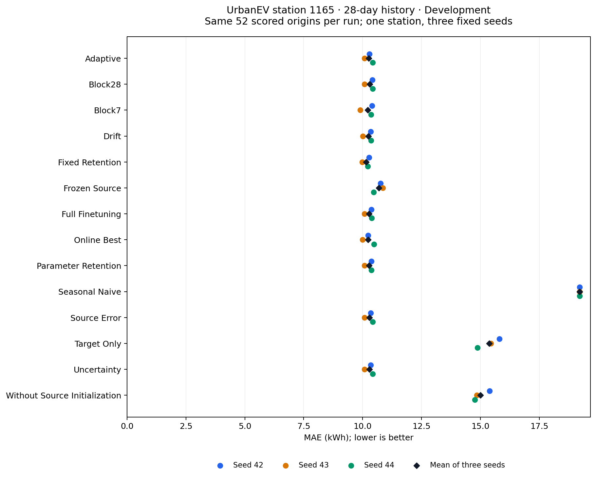

# UrbanEV1165 /28-day history — complete three-seed Development case study

This is a complete single-entity/budget comparison:14 frozen variants ×seeds42/43/44
=42 replays, each with90 scheduled days,59 issued forecasts and the same52 scored
origins. It is not a complete UrbanEV/CHARGED population result or Final evaluation.
All42 runs use the same actual Colab T4 environment, clean core code1ac2ae0 and
unchanged accepted inputs/recipes. Each seed retains its original Source weights.
All3 Sources, including the Uncertainty ensemble dependencies, were independently
CPU-restored against their original hashes. Historical partial cells are replaced
by complete migrated units for matched analysis, never counted twice.

The black diamond is an arithmetic mean over the three fixed seeds. Dots are
individual seeds; they are not confidence intervals or three independent stations.
Methods are listed alphabetically, rather than selected or ordered by favourable
outcome. Lower MAE is better. All42 replays retain the accepted missing-data policy.

| Variant | Seed42 MAE,kWh | Seed43 | Seed44 | Mean seed MAE,kWh |
|---|---:|---:|---:|---:|
| adaptive | 10.287251 | 10.078115 | 10.431048 | 10.265471 |
| block28 | 10.415855 | 10.078115 | 10.431048 | 10.308339 |
| block7 | 10.405989 | 9.897393 | 10.363928 | 10.222437 |
| drift | 10.349071 | 10.014374 | 10.359812 | 10.241086 |
| fixed_retention | 10.268517 | 9.981572 | 10.215975 | 10.155355 |
| frozen_source | 10.762809 | 10.853389 | 10.464660 | 10.693619 |
| full_finetuning | 10.370493 | 10.081544 | 10.383837 | 10.278625 |
| online_best | 10.238610 | 10.000703 | 10.481335 | 10.240216 |
| parameter_retention | 10.370452 | 10.081551 | 10.371950 | 10.274651 |
| seasonal_naive | 19.209335 | 19.209335 | 19.209335 | 19.209335 |
| source_error | 10.351421 | 10.078115 | 10.431048 | 10.286861 |
| target_only | 15.803999 | 15.447953 | 14.876859 | 15.376271 |
| uncertainty | 10.351421 | 10.078115 | 10.431048 | 10.286861 |
| without_source_initialization | 15.389518 | 14.854179 | 14.765770 | 15.003156 |

Adaptive mean MAE is10.265471kWh, compared with10.155355 for Fixed Retention:
Adaptive is0.110116kWh worse on this case's mean seed MAE. This does not establish
population significance, equivalence or a causal advantage of one component.
Source, target and controller randomness vary together across the fixed seeds.
No seed, checkpoint, station, budget or method was dropped after seeing results.
The complete frozen Development matrix remains necessary before interpreting
method effectiveness or preparing the independently reviewed Final lock.

The52 evaluated origins are the intersection allowed by the accepted label/history
gates, rather than90 fully observed days. The full schedule/skip reasons and
committed forecasts/events/latest states remain in each canonical archive. This
analysis does not extrapolate to missing-label days or other stations/budgets.
Prefix adaptation is present (27 initial examples for trained methods); source-only
cases elsewhere must remain separately analysed.

The downloadable bundle includes exact CSV/JSON numbers (including mean seed RMSE,
which is explicitly a mean of per-seed RMSE rather than a pooled RMSE), PNG/SVG,
script, input/code/environment fingerprints and6 independently verified partition
identities. Analysis uses a separate plotting environment; no training environment
or dependency lock was changed. The first read-only analysis failed on missing
legacy proxy `comparison_variant` fields; the repaired script derives names from
the authenticated whole-unit acceptance records and cross-checks config/variant.
A subsequent layout-only pass moved the legend outside the data; CSV bytes stayed
identical. Failed/draft attempts are preserved locally and in the bundle.

Acceptance records: [seed42](issue23-colab-unit1165-acceptance.json),
[seed43](issue23-colab-unit1165-seed43-acceptance.json),
[seed44](issue23-colab-unit1165-seed44-acceptance.json).

Artifacts: [seed42 first12](https://drive.google.com/drive/folders/1YN4rJ6dKG6Oh01gF-a_3wvTs7B8XWe84),
[seed42 last2](https://drive.google.com/drive/folders/1_KaL6F-TvlxTLynCBU3eG0QOcXPjY8iL),
[seed43 first12](https://drive.google.com/drive/folders/1HrBAh0rddlkNlTBOzRScR0gKNCXjCHXT),
[seed43 last2](https://drive.google.com/drive/folders/1IWibxu335sJiTnjyKYGVr2SzRf2UhWw_),
[seed44 first12](https://drive.google.com/drive/folders/1Z_tsIgLDSlaARS7cBynJT2sfQ0bpjl0V),
[seed44 last2](https://drive.google.com/drive/folders/126MrFyu1Ro9bAvxDstg1g32W-Ru6T2AD).

[Reproducible analysis bundle](https://drive.google.com/file/d/10sK5-zoe5gaAqicb7uWYZ3A_plUDsJDO/view)
is225,727 bytes, SHA-256
`e1723509d6ed4177280c1453384bbfad06f6107775cc7f0d522fa4d888197c43`.
Fresh Drive readback verified the archive, ZIP CRC and every manifest member.
The bundle's report snapshot precedes this download-link paragraph; metric/script/
figure identities are unchanged. Separate Source/target raw payloads remain in
the six canonical artifact folders above, rather than being duplicated in this
small analysis package.
