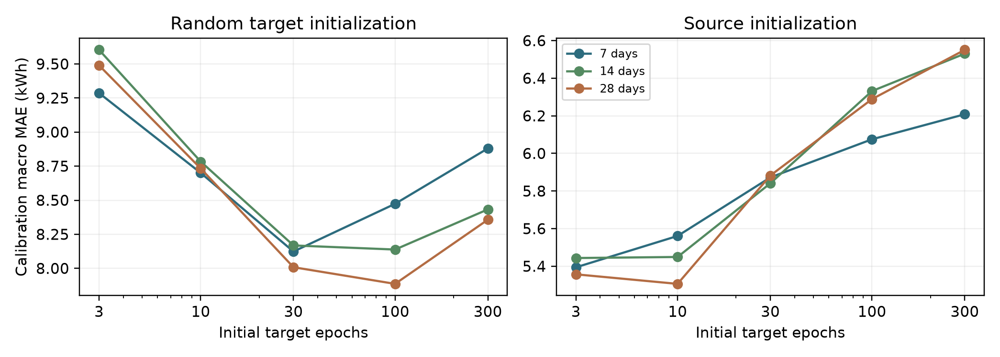
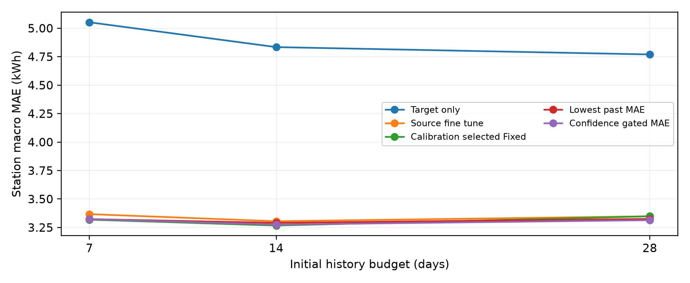
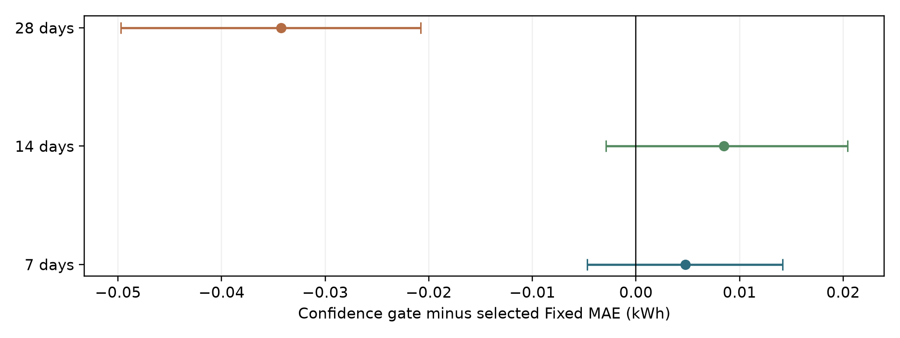

# Source Retention and Confidence Guided Adaptation for Low History EV Charging Forecasts

AIP491 G10 Research Team

## Abstract

Forecasting charging demand at a station with little local history requires separating the value of source initialization from the value of retaining source representations during adaptation. We study a two layer GRU under a causal 24 hour to 24 hour forecasting task using UrbanEV Shenzhen data. Four Development targets select training duration and a constant retention level. Twelve additional targets, three seeds and initial histories of 7, 14 and 28 days provide matched 90 day replays. Target only training is selected from 3, 10, 30, 100 and 300 initial epochs, giving 30, 100 and 100 epochs across the three budgets. Transfer retains a substantial advantage after this correction. Source fine tuning obtains macro MAE of 3.3671, 3.3046 and 3.3482 kWh, compared with 5.0521, 4.8341 and 4.7697 kWh for target only. On a common bank of retention experts, a bootstrap confidence gate improves recent error selection at 14 and 28 days. It exceeds calibration selected Fixed at 28 days by 1.02%, while a retrospectively selected constant expert remains better. These exploratory results support source initialization under the tested training budgets and show that confidence guided switching is sensitive to calibration, history and the comparator. Architecture superiority and prospective generalization remain open.

## 1 Introduction

An established charging network provides observations that may help forecast a new or sparsely observed location. UrbanEV supplies hourly charging related series in Shenzhen and supports study of this setting [1]. Restricting the initial observations of an existing entity produces a controlled limited history experiment. The identifiers in the dataset provide forecasting units; the experiment simulates limited history rather than establishing the opening date of each physical station.

Transfer learning introduces several distinct choices. A pretrained model provides initial parameters. A source retention penalty constrains subsequent adaptation. An online selector decides whether to change the strength of that constraint after observing new errors. A gain from source initialization can coexist with an ineffective retention selector. Evaluating these choices separately is necessary to understand where the benefit arises.

The central question is when the source representation remains useful and when weaker retention helps the target adapt. A second question concerns evidence quality. A candidate retention level can have lower recent MAE by chance or because recent observations are unrepresentative. A lower bootstrap bound on paired improvement may prevent some unreliable changes, but it concerns an observed block and does not guarantee improvement in the next block.

We address these questions through a controlled GRU study. We first select target training duration on calibration targets, correcting a short random initialization baseline. We then compare source fine tuning, constant retention and two selectors that share exactly the same expert predictions. The selectors recommend the same lowest mean error candidate; only one requires additional bootstrap evidence before switching. Three initial history budgets test whether the findings persist as more target data become available.

The contribution is an empirical separation of initialization, retention and confidence effects within an authenticated replay pipeline. The study also exposes a calibration failure mode: a controller can beat a constant chosen on calibration while still losing to a stronger constant available in its expert bank. This distinction affects how an apparent adaptive advantage should be interpreted.

## 2 Related work

GRUs provide gated recurrent representations for sequential inputs [2]. We use the existing compact encoder as an architectural control across all retention comparisons. The implemented equations follow the PyTorch GRU convention [3]. The recurrent cell remains standard; the retention mechanism operates through an additional adaptation loss and model selection.

Source referenced regularization has an established transfer learning basis. L2 SP penalizes displacement from pretrained parameters [4]. Feature based regularization instead constrains representations. Our primary penalty compares the final target and frozen source hidden states after dimensionwise normalization by source latent standard deviations. Earlier Development probes also tested encoder L2 SP and weighted latent retention. Their effects depended on the selected station cohort, motivating the broader matched study here.

Continuous regularization can be adjusted through validation hypergradients [5]. A previous one step Adam prototype in this project did not outperform its selected constant on the inspected later window. The present experiment focuses on direct comparison of saved forecast errors. Its purpose is to determine the incremental effect of an evidence gate on an otherwise matched candidate recommendation.

Block bootstrap methods address dependence by resampling contiguous observations [6]. We apply paired moving blocks to recent daily errors. The resampling preserves the comparison between experts on the same dates. Its assumptions and short block size limit interpretation, particularly after selecting a challenger on the same observations.

## 3 Data and forecasting task

### 3.1 Source and target roles

The prepared UrbanEV SZH input defines disjoint Source, Development and Final roles. This study uses Source and Development data. The existing three Source10 checkpoints, one per seed 42, 43 and 44, are reused throughout. Authenticated training headers contain 65,888 eligible Source examples at every target history budget, and the Source population identity is shared across budgets. Source weights remain isolated from previously adapted targets.

Four historical Development IDs, 1405, 2152, 1153 and 1693, supply calibration. Twelve additional IDs supply the expanded comparison. They were selected by requiring ready input status and at least four usable prefix examples, excluding entity IDs found in tracked experiment metadata, stratifying by prefix zero hour fraction, and taking fixed hash ranks within each stratum. The twelve IDs are 1691, 2564, 2398, 1114, 1225, 1169, 1885, 1802, 2035, 1836, 1303 and 1325.

The strata cover prefix zero fractions from 0% to 97.3%. Initial trainable counts are six examples at seven days and thirteen at fourteen days. At twenty eight days, counts range from eighteen to twenty seven. The nominal history budget therefore measures the observation interval, while the usable training count also reflects missing or incomplete windows.

The cohort and earlier aggregate results have been inspected during development. Tracking metadata cannot exhaustively establish prior remote or untracked exposure. All comparisons in this manuscript are exploratory Development evidence.

### 3.2 Inputs and normalization

Each forecast uses the preceding 24 hourly observations and issues all next 24 hourly energy values. Historical input has shape 24 by 7. Its columns contain scaled energy, sine and cosine of local hour, sine and cosine of weekday, weekend status and an observation mask. A separate 24 by 5 tensor supplies the known future calendar. Weather, future energy and future validity values are outside this input contract.

Each target uses a positive energy scale fitted from its permitted initial observations, following the existing prefix percentile and fallback policy. Scaled energy is y divided by this fixed scale. The observation mask distinguishes recorded zero consumption from missing history. Complete future labels are required for scoring and model updates. A missing target label is excluded; its value is never inferred from zero demand.

### 3.3 Chronological replay

Deployment starts on 1 December 2022, followed by ninety scheduled daily origins. At an origin, the predictor uses the permitted history and calendar. Saved forecasts are scored when complete labels become available. Their examples then become eligible for updates. Expert and target only runs use the same eligible origins.

The twelve station score counts per seed are 52, 90, 90, 89, 52, 52, 90, 90, 90, 52, 51 and 90 in the listed station order. The common mask totals 888 station days per seed and history budget. These masks match across all methods and all three budgets. Ninety scheduled days do not imply ninety scoreable days for every station.

## 4 Models and retention mechanisms

### 4.1 GRU encoder and forecasting head

The encoder has two GRU layers with hidden width 64. For one layer, using the PyTorch convention [3], the reset and update gates are

$$r_t=\sigma(W_{ir}x_t+b_{ir}+W_{hr}h_{t-1}+b_{hr})$$

$$z_t=\sigma(W_{iz}x_t+b_{iz}+W_{hz}h_{t-1}+b_{hz})$$

The candidate state and recurrent update are

$$n_t=\tanh(W_{in}x_t+b_{in}+r_t\odot(W_{hn}h_{t-1}+b_{hn}))$$

$$h_t=(1-z_t)\odot n_t+z_t\odot h_{t-1}$$

The final hidden vector of the second layer is concatenated with the 120 known future calendar values. A linear layer of width 64, ReLU, a 24 output linear layer and Softplus form the forecasting head. This model has 52,376 trainable parameters. A matched two layer width 64 LSTM with the same head would have 65,368 parameters; this is a capacity comparison, while predictive backbone ranking requires validated experiments.

### 4.2 Forecast and latent retention losses

For a batch B of complete daily targets, training uses mean normalized absolute error

$$F_B(\theta)=\frac{1}{24|B|}\sum_{i\in B}\,\sum_{j=1}^{24}|\hat y_{ij}(\theta)-y_{ij}|$$

Let h denote the final encoder vector, theta subscript s the frozen Source parameters and s subscript k the Source population standard deviation of latent coordinate k. The penalty is

$$R_B(\theta)=\frac{1}{64|B|}\sum_{i\in B}\,\sum_{k=1}^{64}\left(\frac{h_k(x_i;\theta)-h_k(x_i;\theta_s)}{s_k+\epsilon_R}\right)^2$$

The adaptation objective is

$$L_B(\theta,\lambda)=F_B(\theta)+\lambda R_B(\theta),\qquad \epsilon_R=0.001$$

Division by s_k plus epsilon occurs before squaring. The Source parameters and scales stay frozen. Lambda controls the retention penalty and remains distinct from the Adam learning rate. It is not a percentage of source knowledge.

Source fine tuning sets lambda to zero after Source initialization. Random target only uses a fresh GRU and head with zero retention. Both use a fresh target Adam optimizer. All methods update on the same complete arrived examples, with one online epoch per arrival.

### 4.3 Fixed expert bank

The confidence ablation uses independent experts at lambda 0, 0.1 and 1, inherited operating points of the historical selector. Each expert maintains its own weights and optimizer. Selection chooses which saved expert forecast is active and never changes the experts' training trajectories. This common bank fixes the evidence seen by both selectors.

A separate earlier wide coefficient study measured twenty one points, including values up to 33.844. Its mechanism audit is summarized in Appendix A. The three point bank in the present study fixes the candidate set for an isolated confidence comparison. It supplies a bounded comparator rather than an exhaustive search over all possible retention strengths.

A single Fixed level is chosen by calibration macro MAE and locked before additional target replay. It is lambda 1 for the seven and fourteen day budgets and lambda 0 for twenty eight days. Every selector begins at that same calibration selected Fixed level, giving identical initial active expert predictions.

### 4.4 Matched online selection

At each seven day boundary, both policies examine only complete labels already available from the previous block. At least five valid days are required. The recommended challenger has the smallest past block mean MAE, with ties resolved by distance from the active level and then configured level order.

For active expert a and challenger b, the paired daily improvement is

$$d_i^{a,b}=\ell_i^a-\ell_i^b$$

The mean only policy switches to the recommendation. The confidence policy resamples contiguous blocks of three valid daily pairs, generates 2000 paired mean improvements and takes their 0.025 quantile. It switches to the same recommendation only when this lower bound exceeds zero

$$\lambda_{t+1}=\begin{cases}\lambda_b,&n\geq5\ \mathrm{and}\ \mathrm{LCB}_{0.025}(d^{a,b})>0\\\lambda_a,&\mathrm{otherwise}\end{cases}$$

The implementation logs missing calendar gaps; resampling operates on the ordered valid days. A deterministic seed binds the bootstrap to the model seed and replay context. A bound on recent improvement concerns the observed block. Its capacity to predict the next block is assessed separately through retrospective continuation errors.

The permanent expert bank differs from the historical controller that reforks candidate states at boundaries. The current ablation isolates confidence in expert selection; its results have that scope.

## 5 Experimental design

### 5.1 Validation selected target training

A short target only initialization can exaggerate the apparent benefit of pretraining. We therefore evaluate 3, 10, 30, 100 and 300 initial epochs for both random and Source initialization on the original four calibration targets. The criterion averages daily MAE within seed, seeds within target and four targets equally. Calibration uses the first 28 scheduled origins of the four calibration targets; the additional target identities supply the full 90 day comparison. If 300 epochs is selected, a declared extension to 900 is available. No extension is triggered in this study.

All runs use Adam with learning rate 0.001 and batch size 64. The selected random target budgets are 30, 100 and 100 epochs. Increasing to 300 worsens calibration MAE in all three histories. The Source budgets are 3, 3 and 10 epochs. These are validation selected durations within a declared learning curve, with the learning rate and online update schedule fixed.

| History | Target only epochs | Source epochs | Fixed coefficient |
| --- | ---: | ---: | ---: |
| 7 days | 30 | 3 | 1 |
| 14 days | 100 | 3 | 1 |
| 28 days | 100 | 10 | 0 |

Table 1. Calibration selected initial training durations and constant retention coefficients.

All bank experts share the selected Source adaptation duration for their history budget. Fixed level selection is then performed on the same four calibration targets. This sequence controls the Source training profile across experts. It is a bounded sequential calibration procedure; it does not optimize every epoch and coefficient combination jointly.

Figure 1. Calibration error as initial target training duration increases. Source and random initialization are evaluated separately. The selected random durations lie below the maximum tested epoch count.

### 5.2 Baselines and backbone evidence

Daily naive repeats the observed same hour from the previous day. Missing historical hours use the mean of the observed preceding day. Weekly naive uses the same hour one week earlier if that observation is in the permitted prefix or has arrived by prediction time; otherwise it uses the daily fallback. Their complete predictor pass is persisted before retrospective scoring. Missing labels remain excluded.

Independent team benchmark submissions cover classical and alternative neural architectures. The inspected ledger contains 172 unique rows, but outstanding graph input, SARIMA state, availability gate and artifact acceptance findings limit its evidential status. A second assigned baseline has no published matching benchmark in the inspected repository. The current validated comparisons establish behavior within the fixed GRU pipeline. Architecture superiority remains unresolved.

### 5.3 Metrics and uncertainty

MAE and RMSE are computed in original kWh on complete 24 value forecasts. The principal aggregation averages days within model seed, three seeds within station and twelve stations equally. Deterministic naive methods receive one result per station. RMSE is formed per station and seed before the same station macro aggregation.

We report signed paired contrasts and 20000 station bootstrap draws within the four predefined prefix sparsity strata, averaging seeds before resampling. The intervals describe this selected cohort. They are exploratory and unadjusted for multiple contrasts. Station and date dependence, prior exposure and the small stratum sizes constrain interpretation.

## 6 Results

### 6.1 Effect of validation selected target training

At fourteen days, increasing random target training from the earlier three epoch control to the calibration selected one hundred epochs reduces additional cohort MAE from 5.4629 to 4.8341 kWh. The earlier approximately 39.5% Source initialization advantage becomes approximately 31.6% against the stronger target only baseline. The comparison therefore remains favorable to Source initialization while materially reducing the estimated effect.

Across seven, fourteen and twenty eight days, Source fine tuning improves on the selected target only model by approximately 33.4%, 31.6% and 29.8%. The learning curve supports a finite validation selected baseline. Learning rate optimization, wider architectures and unrestricted convergence remain outside this estimate.

### 6.2 Forecast accuracy across histories

| Method | 7 days | 14 days | 28 days |
| --- | ---: | ---: | ---: |
| Daily naive | 5.0906 | 5.0906 | 5.0906 |
| Weekly naive | 6.0773 | 6.0773 | 6.0773 |
| Target only | 5.0521 | 4.8341 | 4.7697 |
| Source fine tune | 3.3671 | 3.3046 | 3.3482 |
| Calibration selected Fixed | 3.3186 | 3.2670 | 3.3482 |
| Lowest past MAE | 3.3234 | 3.2904 | 3.3252 |
| Confidence gated MAE | 3.3234 | 3.2755 | 3.3140 |

Table 2. Station macro MAE in kWh on the same twelve targets and matched replay origins.

| Method | 7 days | 14 days | 28 days |
| --- | ---: | ---: | ---: |
| Daily naive | 7.3988 | 7.3988 | 7.3988 |
| Weekly naive | 8.4245 | 8.4245 | 8.4245 |
| Target only | 6.9390 | 6.7659 | 6.7101 |
| Source fine tune | 5.2478 | 5.1211 | 5.1562 |
| Calibration selected Fixed | 5.2358 | 5.1255 | 5.1562 |
| Lowest past MAE | 5.2230 | 5.1279 | 5.1410 |
| Confidence gated MAE | 5.2327 | 5.1177 | 5.1209 |

Table 3. Station macro RMSE in kWh, averaging per station and seed RMSE values.

The Source informed methods outperform both deterministic naive baselines in aggregate. Target only improves as more initial history becomes available. Source based performance is nonmonotonic: the selected twenty eight day Source profile has higher aggregate error than the fourteen day profile. History changes usable examples, prefix normalization and the calibration selected duration together, so this is a protocol outcome rather than an isolated effect of sample count.

Figure 2. Additional cohort MAE after calibration selected training. The Source benefit is larger than the incremental differences among retention selectors.

### 6.3 Confidence against mean error and Fixed

At seven days, the confidence and mean only policies have almost identical macro error. At fourteen days, the gate improves on mean only by approximately 0.45%; at twenty eight days the improvement is approximately 0.34%. The corresponding exploratory intervals include zero at seven and twenty eight days. The fourteen day contrast has an interval below zero under the declared resampling scheme.

| History | Gate minus Fixed MAE | Exploratory interval | Stations improved |
| --- | ---: | --- | ---: |
| 7 days | +0.00477 | [-0.00472, +0.01415] | 4/12 |
| 14 days | +0.00848 | [-0.00289, +0.02045] | 3/12 |
| 28 days | -0.03424 | [-0.04974, -0.02079] | 7/12 |

Table 4. Confidence gate minus calibration selected Fixed. Negative values favor the gate. Intervals resample station means within the predefined strata.

Confidence is worse than Fixed by approximately 0.14% and 0.26% at seven and fourteen days. At twenty eight days it improves on the selected Fixed by approximately 1.02%, with seven station means improved. This favorable case is sensitive to the comparator. Calibration selected lambda zero at twenty eight days, while the additional cohort retrospectively favors constant lambda one, with MAE 3.2925 kWh. That hindsight constant has lower error than the gate at 3.3140 kWh. The observed adaptive advantage therefore includes recovery from a calibration choice that transfers imperfectly to the additional cohort.

Figure 3. Paired station bootstrap intervals for the confidence gate relative to the calibration selected constant.

## 7 Discussion

### 7.1 What Source usefulness means in these experiments

The results distinguish useful initialization from useful ongoing retention. Source fine tuning uses pretrained parameters even when lambda is zero. Its lower error relative to random target only supports initialization under the tested histories and selected training durations. A harmful retention penalty at a particular station would not imply that all source knowledge should be discarded.

The additional gain from retention is much smaller. Constant lambda one is useful in the seven and fourteen day bank comparisons, while the twenty eight day calibration chooses zero. The additional cohort then favors a stronger constant. Calibration representativeness is therefore part of the scientific question. Four targets cannot describe every sparsity pattern represented by the twelve target extension.

### 7.2 What confidence contributes

A confidence gate can suppress switches based on weak recent evidence. It can also delay useful changes and leave an active expert in place after conditions change. Earlier matched start diagnostics recorded both prevented harmful recommendations and rejected beneficial ones. The present history study similarly evaluates future blocks only after causal decisions have been fixed.

The gate's modest advantage over mean selection supplies evidence for a filtering effect under some conditions. The overall comparison with Fixed remains conditional. The bootstrap lower bound estimates recent paired improvement under its resampling construction; it does not provide a calibrated probability of future success or identify source usefulness directly.

### 7.3 Calibration and candidate dependence

The twenty eight day favorable comparison illustrates why the reported comparator matters. A controller can improve on the constant selected by a small calibration cohort while losing to another constant in the same bank. Reporting both the deployable calibration choice and the retrospective constant diagnostic makes this dependence visible. The retrospective constant uses the evaluated labels and serves only as a diagnostic.

Finite bank levels, the seven day decision period, five valid day threshold and short bootstrap segments also constrain the findings. Daily switching sensitivity and a continuous hypergradient prototype were explored separately. Their adverse results support keeping training duration, state sharing, candidate strength and confidence as distinct design choices.

## 8 Limitations and reproducibility

The study covers one prepared UrbanEV namespace and twelve additional targets. It simulates limited history on existing identifiers and shares historical dates across targets. Broader city, real deployment and station opening conclusions require new evidence. The twelve target extension has prior Development exposure and the broader research program used its earlier outcomes to refine subsequent analyses.

Epoch selection tests a declared range with a fixed learning rate and fixed online budget. The random optima are interior to that range, but this does not establish a globally optimized target only learner. The Source selection can occur at the minimum tested duration. Architecture ranking awaits acceptance of independently authenticated alternative model artifacts.

The common bank isolates confidence by sharing expert predictions, with three experts maintained throughout replay. A deployed single trajectory controller has state feedback and potentially different compute. The historical forked controller and the common bank ablation have separate semantics and results.

Challenger selection and confidence calculation use the same recent block. The bootstrap has finite resampling error, gaps are represented in valid day order, and intervals do not correct selection or multiple testing. Small aggregate differences should be read with station contrasts and practical costs.

All input manifests and Source checkpoint bytes are identified. The three budget inputs share 65,888 eligible Source records. Independent readback verifies 31,968 additional cohort neural forecast scores, original unit MAE and MSE, selected expert lineage and common masks across histories. The naive controls add 72 deterministic station budget rows. Publisher raw archives were not freshly acquired during this extension.

Code, epoch curves, locks, per station results and review audit are versioned separately from the frozen historical report. Large input archives, optimizers and model checkpoints remain outside Git. The earlier broad frozen evaluation is preserved as historical evidence with its original method and scope. This Development extension supplies a revised account of training budget and confidence effects for review.

## 9 Conclusion

Source initialization improves low history EV charging forecasts under the calibrated GRU training budgets studied here. Correcting the target only duration reduces the apparent benefit but preserves a substantial advantage across seven, fourteen and twenty eight day histories. Confidence gating can improve recent mean error selection, while its advantage against Fixed depends on the history and calibration choice. The twenty eight day favorable case is weaker than a hindsight constant available in the same bank.

The evidence supports source initialization and careful retention calibration within this pipeline. A general adaptive retention superiority claim remains unresolved. The research contribution at this stage is an authenticated separation of these effects and an explicit account of when a favorable aggregate can depend on training and comparator selection.

## Appendix A Retention mechanisms examined during Development

A prior twenty one point Fixed study used the original four fourteen day calibration targets. The following measured points illustrate gradient influence on the encoder in that study.

| Coefficient | Median retention to forecast gradient norm | Interpretation at measured states |
| --- | ---: | --- |
| 0 | 0 | Retention switched off |
| 0.11457 | 0.158 | Forecast gradient substantially larger |
| 1 | 0.946 | Gradient magnitudes close |
| 1.96915 | 2.041 | Retention gradient about twice as large |
| 13.12658 | 11.42 | Retention gradient dominates magnitude |

These are measurements at sampled states. Gradient direction can differ even when magnitudes are equal. The values describe a mechanism and do not establish universal interval boundaries or stable optimal coefficients.

A one step validation hypergradient controller, motivated by continuous regularization tuning [5], was implemented through the current Adam moments. Its later window MAE was 4.806223 kWh, compared with 4.803054 for its calibrated Fixed comparator. Those four target, selected window results have a separate split and runtime and are not pooled with the full ninety day twelve target tables.

A further encoder L2 SP probe achieved 4.710197 versus 4.815521 for its matched latent comparator on the original four targets. On the twelve target extension its advantage contracted to approximately 0.085%, with a station interval including zero. These alternatives remain diagnostic evidence rather than proof of a preferred new retention method.

## References

[1] Li H, Qu H, Tan X, You L, Zhu R, Fan W. UrbanEV An Open Benchmark Dataset for Urban Electric Vehicle Charging Demand Prediction. Scientific Data 12, 523, 2025. [Publisher record](https://doi.org/10.1038/s41597-025-04874-4).

[2] Cho K and colleagues. Learning Phrase Representations using RNN Encoder Decoder for Statistical Machine Translation. EMNLP, 1724 to 1734, 2014. [ACL Anthology](https://aclanthology.org/D14-1179/).

[3] PyTorch. GRU module equations and implementation convention. Version 2.11 documentation. [Official documentation](https://docs.pytorch.org/docs/2.11/generated/torch.nn.GRU.html).

[4] Li X, Grandvalet Y, Davoine F. Explicit Inductive Bias for Transfer Learning with Convolutional Networks. ICML, PMLR 80, 2825 to 2834, 2018. [Proceedings](https://proceedings.mlr.press/v80/li18a.html).

[5] Luketina J, Berglund M, Greff K, Raiko T. Scalable Gradient Based Tuning of Continuous Regularization Hyperparameters. ICML, PMLR 48, 2952 to 2960, 2016. [Proceedings](https://proceedings.mlr.press/v48/luketina16.html).

[6] Kunsch H R. The Jackknife and the Bootstrap for General Stationary Observations. Annals of Statistics 17, 1217 to 1241, 1989. [Publisher record](https://doi.org/10.1214/aos/1176347265).
