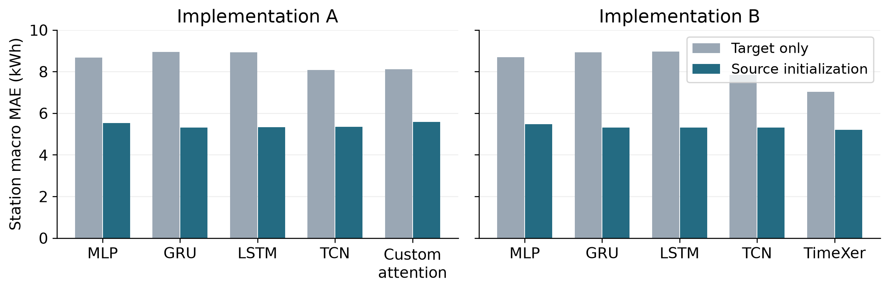
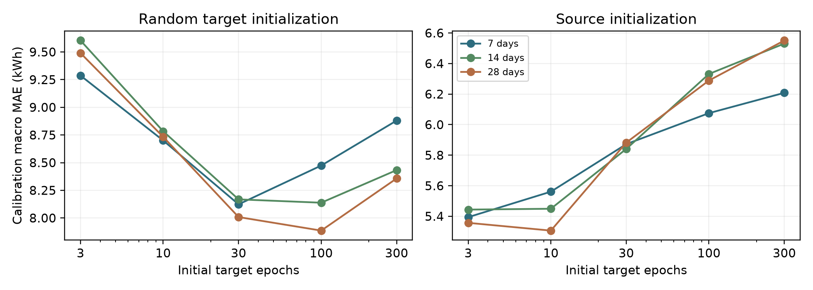
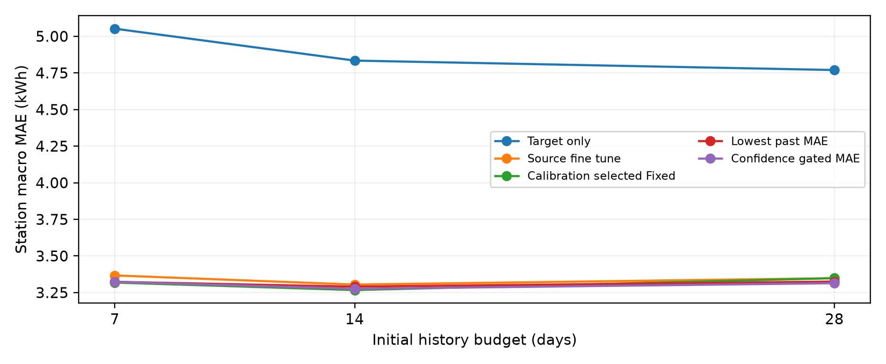
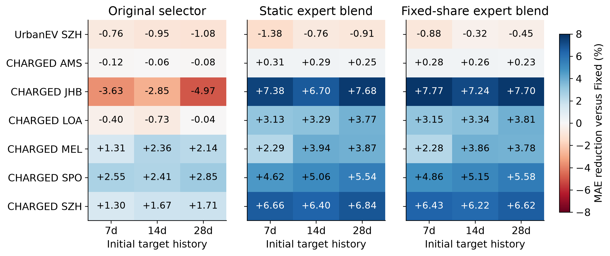
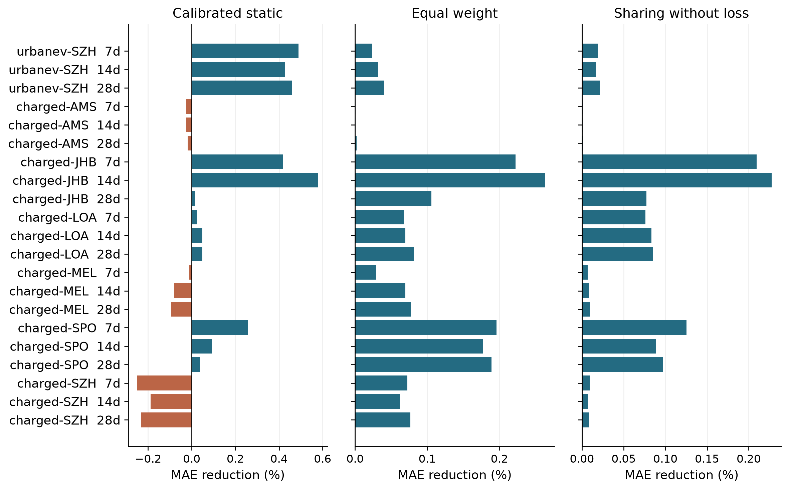
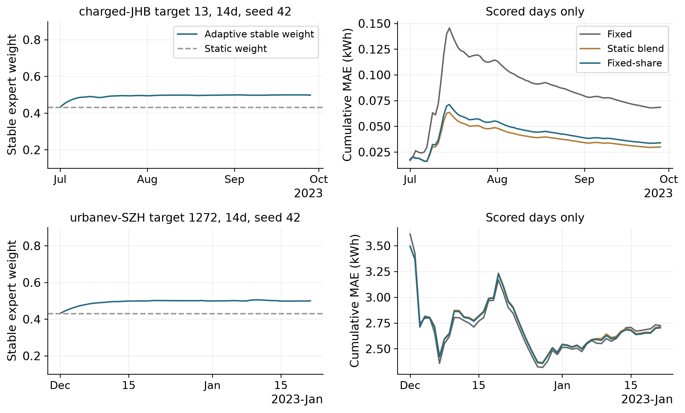

# Source Retention and Adaptive Expert Fusion for Low History EV Charging Forecasts

AIP491 G10 Research Team

## Abstract

We investigate when source knowledge should constrain adaptation in low history electric vehicle charging forecasts. The task uses 24 observed hourly bins to predict the next 24 hourly energy values, with chronological label availability and explicit missing data handling. Three complementary evidence streams separate backbone choice, source initialization and adaptive forecast fusion. Two independent four station Development benchmarks each contain 172 model results; both favor Source initialization within all five neural families, while the best transferred backbone differs between implementations. A twelve station GRU study selects target training duration and finds approximately 30 to 33 percent lower MAE from Source initialization across 7, 14 and 28 day histories. A subsequent historical cohort comparison covers seven dataset namespaces, 90 entities, three histories and three seeds, totaling 810 units and 21 station first aggregates. A stable retention GRU and a recent window GRU are combined using Fixed share forecast weights. The adaptive blend has lower MAE than the original single Fixed model in 18 of 21 groups, compared with 9 of 21 for the original selector. A calibrated static blend also wins 18 of 21; adaptive weights improve on this matched static blend in 12 groups and worsen nine. The evidence supports useful expert complementarity and conditional benefits from adaptive weighting. All cohorts have prior exposure, and these descriptive comparisons do not establish universal superiority or performance on an untouched test set.

## 1 Introduction

A station with little local history may benefit from observations at established charging locations. UrbanEV and CHARGED provide hourly charging series suitable for studying this setting [1,8]. We simulate limited history on existing dataset identifiers rather than claiming that their physical opening dates are known. Source and target entities remain disjoint under the prepared split.

The research question is when a pretrained representation remains useful and when target adaptation should be less constrained. Source initialization, a retention penalty and an online controller are separate mechanisms. Better transfer forecasts do not by themselves prove that a controller adds value. Similarly, a two model ensemble can outperform one model through complementary errors even when adaptive weighting adds little beyond a static mixture.

We therefore organize the evidence into three streams. Independent baseline implementations compare statistical, classical and neural forecasting families. A controlled GRU study calibrates initial target training to avoid a weak target only comparator. Finally, the full historical cohort tests a fixed expert fusion recipe against the original retention results and an equally informed static blend. The resulting paper reports positive and adverse outcomes together, including the three UrbanEV history groups where the new blend loses.

This study separates source initialization, retention and adaptive forecast weighting empirically. The new controller is an application of an established expert weighting rule [7]; it is not a new GRU cell, a newly established theory of source usefulness, or a validated continuous lambda update.

## 2 Related work and method attribution

GRUs provide a compact gated representation for sequences [2]. We use the standard PyTorch recurrence [3] and retain the same GRU backbone within the retention and fusion studies. Source referenced regularization has established transfer learning precedent, including L2 SP [4]. Our latent penalty constrains the difference between target and frozen Source encoder states after coordinatewise scaling.

Validation hypergradients can tune continuous regularization coefficients [5]. A separate project prototype differentiates a virtual Adam step using arrived labels, but it did not improve its matched constant on the inspected objective window. It remains diagnostic evidence, not the mechanism responsible for the new 18 of 21 result.

The original confidence selector compares recent paired forecast errors using moving block resampling, motivated by dependent observation bootstrap methods [6]. That bound concerns recent observations rather than a probability of future improvement. Challenger selection on the same block and short, incomplete histories limit its interpretation.

The new fusion controller specializes the Fixed share expert algorithm of Herbster and Warmuth [7] to two forecasting experts and delayed complete daily feedback. The two expert share to other update is retained explicitly. GRU definitions, normalization, calibration candidates and EV replay rules are project choices. We do not import the paper's regret guarantees to unbounded energy losses or jointly trained recurrent networks.

## 3 Data and evidence streams

### 3 1 Separate experimental scopes

| Stream | Target cohort | History | Source training | Purpose |
|---|---|---|---|---|
| Independent baselines | Four UrbanEV Development IDs | 14 days | Three epochs per backbone | Backbone and transfer comparisons |
| Calibrated GRU study | Twelve additional UrbanEV Development IDs | 7 14 28 days | Reused Source epoch 10 | Training budget and retention effects |
| Historical cohort followup | Ninety selected IDs in seven namespaces | 7 14 28 days | Reused Source epoch 10 | Full scope forecast fusion comparison |

Table 1. Distinct evidence streams. Absolute MAEs and training recipes must not be pooled across streams.

The four baseline and calibration IDs are 1405, 2152, 1153 and 1693. At fourteen days they have 4, 12, 13 and 13 complete initial training examples. Both independent benchmarks use the same prepared input manifest and 65,888 eligible Source examples, with separate implementations and separately trained Source checkpoints.

The twelve additional Development IDs are 1691, 2564, 2398, 1114, 1225, 1169, 1885, 1802, 2035, 1836, 1303 and 1325. Their fixed selection balances four prefix zero fraction strata. They have 888 scored station days per seed at each history budget; coverage varies from 51 to 90 complete days per station. Earlier outcomes and cohort identities have been inspected.

The historical cohort contains 30 UrbanEV SZH IDs and 10 IDs in each CHARGED namespace AMS, JHB, LOA, MEL, SPO and SZH. Thus seven namespaces times three history budgets gives 21 groups. SZH occurs in both datasets; this is not 21 cities or seven distinct cities. Ninety entities times three budgets times three seeds gives 810 units. UrbanEV ID2193 remains unscored in its nine budget and seed units, retained as null. There are 67,293 scored entity history seed days across the full matrix.

### 3 2 Inputs and labels

Every forecast uses a 24 by 7 historical tensor: scaled energy, sine and cosine of hour, sine and cosine of weekday, weekend status and an observation mask. A 24 by 5 tensor supplies known future calendar values. Weather and future energy are excluded. A positive scale fitted from the permitted target prefix stays fixed throughout replay. Recorded zeros and missing history have different mask semantics.

Ninety daily forecast origins are scheduled per replay. At an origin, previously issued forecasts may be scored and used for training only after all 24 labels have arrived. The current forecast is persisted before its own future label is used. Incomplete targets are excluded from scoring and updates; they are never filled with zeros. A source only target start performs zero initial optimizer steps if no complete prefix examples exist.

The baseline studies are Development experiments. The broad followup reuses the historical Final cohort after its outcomes were already published and inspected. Its original role name is preserved for identity checks, but it supplies exploratory historical evidence, not a new unseen Final evaluation. No results in this paper establish independent prospective generalization.

## 4 Forecasting models and source retention

### 4 1 Standard GRU backbone

The primary encoder has two GRU layers, hidden width 64 and the standard recurrence [3]. For a layer, reset and update gates are

$$r_t=\sigma(W_{ir}x_t+b_{ir}+W_{hr}h_{t-1}+b_{hr})$$

$$z_t=\sigma(W_{iz}x_t+b_{iz}+W_{hz}h_{t-1}+b_{hz})$$

The candidate and hidden states are

$$n_t=\tanh(W_{in}x_t+b_{in}+r_t\odot(W_{hn}h_{t-1}+b_{hn}))$$

$$h_t=(1-z_t)\odot n_t+z_t\odot h_{t-1}$$

The final hidden vector is concatenated with 120 known future calendar values. A width 64 linear layer, ReLU, a 24 output layer and Softplus form the head. The primary model has 52,376 trainable parameters. A two layer width 64 LSTM with the same primary head would have 65,368; that is a capacity comparison, not a prediction accuracy result. The standard recurrent layers are not customized.

### 4 2 Forecast and retention objectives

Let B contain complete daily examples with targets normalized by the fixed target scale. Forecast training minimizes

$$F_B(\theta)=\frac{1}{24|B|}\sum_{i\in B}\sum_{j=1}^{24}|\hat y_{ij}(\theta)-y_{ij}|$$

Let θₛ denote the frozen Source model and sₖ its latent coordinate standard deviation. Define

$$u_{ik}=\frac{h_k(x_i;\theta)-h_k(x_i;\theta_s)}{s_k+\epsilon_R}$$

$$R_B(\theta)=\frac{1}{64|B|}\sum_{i\in B}\sum_{k=1}^{64}u_{ik}^{2}$$

$$L_B(\theta,\lambda)=F_B(\theta)+\lambda R_B(\theta),\qquad\epsilon_R=0.001$$

The Source model and latent scales receive no target gradients. Scaling occurs before squaring. Lambda is a penalty coefficient, distinct from the optimizer learning rate; it does not measure a percentage of source knowledge. Lambda zero removes the explicit retention penalty but does not remove Source initialization.

### 4 3 Stable and fast experts

The stable expert is the historical Fixed lambda 1 model: Source epoch 10 initialization, three initial target epochs when possible, Adam 0.001 and one online epoch per newly arrived complete day. Its authenticated saved forecasts are reused without retraining.

The fast expert starts from the matching Source checkpoint, uses lambda zero, three initial target epochs and Adam 0.001. Each complete online arrival triggers one epoch on available records in the seven calendar day window ending at that arrival's forecast origin. Prefix examples may enter the first such windows. The window contains at most seven daily examples and fits one optimizer step. It never includes unavailable labels. This creates a different adaptation trajectory rather than a different GRU architecture.

Both experts use Source initialization. Their difference is retention and recent window training, not Source versus randomly initialized target learning. The fusion method needs two model trajectories and two forecasts; equal online optimizer step counts do not imply equal example counts or total computation.

## 5 Adaptive forecast weighting

### 5 1 Prediction and delayed feedback

Let w be the current weight of the stable expert, with the remaining weight assigned to the fast expert. Forecast in original energy units:

$$\hat y_{t,h}=w_t\hat y_{S,t,h}+(1-w_t)\hat y_{F,t,h}$$

When the complete labels of an earlier issued day d arrive, calculate each expert's error from its saved forecast. With fixed target scale c, use

$$\ell_{e,d}=\frac{1}{24c}\sum_{h=1}^{24}|\hat y_{e,d,h}-y_{d,h}|,\qquad e\in\{S,F\}$$

A feedback event index k is distinct from calendar day t. At each current forecast origin, process eligible older feedback in availability order and then origin order. After all such events, issue the current mixture using the resulting weight. Unscored days do not update weights, and there is no elapsed time decay.

### 5 2 Controller update formula

For current stable weight w subscript k, first form the exponential loss posterior

$$p_k=\frac{w_k e^{-\eta\ell_{S,d}}}{w_k e^{-\eta\ell_{S,d}}+(1-w_k)e^{-\eta\ell_{F,d}}}$$

Then share probability mass with the other expert:

$$w_{k+1}=(1-\alpha)p_k+\alpha(1-p_k)=\alpha+(1-2\alpha)p_k$$

This is the exact two expert share to other update used in the code [7]. Lower stable loss favors its posterior; the share step pulls extreme weights back toward balance. The implementation evaluates the equivalent log odds form to avoid exponential overflow. Initial weight is 0.4307815378871372, eta is 0.1 and alpha is 0.1. Updated weights lie in [0.1,0.9]. Both experts always retain some influence.

The adaptive state is the mixture weight w; the stable and fast experts retain constant lambda coefficients of 1 and zero, respectively.

### 5 3 Calibration and the static control

Before the historical replay, the earlier four UrbanEV calibration targets and seeds 42, 43 and 44 supplied a finite recipe comparison. Six fast recipes crossed windows of 3, 7 and 14 days with learning rates 0.001 and 0.003. For each pair, one global static stable weight in [0,1] minimized equal cell calibration MAE using the exact weighted median solution to the convex absolute error objective. The best static mixture selected the seven day, 0.001 recipe and the initial weight above.

On that fixed pair, eta in {0.1,1,10} and alpha in {0.001,0.01,0.1} gave nine controller recipes. Their calibration criterion selected eta 0.1 and alpha 0.1. These are bounded engineering candidate sets, not universal EV constants or proven optima. They were carried unchanged to all namespaces and histories. The static comparator uses precisely the same two experts and initial weight, with updates disabled.

Calibration and historical outcomes have prior exposure. Locking before this particular replay prevents within replay parameter replacement; it does not erase earlier exposure or turn the historical cohort into a prospective test.

## 6 Independent baseline evidence

### 6 1 Experimental setup

Two independent implementations, A and B, each provide 172 unique model, mode, station and seed rows: 160 nonspatial and 12 spatial. Deterministic methods are not artificially repeated across seeds. Source neural models use three epochs, target adaptation uses three epochs, target batch size four and learning rate 0.0005, followed by one online epoch per eligible arrival. These are fixed recipe exploratory comparisons, without architecture specific tuning or a prospective mutually agreed implementation lock.

Metrics were reconstructed from saved forecasts on matched scored origins within each implementation. These verification checks do not reproduce full training.

### 6 2 Complete family comparison

| Model family | A local | A transfer | B local | B transfer |
|---|---:|---:|---:|---:|
| Daily naive | 7.0763 | n/a | 7.0757 | n/a |
| Weekly naive | 8.4631 | n/a | 8.4631 | n/a |
| Ridge | 5.9339 | n/a | 5.9339 | n/a |
| SARIMA | 6.5799 | n/a | 6.6771 | n/a |
| Random forest | 5.8008 | n/a | 5.8204 | n/a |
| XGBoost | 6.4847 | n/a | 6.4613 | n/a |
| MLP | 8.6711 | 5.5196 | 8.6855 | 5.4753 |
| GRU | 8.9406 | 5.3150 | 8.9239 | 5.3157 |
| LSTM | 8.9360 | 5.3356 | 8.9565 | 5.3168 |
| TCN | 8.0734 | 5.3447 | 7.8415 | 5.3027 |
| Custom attention | 8.1209 | 5.5823 | n/a | n/a |
| Official TimeXer | n/a | n/a | 7.0224 | 5.1979 |
| GCN LSTM spatial | 7.1288 | n/a | 7.1790 | n/a |

Table 2. Station equal mean MAE in kWh from the two independent four station benchmarks. Local denotes target only training; the spatial model additionally receives support histories. A and B denote the two implementations; their results are not pooled.

Figure 1. Local versus Source initialized neural models within each independent implementation. Implementation A's custom attention adapter and Implementation B's official TimeXer adapter have different tokenization and capacity and are deliberately labeled separately.

Implementation A's GRU Transfer MAE is 5.3150, close to LSTM 5.3356 and TCN 5.3447. Implementation B's official TimeXer Transfer is 5.1979, below TCN 5.3027, GRU 5.3157 and LSTM 5.3168. Both studies report all 60 matched within backbone station and seed comparisons favoring Source initialization. Four stations, different implementations and untuned recipes do not establish a universal backbone ordering.

GRU is retained as a compact controlled backbone with an established reproducible pipeline and competitive observed performance. The two studies cannot be pooled as paired replications. In particular, Implementation A's attention adapter omits the reference TimeXer patch and global tokens; Implementation B pins the official implementation. Spatial results also use information unavailable to nonspatial models.

## 7 Calibrated transfer and retention results

A separate twelve station study selects initial training duration on the four calibration targets from 3, 10, 30, 100 and 300 epochs. Selected random target durations are 30, 100 and 100 epochs at histories 7, 14 and 28; selected Source durations are 3, 3 and 10. All use learning rate 0.001 and the same online update budget. The optima are within this finite search; global convergence and tuned learning rates are not established.

Figure 2. Existing calibration curves for random and Source initialization across all three history budgets. Increasing random training duration strengthens the target only comparison.

| Method | 7 days | 14 days | 28 days |
|---|---:|---:|---:|
| Daily naive | 5.0906 | 5.0906 | 5.0906 |
| Weekly naive | 6.0773 | 6.0773 | 6.0773 |
| Calibrated target only | 5.0521 | 4.8341 | 4.7697 |
| Source fine tune | 3.3671 | 3.3046 | 3.3482 |
| Calibration selected Fixed | 3.3186 | 3.2670 | 3.3482 |
| Lowest past MAE | 3.3234 | 3.2904 | 3.3252 |
| Confidence gated MAE | 3.3234 | 3.2755 | 3.3140 |

Table 3. Matched twelve station Development MAE in kWh, using the stronger calibration selected target training durations. These results have a different cohort and Source recipe from Table 2.

Figure 3. Transfer and retention results on the same twelve targets and masks. Fine tuning from Source reduces MAE by approximately 33.35, 31.64 and 29.80 percent relative to calibrated target only training.

The estimated fourteen day transfer gain decreases from the earlier approximately 39.5 percent under a three epoch random baseline to approximately 31.6 percent under the selected one hundred epoch baseline. A substantial gain persists, while its magnitude depends on a credible training budget.

The matched confidence gate improves mean based selection modestly at fourteen and twenty eight days. It beats the calibration selected Fixed at twenty eight days by 1.02 percent, but a retrospectively chosen lambda 1 constant achieves 3.2925 kWh and is better than the gate's 3.3140. That retrospective constant is a diagnostic using evaluated labels, not a deployable calibration choice. It shows why a favorable adaptive comparison does not settle general superiority.

## 8 Full historical cohort results

### 8 1 Complete aggregate results

| Namespace | History | Fixed | Original selector | Static blend | Fixed share |
|---|---:|---:|---:|---:|---:|
| urbanev-SZH | 7 | 8.0400 | 8.1014 | 8.1510 | 8.1111 |
| urbanev-SZH | 14 | 7.9758 | 8.0517 | 8.0361 | 8.0016 |
| urbanev-SZH | 28 | 7.9159 | 8.0015 | 7.9879 | 7.9512 |
| charged-AMS | 7 | 6.1483 | 6.1559 | 6.1294 | 6.1310 |
| charged-AMS | 14 | 6.1482 | 6.1520 | 6.1305 | 6.1321 |
| charged-AMS | 28 | 6.1482 | 6.1529 | 6.1331 | 6.1343 |
| charged-JHB | 7 | 1.3206 | 1.3685 | 1.2230 | 1.2179 |
| charged-JHB | 14 | 1.3227 | 1.3604 | 1.2341 | 1.2269 |
| charged-JHB | 28 | 1.2919 | 1.3560 | 1.1926 | 1.1924 |
| charged-LOA | 7 | 1.3220 | 1.3273 | 1.2807 | 1.2803 |
| charged-LOA | 14 | 1.3334 | 1.3431 | 1.2895 | 1.2889 |
| charged-LOA | 28 | 1.3265 | 1.3271 | 1.2765 | 1.2759 |
| charged-MEL | 7 | 52.8482 | 52.1542 | 51.6384 | 51.6443 |
| charged-MEL | 14 | 54.3655 | 53.0840 | 52.2222 | 52.2649 |
| charged-MEL | 28 | 54.2423 | 53.0832 | 52.1444 | 52.1934 |
| charged-SPO | 7 | 2.0217 | 1.9702 | 1.9284 | 1.9234 |
| charged-SPO | 14 | 1.9893 | 1.9414 | 1.8887 | 1.8869 |
| charged-SPO | 28 | 2.0256 | 1.9679 | 1.9133 | 1.9126 |
| charged-SZH | 7 | 91.8211 | 90.6306 | 85.7026 | 85.9166 |
| charged-SZH | 14 | 90.8436 | 89.3300 | 85.0301 | 85.1907 |
| charged-SZH | 28 | 90.8853 | 89.3310 | 84.6675 | 84.8648 |

Table 4. All 21 historical cohort station first MAEs in kWh. Original selector denotes the archived retention controller, while Fixed share denotes the new two expert forecast controller. The aggregation retains all 810 units, including nine unscored units.

Figure 4. Percentage MAE reduction relative to the same original Fixed forecasts, with one shared color scale. Positive values favor the compared method. Static and adaptive fusion are shown alongside the original selector so the ensemble benefit is visible.

The original selector is below Fixed in 9 of 21 groups. The new static blend and Fixed share are each below Fixed in 18 of 21. The fast expert alone wins 16 groups. All six CHARGED namespaces improve under the adaptive blend at every history budget. Its reduction ranges from 0.23 to 7.77 percent: approximately 7.24 to 7.77 in JHB, 3.15 to 3.81 in LOA, 2.28 to 3.86 in MEL, 4.86 to 5.58 in SPO and 6.22 to 6.62 in CHARGED SZH. AMS improvements are smaller at 0.23 to 0.28 percent.

UrbanEV remains adverse in all three budgets: adaptive fusion increases MAE by 0.88, 0.32 and 0.45 percent. Its earlier twelve station Development result was also adverse at fourteen days, 3.2910 versus Fixed 3.2670. Different absolute errors in the two UrbanEV cohorts must not be mistaken for a contradiction or pooled.

### 8 2 Incremental controller effect

Figure 5. Percentage MAE reduction of adaptive weights against three controls on the same expert pair. The left panel uses the calibration selected static weight; the other panels are posthoc equal weight and loss free sharing diagnostics. Axes have separate numerical ranges, and all measure incremental benefit rather than improvement against a single Fixed model.

Fixed share beats its matched static blend in 12 groups and loses nine. The favorable namespaces are UrbanEV, JHB, LOA and SPO at all three histories; AMS, MEL and CHARGED SZH favor static weights. Even in UrbanEV, improving on static fusion does not overcome the stronger single Fixed model. Fixed share also has lower MAE than the original selector in 20 of 21 groups, with UrbanEV seven days the exception.

Two posthoc diagnostics examine whether the result is simply averaging or reversion toward half weight. Equal weighting fixes w at 0.5. Loss free sharing starts at the same calibrated weight and follows the same label arrival clock and alpha, but sets the posterior to its prior weight, removing the loss signal. No training or parameter selection is performed for these controls. Adaptive weights have lower aggregate MAE in all 21 groups against both controls, but reductions are small: 0.00084 to 0.263 percent versus equal weights, and 0.00097 to 0.227 percent versus loss free sharing. These signs support an incremental loss feedback effect on the inspected data; their magnitude and posthoc status preclude a claim of a large or independently confirmed controller effect.

The expanded 18 of 21 count therefore supports the two expert family more strongly than it isolates adaptive weighting. Two models and recent window updates add computation and capacity. The 21 aggregates reuse entities, dates and history budgets and are not 21 independent replications. No new significance test or fresh performance guarantee is inferred from the win count.

### 8 3 Temporal behavior

Figure 6. Two deterministic examples, one JHB and one UrbanEV, using the median station level percentage gain at fourteen days among stations with Fixed MAE above 0.0001 kWh, and paired seed 42. The left panels show actual stable weights against the static weight; right panels show cumulative MAE on scored days only. The same deterministic selection rule is applied to both examples. These examples illustrate behavior rather than estimate a population effect.

The update can change expert emphasis only after complete earlier losses arrive. The share term prevents permanent exclusion and pulls weights toward balance. Consequently visible movement alone is insufficient evidence of useful control. The static comparison and the adverse namespaces remain essential even when the new family improves strongly on a single retained expert.

## 9 Limitations and reproducibility

All experiments simulate low history on existing identifiers. Prior outcome exposure affects Development calibration, method exploration and the historical cohort. A new untouched cohort or later prospective period is required to confirm generalization. The observed win counts must not be presented as an independent Final success rate or evidence of novelty.

The baseline studies share broad inputs and a three epoch recipe but lack comparable architecture specific tuning. Their TimeXer, TCN and MLP implementations are not all architecture matched. Source checkpoints from those studies differ from the Source10 checkpoints used for retention. Their numerical rankings are within implementation descriptive results, not a universal GRU justification.

The new method controls forecast weights between two Source initialized experts, whose lambdas remain fixed. It does not solve continuous lambda adaptation. Its benefit against one Fixed model combines ensembling, different initial target penalties and rolling window training with weight adaptation. The static expert blend isolates the final component more closely, and its nine favorable groups must remain visible.

Historical stable forecasts were produced on GPU, whereas the new fast experts were run on CPU. The mixture requires two model trajectories, and rolling windows revisit recent examples. Full end-to-end computation, including Source pretraining and method exploration, was not measured; equal-cost superiority is therefore not established.

Saved forecasts were checked against available labels, and aggregate metrics were reconstructed on common scored origins. All 810 units are retained, including nine unscored units. Confidence-gate arithmetic has offline fixture coverage, but every bootstrap resample in the historical runs was not independently repeated. Publisher raw archives were not freshly acquired or audited for these followups.

## 10 Conclusion

Source initialization substantially improves the tested low history forecasts after strengthening target only training. Independent baselines support using GRU as a compact competitive control, while demonstrating that a different transferred backbone can perform better in another implementation.

The new stable and fast GRU fusion family improves on the historical Fixed model in 18 of 21 groups, compared with 9 of 21 for the original retention selector. A static blend achieves the same count. Adaptive Fixed share weights improve on the matched static blend in 12 groups and worsen nine, and UrbanEV remains unfavorable against Fixed. Posthoc equal weight and loss free sharing controls also favor adaptive weights in all 21 groups, with very small reductions below 0.263 percent. The strongest supported conclusion is useful expert complementarity with small, comparator dependent incremental benefits from adaptive weighting. An untouched confirmation and a clearly separated method claim are the next scientific requirements.

## Appendix A Comparator semantics

The twelve station common bank ablation in Table 3 maintains three independent constant lambda trajectories and gives mean selection and confidence selection identical saved forecasts and initial active experts. Its purpose is to isolate the confidence gate.

The original historical selector instead forks candidate model and optimizer states from its selected state every fourteen days. The seven day mean and confidence readbacks in the complete companion CSV select among those archived causal forecasts; they do not rebuild or refork the original model states every seven days. They are shadow output selection comparators on the original fourteen day forked stream, not end to end replacements for that training controller. Their lower than Fixed counts are 10 of 21 and 9 of 21. This state feedback distinction does not affect the independent stable and fast trajectories underlying the new fusion result.

## Appendix B Earlier retention diagnostics

A wider Fixed search measured twenty one coefficients, including values up to 33.844. Gradient ratio diagnostics at measured states ranged from forecast dominated near lambda 0.11457, median retention to forecast gradient norm 0.158, to near balanced at lambda 1, ratio 0.946, and retention dominated at lambda 13.12658, ratio 11.42. These are state dependent observations, not universal lambda intervals.

A separate one step Adam hypergradient controller had MAE 4.806223 versus calibrated Fixed 4.803054 on its own four target later window. An encoder L2 SP probe initially improved its latent comparator on four targets, but its gain contracted to approximately 0.085 percent on the twelve target extension. These adverse or limited diagnostics are preserved and are not pooled with the new full cohort fusion results.

## References

[1] Li H and colleagues. UrbanEV An Open Benchmark Dataset for Urban Electric Vehicle Charging Demand Prediction. Scientific Data 12, 523, 2025. [Publisher record](https://doi.org/10.1038/s41597-025-04874-4).

[2] Cho K and colleagues. Learning Phrase Representations using RNN Encoder Decoder for Statistical Machine Translation. EMNLP, 1724 to 1734, 2014. [ACL Anthology](https://aclanthology.org/D14-1179/).

[3] PyTorch. GRU module equations and implementation convention. Version 2.11. [Official documentation](https://docs.pytorch.org/docs/2.11/generated/torch.nn.GRU.html).

[4] Li X, Grandvalet Y, Davoine F. Explicit Inductive Bias for Transfer Learning with Convolutional Networks. ICML, PMLR 80, 2825 to 2834, 2018. [Proceedings](https://proceedings.mlr.press/v80/li18a.html).

[5] Luketina J and colleagues. Scalable Gradient Based Tuning of Continuous Regularization Hyperparameters. ICML, PMLR 48, 2952 to 2960, 2016. [Proceedings](https://proceedings.mlr.press/v48/luketina16.html).

[6] Kunsch H R. The Jackknife and the Bootstrap for General Stationary Observations. Annals of Statistics 17, 1217 to 1241, 1989. [Publisher record](https://doi.org/10.1214/aos/1176347265).

[7] Herbster M, Warmuth M K. Tracking the Best Expert. Machine Learning 32, 151 to 178, 1998. [Author manuscript](https://mwarmuth.bitbucket.io/pubs/J39.pdf).

[8] Guo Z. A City scale and Harmonized Dataset for Global Electric Vehicle Charging Demand Analysis. CHARGED hourly release, Zenodo record 15814263, 2025. [Dataset record](https://zenodo.org/records/15814263).
