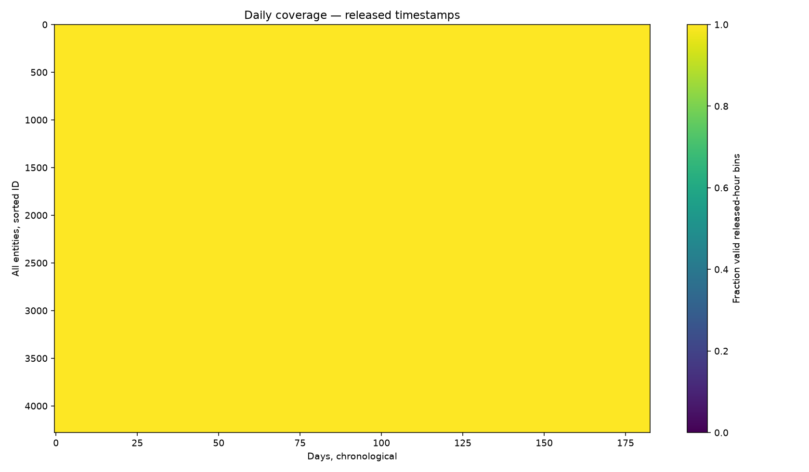
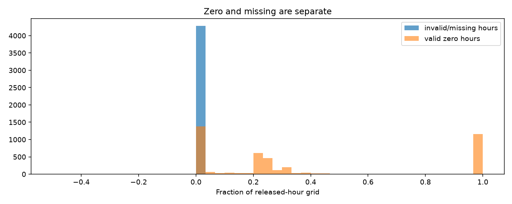
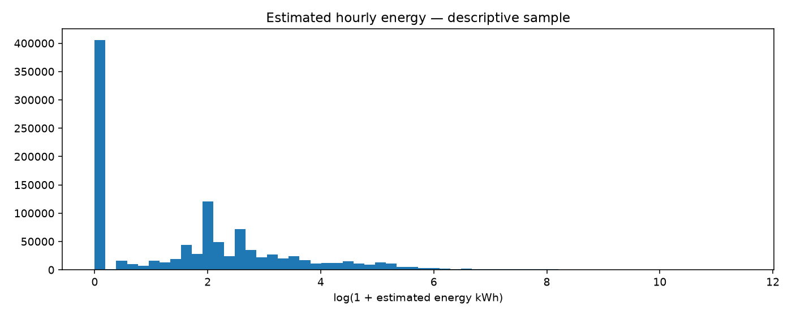
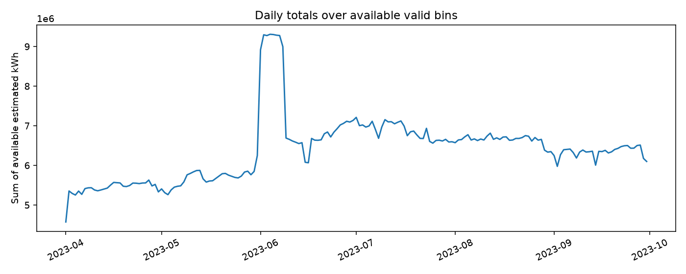
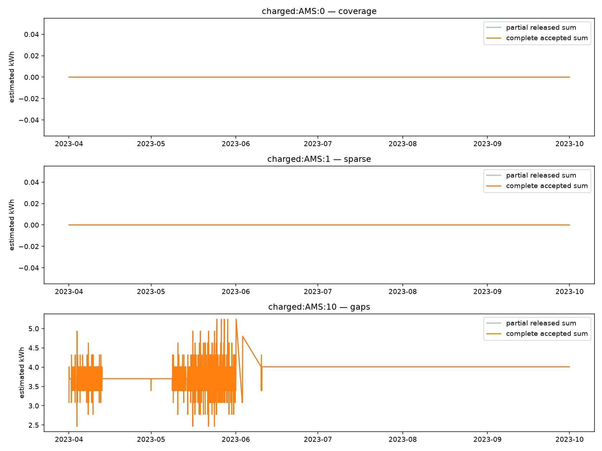
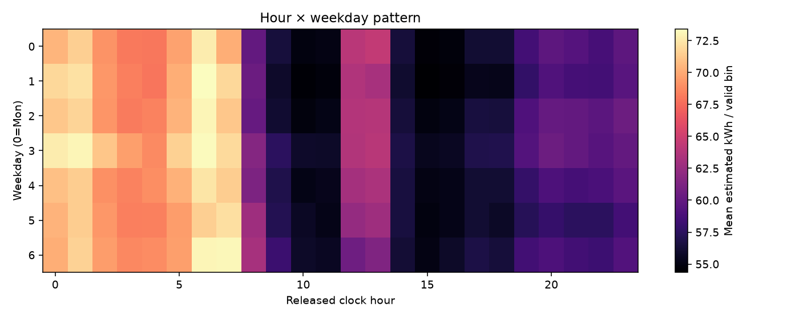
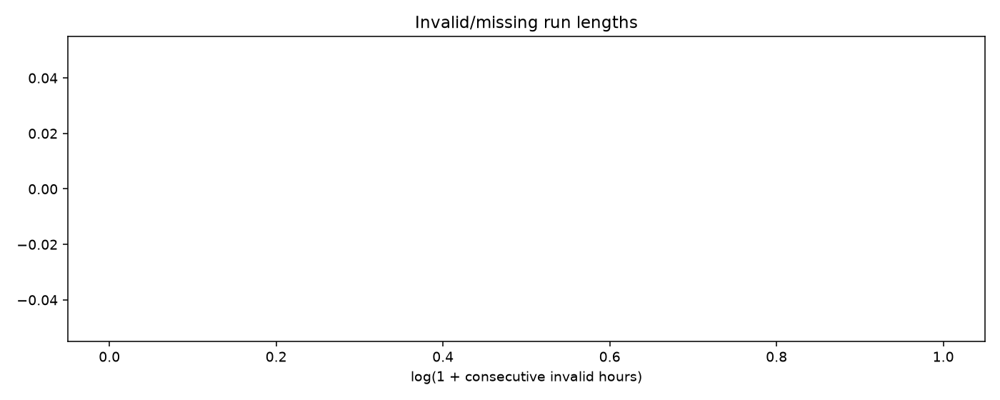
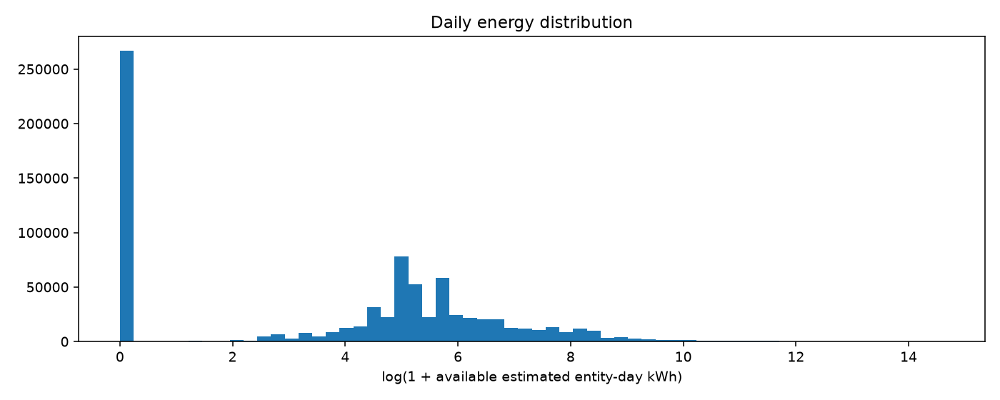
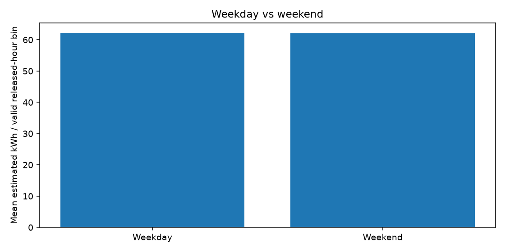

# Data audit — charged

- Full-period EDA is descriptive only; not used for split/model/threshold selection.
- publisher processed, masks unknown
- candidate only: released timezone/bin/availability require verification
- No scaler/imputed label/split/features/windows were created.

```json
{
  "dataset": "charged",
  "run_id": "charged_full_20261002_02",
  "entities_succeeded": 4280,
  "entities_failed": 0,
  "scope": "full released standard scope",
  "panel_status": "candidate only: released timezone/bin/availability require verification",
  "strict_online_ready": false,
  "upstream_status": "publisher processed, masks unknown",
  "independence_status": "Shenzhen overlap not established; no cross-release native-ID mapping",
  "source_sha256": "1ec9c9513b64f3f492fe73261bf08a5955c268dfb876ef0fe283d05cc5a02fab",
  "code_sha256": "8cbdfbfb1009bf5a3fa0c4cbe144df1b6f50aeb6a23c3af8a57d685a733684f2",
  "runtime": {
    "pandas": "3.0.1",
    "numpy": "2.5.3",
    "pyarrow": "25.0.1"
  },
  "totals": {
    "input_rows": 18797760,
    "exact_duplicates": 0,
    "conflicting_timestamps": 0,
    "malformed_timestamps": 0,
    "negative_values": 0,
    "nonfinite_values": 0,
    "valid_hours": 18797760,
    "invalid_hours": 0,
    "zero_hours": 6936073
  },
  "reconciliation_pass": true,
  "panels": [
    "data\\processed\\charged\\charged_full_20261002_02\\AMS_hourly_candidate.parquet",
    "data\\processed\\charged\\charged_full_20261002_02\\JHB_hourly_candidate.parquet",
    "data\\processed\\charged\\charged_full_20261002_02\\LOA_hourly_candidate.parquet",
    "data\\processed\\charged\\charged_full_20261002_02\\MEL_hourly_candidate.parquet",
    "data\\processed\\charged\\charged_full_20261002_02\\SPO_hourly_candidate.parquet",
    "data\\processed\\charged\\charged_full_20261002_02\\SZH_hourly_candidate.parquet"
  ]
}
```

## Daily coverage — released timestamps

4280 entities; coverage is file validity, not original-observation proof.



## Zero and missing are separate

Invalid hours: 0; valid zero hours: 6,936,073.



## Estimated hourly energy — descriptive sample

Up to256 evenly spaced valid bins per entity, fixed deterministic rule; not full-distribution quantiles.



## Daily totals over available valid bins

Coverage changes can drive totals; not a complete metered demand series.



## Before/after examples

Only validity masking/aggregation; no imputation, scaling or outlier removal.



## Hour × weekday pattern

Released clock only; timezone and DST semantics unverified. Weighted across valid entity-hour bins.



## Invalid/missing run lengths

0 invalid runs; file missingness only, not hidden upstream imputation.



## Nhận xét và bàn giao

- Đã xử lý 4,280 entities; 18,797,760 bin giờ; missing/invalid theo file 0.00%.
- 6,936,073 bin giờ zero hợp lệ số học được giữ nguyên; thiếu label không được điền.
- Energy là estimate từ trạng thái/công suất, không phải số đo công tơ. Original-observation status và label availability chưa xác minh.
- Panel là candidate theo giờ hiển thị; không chứng nhận strict online, timezone/DST/bin semantics hoặc upstream causality.
- EDA toàn kỳ chỉ mô tả. Split/cohort/dates, imputation/scaling, features và windows chuyển development.
- Nghiệm thu: đủ để tiếp tục audit/development trên published-data candidate, chưa đạt gate strict causal experiment.
- CHARGED license CC BY4.0 theo record; upstream IQR correction/zero interpolation, original masks không xác nhận. Shenzhen independence chưa xác minh.
- MEL/SPO metadata dùng cột site, các city khác site_id; alias đã ghi city_metadata_audit. Một số info headers malformed, không dùng làm predictors.

## Daily energy distribution

Tổng ngày trên các giờ có giá trị; chưa phải tổng energy ngày đủ coverage. Không dùng để chọn cohort final.



## Weekday vs weekend

Calendar theo timestamp phát hành, timezone chưa xác minh; weighted theo valid entity-hour, không phải so sánh nhân quả.


