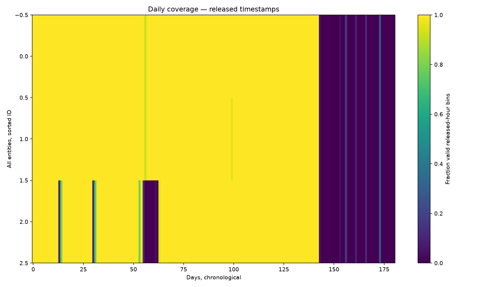
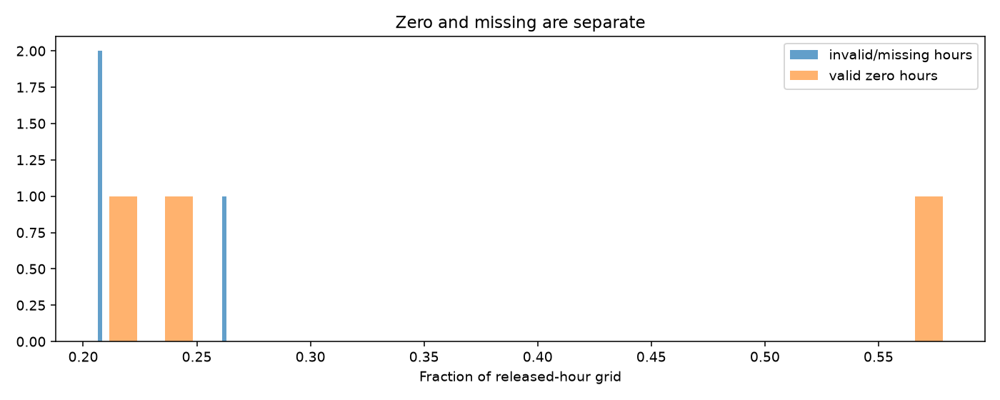
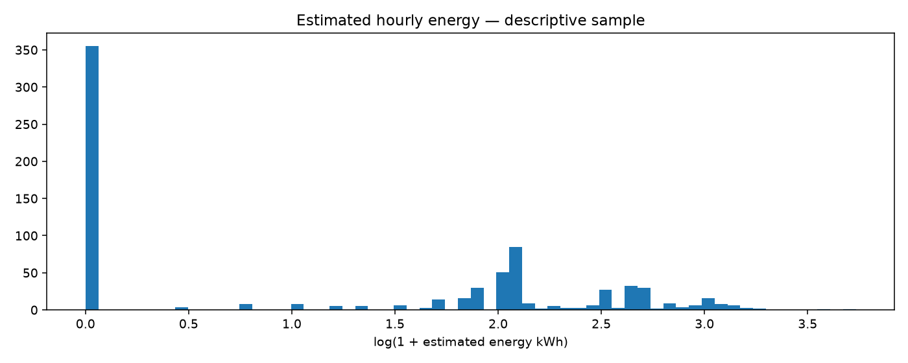
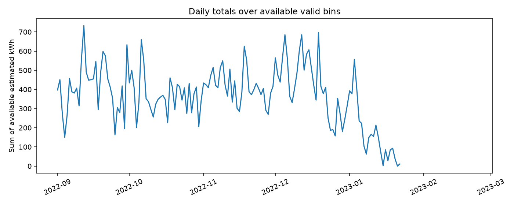
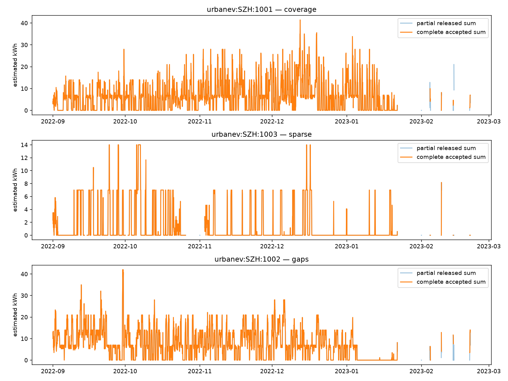
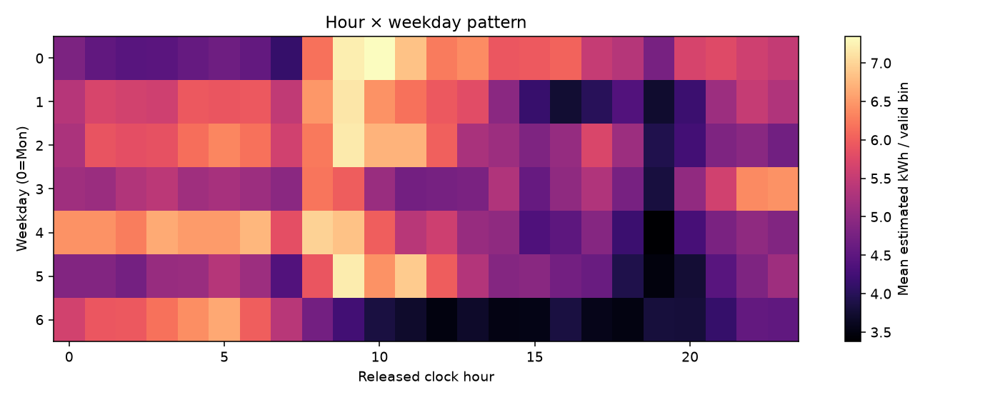
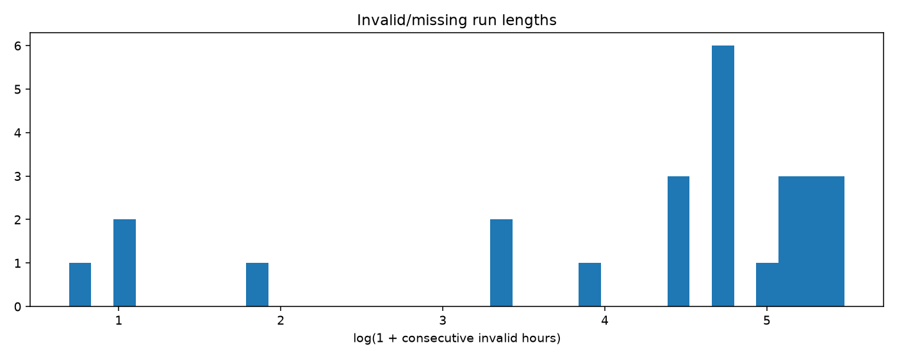
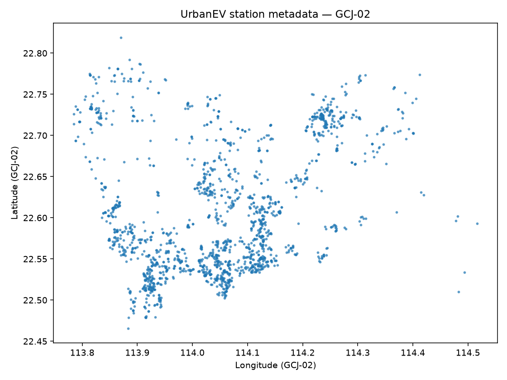

# Data audit — urbanev

- Full-period EDA is descriptive only; not used for split/model/threshold selection.
- structured station-raw release, already derived volume; original pile events unavailable
- candidate only: released timezone/bin/availability require verification
- No scaler/imputed label/split/features/windows were created.

```json
{
  "dataset": "urbanev",
  "run_id": "urbanev_smoke_20261002_02",
  "entities_succeeded": 3,
  "entities_failed": 0,
  "scope": "smoke",
  "panel_status": "candidate only: released timezone/bin/availability require verification",
  "strict_online_ready": false,
  "upstream_status": "structured station-raw release, already derived volume; original pile events unavailable",
  "independence_status": "Shenzhen overlap not established; no cross-release native-ID mapping",
  "source_sha256": "9d3f0aec34434546d082509efcdeeaea116eaa841701cc5854a9b62a27881a79",
  "code_sha256": "ec47ea74e8036dd7962985f4e0cca50a7a465be51d3ddfae3ef25b24e8f86553",
  "runtime": {
    "pandas": "3.0.1",
    "numpy": "2.5.3",
    "pyarrow": "25.0.1"
  },
  "totals": {
    "input_rows": 156384,
    "exact_duplicates": 0,
    "conflicting_timestamps": 0,
    "malformed_timestamps": 0,
    "negative_values": 0,
    "nonfinite_values": 0,
    "valid_hours": 10095,
    "invalid_hours": 2937,
    "zero_hours": 4473
  },
  "reconciliation_pass": true,
  "panels": [
    "data\\processed\\urbanev\\urbanev_smoke_20261002_02\\SZH_hourly_candidate.parquet"
  ]
}
```

## Daily coverage — released timestamps

3 entities; coverage is file validity, not original-observation proof.



## Zero and missing are separate

Invalid hours: 2,937; valid zero hours: 4,473.



## Estimated hourly energy — descriptive sample

Up to256 evenly spaced valid bins per entity, fixed deterministic rule; not full-distribution quantiles.



## Daily totals over available valid bins

Coverage changes can drive totals; not a complete metered demand series.



## Before/after examples

Only validity masking/aggregation; no imputation, scaling or outlier removal.



## Hour × weekday pattern

Released clock only; timezone and DST semantics unverified. Weighted across valid entity-hour bins.



## Invalid/missing run lengths

26 invalid runs; file missingness only, not hidden upstream imputation.



## UrbanEV station metadata — GCJ-02

Coordinates from official station_information; no basemap mixing or coordinate conversion.


